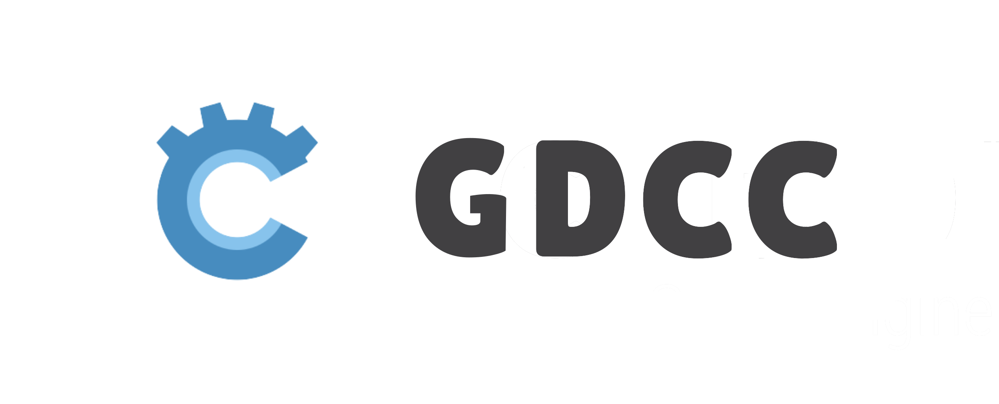
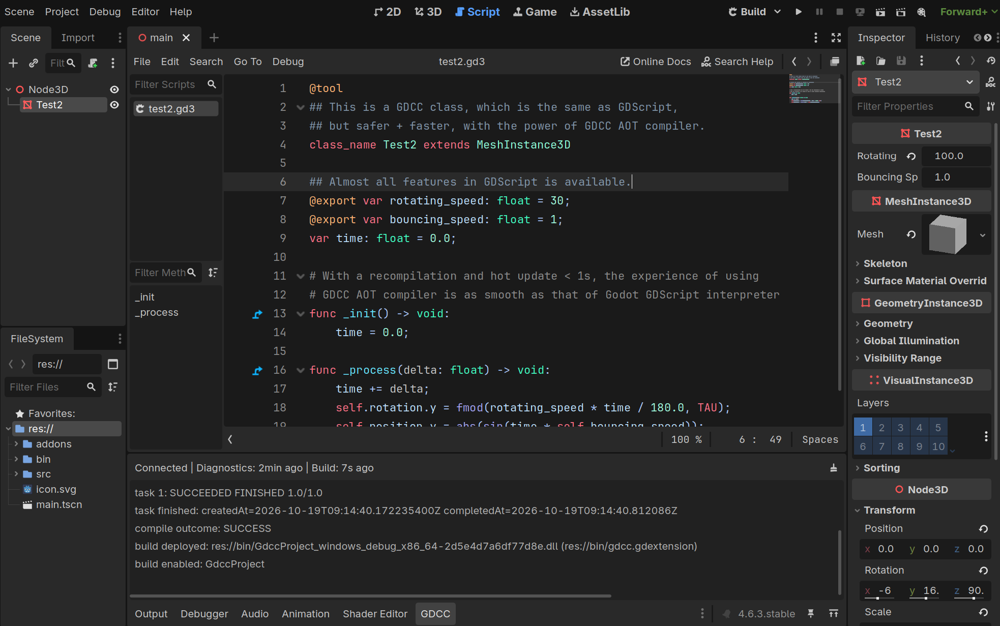

**GDCC: *GD*script to *C* *C*ompiler**

Other languages: [简体中文](README.zh-CN.md)

GDCC is a compiler that turns GDScript into native GDExtension binary modules, allowing GDScript to run safely and efficiently through Godot Engine's native binary interface.

From now on, write GDScript and get the safety and performance of native C/C++-style modules.

-----

# Features

- Extensible architecture: modular design for the parser, semantic analyzer, IR lowering, intermediate representation, backend generator, cross-compilation toolchain, and compilation server
- Reverse-engineering resistance: generates native binary modules for GDScript, protecting source code from disclosure fundamentally
- High performance: directly generates efficient static GDExtension calls, avoiding the overhead of compatibility layers and dynamic dispatch
- Progressive migration: remains compatible with most loosely typed code, allowing gradual migration to a stricter type system for better performance

# Status

GDCC is currently in beta stage. Please evaluate it against your project before use.

## Highlights

- Nearly full `GDScript` feature support, compatible with `Godot >= 4.5.0`, with access to any class, member, and function in the Godot engine.
- Supports code that mixes strongly typed and weakly typed variables; the compiler generates the necessary type-checking and conversion code for weakly typed variables to ensure runtime safety.
- Allows the GDScript interpreter to call code compiled ahead-of-time by GDCC, enabling progressive migration.
- Safer compiled artifacts: attackers cannot recover source code through decompilation, protecting your intellectual property.
- Faster runtime performance, approaching that of GDExtension modules written in C/C++.
- Hot update / hot reload support: after modifying code in the Godot editor, click "Build" to recompile and hot-reload into the running Godot engine.
- Lightning-fast compilation: with the built-in fast compilation backend, GDCC's incremental compile time for ~3000 lines of GDScript is typically under 0.2 seconds.
- First-class cross-compilation support: build GDExtension modules for Windows, Linux, macOS, and more from a single platform.
- Compiled artifacts have no dependency on GDCC or any other runtime library — they run directly on the vanilla Godot engine.
- 100% transparent, open-source, and verifiable, with over 5000 automated tests ensuring compilation correctness. Moreover, GDCC's Godot editor plugin is compiled by the GDCC compiler itself~

## Unsupported or Limited

- Due to GDExtension limitations, GDScript scripts must have a class name, so the following usages are not supported:
  - Path-based `extends` or path-based `preload` from the GDScript interpreter
  - Global script or Autoload superclass binding
  - Attaching GDCC scripts to nodes; you need to change the node type to attach GDCC code to a node
- Lambdas in property initializers.
- Built-in keyed access such as `vector["x"]`; use property-style access such as `vector.x` where supported.
- Broad Godot runtime casting compatibility is incomplete; in some cases you may need an explicit `as` cast.
- Arbitrary compile-time constant evaluation.

# Download & Installation

Download GDCC from the [GitHub Releases](https://github.com/script-gd/gdcc/releases) page.

The most convenient way to use GDCC is through the GDCC editor plugin:
1. Download the GDCC editor plugin archive `gdcc_editor_addon.zip` from the [GitHub Releases](https://github.com/script-gd/gdcc/releases) page
2. Open the "Asset Library" page, click the "Import" button in the top-right corner, select the downloaded `zip` file, and confirm the import
3. Click the "Project" tab in the top toolbar, open the "Project Settings" page, go to the "Plugins" tab, and enable the GDCC editor plugin
4. A "GDCC" tab will appear in the bottom dock; open it and follow the configuration wizard to install (the initial setup requires about 60MB of disk space)
5. Once installed, you can create a new `.gd3` script, write code, and click the "Build" button in the top-right corner to compile GDScript into a GDExtension module and hot-reload it into the Godot engine

You can also install the GDCC platform packages for command-line or CI/CD use; download and extract them to any directory.
The normal platform packages are named like `gdcc-<version>-<os>-<arch>.zip`. Each normal platform package contains the `gdcc` launcher and other core files that may change between versions.
The `*-full.zip` packages contain the same files plus all cross-compilation toolchains needed to run; see [CLI Usage](help/cli-usage.md) for details.

# Community

- Discord: [https://discord.gg/u22VjH2aQw](https://discord.gg/u22VjH2aQw)
- QQ Group: 1082512847
