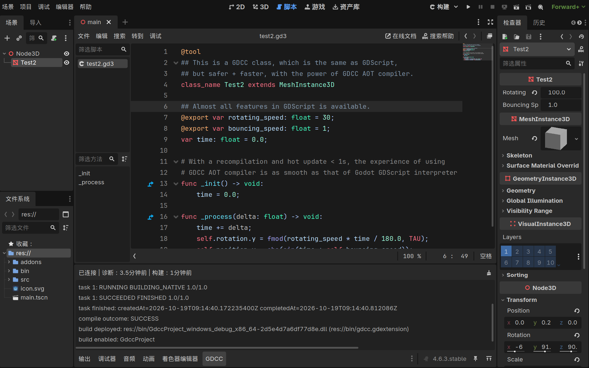

**GDCC: *GD*script to *C* *C*ompiler**

其他语言版本：[English](README.md)

GDCC 是一个将 GDScript 编译为 GDExtension 本机二进制模块的编译器，允许您通过 Godot 引擎的本机二进制接口安全且高效地运行 GDScript 代码。

从现在起，编写 GDScript，获取类似 C/C++ 原生模块的安全性与性能！

-----

# 特性

- 可拓展的架构：解析器、语义分析器、IR转换器、中间表示、后端生成器、交叉编译、编译服务器模块化设计
- 反编译安全：为 GDScript 生成本机二进制模块，根源上保护源码不泄露
- 高性能：直接生成高效的静态 GDExtension 调用，避免兼容层和动态派发的性能损失
- 渐进式迁移：兼容大部分弱类型代码，允许逐步迁移到更严格的类型系统以获得更高性能

# 状态

GDCC 目前仍处于 beta 阶段，在使用前请先针对您的项目进行评估。

## 亮点

- 几乎全部的 `GDScript` 功能支持，兼容 `Godot >= 4.5.0`，可使用任意 Godot 引擎中的类、成员和函数。
- 支持混合强类型和弱类型变量代码，编译器会为弱类型变量生成必要的类型检查和转换代码，确保运行时安全。
- 允许 GDScript 解释器调用 GDCC 运行前编译的代码，您可以渐进式迁移。
- 更安全的编译产物，攻击者无法通过反编译获取源码，保护您的知识产权。
- 更快速的运行时性能，接近与使用C/C++编写的GDExtension模块的性能。
- 支持热更新/热重载，在 Godot 编辑器中修改代码后，点击“构建”即可重新编译并热重载到运行中的 Godot 引擎中。
- 闪电般的编译速度，内置的快速编译后端对于约 3000 行的 GDScript 代码，GDCC 的增量编译时间通常在 0.2 秒以内。
- 一流的交叉编译支持，在单平台上即可编译出适用于 Windows、Linux、macOS等平台的 GDExtension 模块。
- 编译后的产物无需依赖 GDCC 或其他的运行时库，直接使用原版 Godot 引擎即可运行。
- 100% 透明、开源、可检验，超过 5000 项目自动测试确保编译正确，此外 GDCC 的 Godot 编辑器插件就是用 GDCC 编译器自己编译的~

## 受限的 GDScript 用法

- 由于GDExtension限制，必须使用带有类名的GDScript脚本，所以无法支持以下用法：
  - 基于路径的 `extends` 或从 GDScript 解释器中通过路径 `preload`
  - 全局脚本或 Autoload 超类绑定
  - 附加 GDCC 脚本到节点，您需要通过修改节点类型来将 GDCC 代码附加到节点上
- 初始化表达式中的Lambda函数
- 类似 `vector["x"]` 的内置类型 keyed 访问；已支持场景下请使用 `vector.x` 这类属性访问
- 更宽松的 Godot 运行时转换兼容性仍不完整，一些情况下需要手动 `as`
- 任意的编译期常量求值

# 下载与安装

从 [GitHub Releases](https://github.com/script-gd/gdcc/releases) 页面下载 GDCC。

使用 GDCC 最方便的方式就是使用 GDCC 编辑器插件：
1. 从 [GitHub Releases](https://github.com/script-gd/gdcc/releases) 页面下载 GDCC 编辑器插件压缩包 `gdcc_editor_addon.zip`
2. 打开“资源商店”页面，点击右上角的“导入”按钮，选择刚刚下载的`zip`文件，然后确认导入
3. 点击上方工具栏的“项目”选项卡，打开“项目设置”页面，进入“插件”标签页，启用 GDCC 编辑器插件
4. 最下方的 dock 栏会出现一个“GDCC”标签页，打开后可以跟随配置向导进行安装，初次配置需要约 60MB 硬盘空间
5. 安装完毕后可以新建`.gd3`脚本，输入代码，点击右上角的“构建”按钮，即可将 GDScript 编译为 GDExtension 模块并热重载到 Godot 引擎中

您也可以安装用于命令行或者CI/CD的GDCC平台包，下载后解压到任意目录即可使用。
普通平台包名称类似 `gdcc-<version>-<os>-<arch>.zip`。 每个普通平台包内含 `gdcc` 启动器以及其他可能随版本升级而改变的核心文件。  
`*-full.zip` 包内含相同文件，并额外打包了运行所需的全部交叉编译工具链，详情参阅 [CLI用法](help/cli-usage.zh-CN.md)。

# 社区

- QQ群：1082512847
- Discord：[https://discord.gg/u22VjH2aQw](https://discord.gg/u22VjH2aQw)
