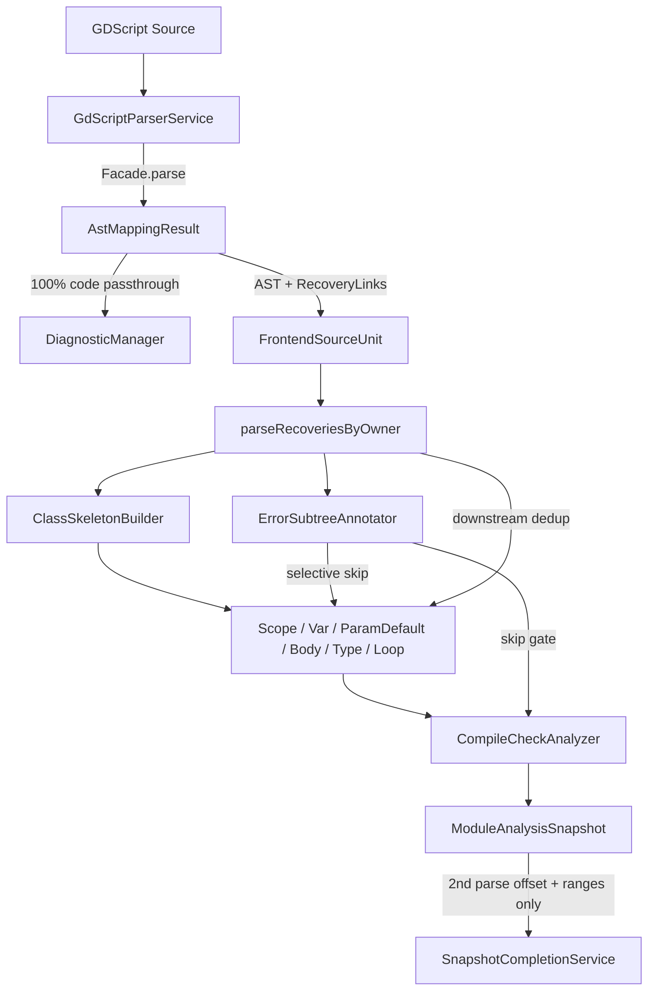

# GDCC 前端集成 GDParser 0.7.2 修复与适配实施计划

> **文档状态**：正式实施计划（架构决策已确认，分批独立审阅收敛中）
> **目标仓库**：`/home/superice/projects/gdcc`（分支 `feat/frontend/pure-java-parser`，基线提交 `017f2e6e`）
> **上游依赖目标**：`com.github.SuperIceCN:gdparser:0.7.2`（对应 tag `0.7.2` / commit `fbe1369`，含 PR #2 `0e6164b` 落地的 `R1`–`R5` 全部修复；JitPack 构建已验证就绪）
> **上游关联文档**：`/home/superice/projects/gdparser/doc/gdparser-0.7.1-issues-fix-plan.md`（`R6` GDCC 集成要求）

---

## 1. 背景、核心决策与工程治理约束

### 1.1 为什么必须直接对接 `0.7.2`

- `gdparser` 的 `0.7.1` tag（`8b19f6b`）停留在 `R1`–`R5` 合入之前，不包含 `RecoveredInfixExpression`、Key-Only 字典 Match Pattern（`DictEntry.value() == null`）、`VariableDeclaration.recoveryAnnotations`、106 个 `DiagnosticCodes` 与 `RecoveryLink(owner, facet)` 精确归属契约，也不包含 8-kind 纯 Java `CompletionContext`。
- `0.7.2`（`fbe1369`）已发布至 GitHub Release 并完成 JitPack 构建与拉取验证，完整导出 `dev.superice.gdparser.frontend.gdscript` 包（`GdScriptParserFacade`、`DiagnosticCodes`、`CompletionContext` 等）。GDCC 侧集成以 **`0.7.2`** 为唯一目标版本。

### 1.2 已确认的核心架构契约

1. **解析诊断类别契约（精确透传 `AstDiagnostic.code()`，零前置丢弃）**：
   - `GdScriptParserService` **100% 保留** `GdScriptParserFacade.parse(source)` 产出的全部诊断，绝不在解析阶段预先丢弃任何 `AstDiagnostic`（防止 `CompileTaskRunner:220-234` 在存在解析错误提前返回、参数默认值岛内 Lambda、受损跳过子树或被解析器丢弃的重复参数场景下发生静默漏报）。
   - 非空白的 `AstDiagnostic.code()`（`0.7.2` 注册的 106 个 `parse.*` 稳定诊断码）直接映射为 `FrontendDiagnostic.category()`；仅当 `code == null || code.isBlank()` 时回退至 `"parse.lowering"`；解析器运行期未捕获异常仍映射为 `"parse.internal"`。
   - 保持 `FrontendDiagnostic` 5 字段 record、JSON-RPC 载荷结构与编辑器插件渲染格式（`[gdcc <category>] <message>`）完全兼容，生产代码中基于 `category.startsWith("parse.")` 的既有判定继续成立。
2. **8-Kind 补全枚举与候选契约（完整扩展公开分析 API）**：
   - 在 `gd.script.gdcc.api.analysis.CompletionContextKind` 中新增 `PARAMETER_NAME`、`SUITE_START`、`EXPECTED_KEYWORD`（对齐 `gdparser 0.7.2` 全部 8 种上下文）；在 `gd.script.gdcc.api.analysis.CompletionCandidateKind` 中新增 `KEYWORD`。
   - 路由规则（**`view.parseFailed()` 在调用 `COMPLETION_FACADE` 重解析之前最先短路返回 `(UNKNOWN, queryRangeAt(byteOffset, byteOffset), List.of())`**，杜绝 `parse.internal` 崩溃源在补全时重抛运行期异常）：
     - `CALL_ARGUMENT`、`PARAMETER_NAME`（如 `func f(|): pass`、`func f(x: Array[Inner, |): pass`、`signal s(a, |)`）、`UNKNOWN` → 在光标跳过子树门控**之前**直接返回 `List.of()`；
     - `EXPECTED_KEYWORD`（`0.7.2` 定义为中缀 `not` 后期待 `"in"` 的槽位，如 `var ok = (x not |)`、`x is Foo not |`、`x not \\\n|`）→ **在光标跳过子树门控之前**直接返回 `List.of(new CompletionCandidate("in", CompletionCandidateKind.KEYWORD, null, null))`（不依赖语义侧表事实，避免被外层受损语句 `skippedSubtreeRoots` 清空）；
     - `SUITE_START`（`0.7.2` 定义为函数、构造器 `_init` 或已发布可执行 `LambdaExpression` 头部冒号**同一逻辑行**的空体槽位，含跨显式 `\` 续行与续行后整行注释/空行的延续空隙如 `func f(seed: int): \\\n# trivia\n\t|`；普通换行缩进的 `func f():\n\t|` 与行尾注释换行的 `func f(): # note\n\t|` 在 `0.7.2` 均为 `UNKNOWN`）→ **在光标跳过子树门控之前**转入专用宿主锚定：通过 `COMPLETION_FACADE.tokenize(source)` 取光标前最后一个显著 token 并校验其为 `GdTokenType.COLON` 且 `[colonToken.endByte(), byteOffset)` 通过双态 `isSameLogicalLineGap` 校验（未进入显式 `\` 续行态时仅允许 `' '`、
       `'\t'` 与紧跟 `"\n"`/`"\r\n"` 的 `'\\'`，遇到 `'#'` 行尾注释或未转义换行立即返回 `false`；仅在显式 `\` 续行态内才允许跳过纯空白行与以 `'\n'` 结束且不覆盖 `byteOffset` 的 `#` 整行注释，杜绝行尾注释或未闭合括号跨行借用冒号），以 `colonToken.startByte()` 在快照 `unitIndex.nodeAt` 上定位可调用体宿主并核验该冒号确实直接引导该宿主的 `body()`（拦截被丢弃重名参数默认值内 Lambda 误落到外层函数），核验宿主不在 `skippedSubtreeRoots` 且（若为 `LambdaExpression`）在 `snapshot.analysisData().lambdaPlans()` 中确有已发布计划（统一排除类属性初值、参数默认值及块内局部 `const` 初值等未录制 Lambda）后，以 **`colonToken.startByte()`** 作为声明顺序可见性枢轴（排除函数末尾 `var cb = func(seed):|` 正在初始化的自身变量 `cb`）枚举 `BlockScope` 可见符号，并追加可调用体顶层语句起始关键字（`pass`、`return`、`var`、`const`、`if`、`for`、`while`、`match`、`assert`，类型为 `CompletionCandidateKind.KEYWORD`，不含仅循环内合法的 `break`/`continue`）；
     - `MEMBER_ACCESS`、`IDENTIFIER`、`TYPE_POSITION` 完整保留既有 `locateCursorNode` + `isInsideSkippedSubtree` 门控（`TYPE_POSITION` 候选继续严格只含 `CompletionCandidateKind.TYPE`）。
3. **源码语法违规与手工 AST / 新鲜 `DiagnosticManager` 保底的下游单归属去重契约**：
   - **结构抑制与诊断抑制严格解耦**：某语法结构是否因解析受损而禁止发布有效骨架/元数据（如受损 `enum`、缺名内部类 `class:`、裸语句级 `LambdaExpression`、受损类级 `const`/`var`、受损 `@tool`/`@export*`、受损参数默认值），一律以 AST 结构形态与同代侧表 `parseRecoveriesByOwner`（及显式恢复节点）为准，绝不依赖 `DiagnosticManager` 是否恰好保存着解析期诊断；
   - **诊断去重与恢复接管一律绑定当前活跃 `DiagnosticManager` 快照五字段验证**：`claimParseRecovery(recovery, coveringDiagnostic)` 记录实际覆盖该恢复项的阻塞 `FrontendDiagnostic`，下游各 Sema 阶段（含跨两阶段调用的恢复感知类型槽位解析）与编译门仅当当前活跃 `DiagnosticManager` 快照中**确实存在**与该原始 `parse.*` 恢复项或已登记 `coveringDiagnostic` **五字段完整相等**（`ERROR` 级别、`category`、`message`、`sourcePath`、`range`）的活跃诊断时才视为已覆盖并抑制重复发射（确保 `@tool\n@tool(1)` 等同码同区间不同消息的双解析错误在切到新空管理器重放时两条均完整恢复、不因首条重放吞掉第二条），同时**无条件保留所有内部状态与元数据保护动作**（如 `FrontendChainReductionHelper` 的 `FAILED` 侧表、`FrontendParameterDefaultMetadataOwner` 的 `violatingParameters` 剔除与 `_default_` 占位回收）；
   - **双公开入口与全量源单元统一收尾**：共用收尾辅助 `ensureUncoveredParseDiagnosticsReported(analysisData, diagnosticManager)` 从原始单元列表 `analysisData.effectiveSourceUnits()`（含未进 `sourceClassRelations` 的 `parseFailed` 单元与 `owner == null` 无宿主错误）出发，在 **`FrontendSemanticAnalyzer.analyze` 返回前**与 **`FrontendCompileCheckAnalyzer.analyze` 最前端（先重放 `analysisData.diagnostics()` 中当前管理器缺失的同代已发布语义阻断诊断，再补齐未覆盖解析错误，最后拍摄 `publishedDiagnostics` 快照）**各执行一次：对 `parseFailed` 单元核验当前快照是否已有该文件 `"parse.internal"` 错误（缺失则补发 1 条无宿主阻断错误），对非失败单元核验每条 `ERROR` 级 `FrontendParseRecovery` 是否已有经当前快照验证的覆盖诊断（缺失则直接按 `recovery.range()` 重放 1 条原始 `parse.*` 错误，**绝不改写 `claimedParseRecoveries()` 中已有的语义接管映射**，绝不伪造 AST `Node`，也不在普通 `analyze` 中跑完整编译门）。由此无论复用 `FrontendModule`、还是对源码或无恢复手工 AST（如手工循环外 `break`）在 `analyze(A)` 后将 `analysisData` 配全新空管理器 `B`（乃至 `A -> B -> A` 交替）传入 `FrontendCompileCheckAnalyzer`，均保证零静默放行、零重复报错。
4. **统一编译期常量求值路径（方案 C + `EvaluationPolicy` 能力扩展）与 `R6.2` 字面量边界契约**：
   - **`match` 字典模式常量键统一走 `FrontendConstantEvaluator`（禁止求值器外旁路回退）**：在 `GdConstantValue` 新增 `NullValue`、`StringNameValue`、`NodePathValue` 三个不可变载荷 record（**严格保持 `GdConstantValue.isSupportedConstantType(GdType)` 返回值不变**，防止三者被 `FrontendConstantEvaluator.isBuiltinConstantType` 误判为几何内建类型并保持 `const N: StringName = "name"` / `StringName("x")` 既有契约零回归）；在 `EvaluationPolicy.Capability` 新增 `NULL_LITERAL`、`STRING_NAME_LITERAL`、`NODE_PATH_LITERAL` 并提供 `EvaluationPolicy.matchConstant()`（保持 `general()` 与 `enumPrePass()` 原能力集不变）；扩展 `FrontendLocalConstLookupContext` 支持任意表达式锚点、具名全局枚举链（`Side.SIDE_LEFT`）与内建类枚举成员（`Vector2.AXIS_X`）；`match` 字典键 `entry.key()` 统一经 `EvaluationPolicy.matchConstant()` 求值并按节点身份存入 `constantFacts()`（不污染纯结构 `FrontendMatchPlan`，非恒定键唯一由 `FrontendTypeCheckAnalyzer` 报 `"Expression in dictionary pattern key must be a constant."`），CFG 通过新增 `ConstantValueItem` 直接物化折叠后常量喂给 `MatchHasKeyItem` / `MatchElementFetchItem`，LIR `materializeConstantValue` 补齐 `LiteralNilInsn` / `LiteralStringNameInsn` / `LiteralNodePathInsn`。
   - **`R6.2` 最小有符号整数（`L-01`）与单引号/三引号 `StringName`、`NodePath` 全链路对齐**：针对 `0.7.2` 将 `-9223372036854775808` / `-0x8000000000000000` 解析为 `UnaryExpression("-", LiteralExpression("integer", <2^63 幅值>))` 且对超界整数字面量零解析诊断的契约，由 Sema 表达式定型预认领合法一元负号下的 `2^63` 幅值字面量为 `RESOLVED(int)`、将未被外层一元 `-` 合法消费的超界整数字面量定型为 `FAILED`（发 `sema.expression_resolution` 阻断进 CFG），并在 `FrontendCfgGraphBuilder.buildValue` 直接发射 `IntConstantItem(unary, Long.MIN_VALUE, ...)`、在 `FrontendExportAnnotationSupport` 放行 `-9223372036854775808`；同时统一扩展 `StringUtil.decodeGdStringLexeme`（`&` 分支）与 `decodeNodePathLexeme`（`^` 分支）委托 `decodeStringBody` 支持 `'`/`"` 单行与 `'''`/`"""` 三引号字面量。

### 1.3 非目标与模块边界

- **保留 `tree.sitter` JPMS 模块映射**：不移除 `/home/superice/projects/gdcc/build.gradle.kts:259-262` 对 `tree-sitter-0.26.3.jar -> tree.sitter` 的 `extraJavaModuleInfo` 映射，因为 `gdparser 0.7.2` 的 `module-info.java` 为兼容已弃用参考路径仍声明了 `requires tree.sitter;`，删除该映射会导致模块图解析失败。
- **保留 `--enable-native-access=ALL-UNNAMED`**：`/home/superice/projects/gdcc/build.gradle.kts:91,112,126` 仍被后端/插件测试中的 `libtcc` FFM 调用依赖，保持不变。
- **`src/main/java/module-info.java` 无需改动**：已声明 `requires gdparser;`，`gdparser 0.7.2` 已导出 `dev.superice.gdparser.frontend.gdscript`。

### 1.4 仓库工程治理硬约束（遵循 `gdcc/AGENTS.md`）

1. **权限门禁**：修改 `build.gradle.kts` 前必须先获用户显式授权；未经明确要求绝不执行 `git commit`。
2. **分批补丁上限**：单次补丁修改文件数**严禁超过 5 个**，所有实施阶段严格按 `≤ 5` 文件拆批。
3. **测试纪律**：仅通过 `script/run-gradle-targeted-tests.sh --tests ...` 运行定向测试或 `./gradlew classes --no-daemon --info --console=plain` 检查编译，**严禁**执行耗时数小时的全量 `./gradlew clean build`；测试失败必须排查实现根因，禁止弱化断言掩盖缺陷。
4. **文档与注释纪律**：在对应代码修改完整落地并通过定向测试前，不改写 `frontend_rules.md` 等 source-of-truth 文档；代码注释使用 `///` Markdown 自解释风格，不引用计划文档编号；record 字段注释统一使用顶层 `@param`。

### 1.5 集成后前端数据流总览



---

## 2. 按成因与修复点分布的根因分析

> 下文所有 GDCC 路径均相对于 `/home/superice/projects/gdcc/`。

### 2.1 成因簇 RC-1：解析与补全入口仍耦合已弃用 tree-sitter 管线

| 修复点文件 | 精确位置 | 现状与问题成因 | 目标修复动作 |
|---|---|---|---|
| `build.gradle.kts` | `:63` | 依赖固定为 `com.github.SuperIceCN:gdparser:0.6.0` | 获显式授权后升级至 `0.7.2`；保留 `:259-262` `tree.sitter` 映射与 `:91,112,126` `--enable-native-access` |
| `src/main/java/gd/script/gdcc/frontend/parse/GdScriptParserService.java` | `:17-80` | 持有 `GdParserFacade` + `CstToAstMapper`，调用 `parseCstRoot` + `map`，将所有诊断写死为 `"parse.lowering"` 并丢弃 `code`/`recovery`；旧单测 `GdScriptParserServiceDiagnosticManagerTest:126` 直接调用双参 tree-sitter 构造器并用 `TSLanguage` 反射注入异常 | 切换至无状态 `GdScriptParserFacade`；新增包级函数式后端构造器 `GdScriptParserService(Function<String, AstMappingResult> parseBackend)` 作为无反射故障注入缝；100% 透传 `AstDiagnostic`（非空白 `code()` 映射为 `category`，空白/null 回退 `"parse.lowering"`）；将 `AstMappingResult.diagnostics()` 的**全部条目**（含 `recovery() == null` 的独立词法/语法错误）采集为同代 `FrontendParseRecovery` 存入 `unit.parseRecoveries()` |
| `src/main/java/gd/script/gdcc/api/analysis/FrontendSnapshotCompletionService.java` | `:10-11, 64, 89, 808-816` | 引用已弃用 `infra.treesitter.GdParserFacade` 与 5-kind `infra.treesitter.CompletionContext` | 切换至 `frontend.gdscript.GdScriptParserFacade` 单例与 8-kind `frontend.gdscript.CompletionContext` |

---

### 2.2 成因簇 RC-2：新 AST 节点与字段契约变更引发编译阻断、NPE 与类型误判

#### RC-2A：`RecoveredInfixExpression` 破坏密封 `Expression` 分支穷尽性与编译门覆盖（P0 编译阻断 + 编译门防护）

- **成因链路**：
  `gdparser 0.7.2` 在密封接口 `Expression` 的 `permits` 中新增 `RecoveredInfixExpression(@NotNull Expression operand, @NotNull String operator, @NotNull ErrorExpression problem, @NotNull Range range)`（承载 `x as`、`x is`、`x is not`、`x ?` 等右侧截断的中缀恢复节点，`getChildren()` 返回 `List.of(operand, problem)`）。
  1. `FrontendExpressionSemanticSupport.java:1041-1099`（`resolveRemainingExplicitExpressionType`）是全仓唯一无 `default` 的 `Expression` 穷尽分支，升级 `0.7.2` 后直接编译失败。
  2. 在 `FrontendCompileCheckAnalyzer` 中，`walkStatements`（`:624-628`）与 `handleExpressionStatement`/`handleVariableDeclaration`/`handleReturnStatement`/`handleAssertStatement`（`:363-428`）当前**未检查 `skippedSubtreeRoots`**；且对于诸如 `var x := value as + 1` 的输入，截断类型解析诊断挂在 `VariableDeclaration` 上，其 range 与内层 `value`、`RecoveredInfixExpression`、`BinaryExpression` 均不相等（而 `findPublishedDiagnosticAt:1299` 要求精确 range 相等）。若不在编译门同时接入 `skippedSubtreeRoots` 短路与 `RecoveredInfixExpression` 显式收口，即使 `FrontendExpressionSemanticSupport` 返回 `unsupported`，编译门仍会深入 `operand` 产出次生伪阻断诊断。
- **修复点**：
  1. `src/main/java/gd/script/gdcc/frontend/sema/analyzer/support/FrontendExpressionSemanticSupport.java`、`FrontendContainerLiteralSemanticSupport.java` 与 `FrontendAssignmentSemanticSupport.java`：
     - 在 `resolveRemainingExplicitExpressionType`（`:1041-1099`）新增显式分支，严禁把 `operand()` 的类型冒充为整个损坏表达式的结果类型：
       ```java
       case RecoveredInfixExpression recoveredInfix -> rootOutcome(
               FrontendExpressionType.unsupported(
                       "Parser recovered infix expression '" + recoveredInfix.operator()
                               + "' cannot participate in expression typing"
               )
       );
       ```
     - **最终诊断窗口（`finalizeWindow == true`）下不因前序子表达式失败而遮蔽后续独立操作数诊断**：
       - `FrontendExpressionSemanticSupport.resolveBinaryExpressionType`（`:802-806`）、`resolveSubscriptExpressionType`（`:699-703`）、`resolveConditionalExpressionType`（`:936-974`，在条件分支稳定后若左臂失败仍继续解析右臂；条件本身不稳定时保持原短路契约以对齐 `FrontendExpressionSemanticSupportTest:1492`）与 `resolveCallArgumentTypes`（`:1601-1650`，记住首个实参 `dependencyIssue` 后继续按固定形参期望类型解析后续实参，最后返回 `CallArgumentResolution(List.of(), firstIssue)`）；
       - `FrontendContainerLiteralSemanticSupport.resolveArrayExpressionType`（`:110-119`）与 `resolveDictionaryExpressionType`（`:165-190`）：当 `finalizeWindow == true` 时记住首个元素或键值依赖失败 `firstIssue`，继续按容器元素/键值期望类型解析其余元素与条目，最后返回 `propagated(firstIssue)` 且 `planOrNull = null`（绝不发布受损容器计划，兼容 `FrontendContainerLiteralSemanticSupportTest:159-177`）；`finalizeWindow == false` 的预览/重载探测窗口一律保留原即时早退。由此保证 `super.payload + (1 + "a")`、`[super.payload, 1 + "a"]`、`{"a": super.payload, "b": 1 + "a"}`、`take(super.payload, 1 + "a")` 完整暴露全部独立语义错误且无容器/父表达式根回声。
     - `FrontendAssignmentSemanticSupport.resolveAttributeTarget`（`:500-528`）显式新增 `case MissingAttributeStep _ -> AssignmentTargetResult.failed(..., false, "Assignment target ends with a missing member name...")`（替代落入 `default -> unsupported`），并在 `FrontendBodyOwnerProcedures.resolveAssignmentExpressionType`（`:2590-2608`）按 `result.rootOwnsOutcome()` 写入 `rootOwnsExpressionDiagnostics`，使 `self. = 2` 仍解析右值 `2`、保留 `self` 类型事实，且不叠加根级 `AssignmentExpression` 回声。
  2. `src/main/java/gd/script/gdcc/frontend/sema/analyzer/FrontendCompileCheckAnalyzer.java`：
     - **编译门最前端基于单次入口快照的 `O(1)` 索引同步恢复上游语义阻断与未覆盖解析诊断**：在 `analyze(analysisData, diagnosticManager)` 入口、校验 `var priorDiagnostics = analysisData.diagnostics()`（`:70`）之后且拍摄最终不可变 `var publishedDiagnostics = diagnosticManager.snapshot()` **之前**，先对当前管理器拍摄一次初始快照，构建调用期局部 `HashSet<FrontendDiagnostic>`：用 record 的 `equals`/`hashCode` 同时比较 `severity`、`category`、`message`、`sourcePath`、`range`。语义重放、原始恢复项和已登记的接管诊断共享此集合；每次追加成功立即入集，不逐项拍快照。顺序执行以下两步后才拍最终 `publishedDiagnostics`：
       1. 先扫描 `priorDiagnostics`：**同时排除编译门自身产出的 `"sema.compile_check"`（`COMPILE_CHECK_CATEGORY`，由本轮扫描重新生成）与全部 `"parse.*"` 解析类别诊断（即 `d.category().startsWith("parse.")`，将 `"parse.*"` 的恢复权 100% 交由第 2 步统一处理，防止中间管理器 `B` 将重放的原始 `parse.*` 写回 `analysisData.updateDiagnostics(B.snapshot())` 后再以持有 `sema.*` 接管诊断的原管理器 `A` 调用编译门时把原始 `parse.*` 重复拷入 `A`）**；对其余非解析、非编译门上游阻塞诊断（`severity == ERROR` 或属于 `NON_ERROR_BLOCKING_DIAGNOSTIC_CATEGORIES`），按**完整 5 字段 `FrontendDiagnostic` 相等（`Objects.equals`，含 `message`，保留同合成区间上手工 `break` 与 `continue` 两条不同消息）**查询局部 5 字段索引——若尚未存在完全相同诊断（且若其登记为某条 `FrontendParseRecovery` 的语义接管诊断，该恢复项对应的完整原始诊断也不在集合中），则重放至 `diagnosticManager` 并同步写入该集合；同时在 `reportCompileBlock`（`:1268`，**含 `skipPublishedConflictDedup == true` 的 `Worker.new(seed)` 分支**）抑制与 `publishedDiagnostics` 完全同值的 `COMPILE_CHECK_CATEGORY` 自身重复诊断；
       2. 紧接着对 `analysisData.effectiveSourceUnits()` 调用共用的 `ensureUncoveredParseDiagnosticsReported`（传入同一增量集合，只检查 `contains(new FrontendDiagnostic(ERROR, recovery.code(), recovery.message(), sourcePath, recovery.range()))` 或集合是否包含该项非空的实际 `claimed` 诊断，重放原始 `parse.*` 时绝不改写 `claimedParseRecoveries()`），统一恢复任何未获活跃覆盖（无论直接 `parse.*` 还是 `claimedParseRecoveries()` 中活跃 `sema.*`）的 `FrontendParseRecovery`；`parseFailed` 没有恢复项，独立按文件检查 `ERROR` 级 `"parse.internal"`（从活跃及先前快照各一次按文件归集，不逐文件重扫）；对缺失活跃记录的失败单元，若 `priorDiagnostics`（`analysisData.diagnostics()`）中已存有该文件原始 `"parse.internal"` 错误则原样重放以保留 `"Unexpected parser failure: ..."` 异常原因消息，仅当两侧快照均无记录时才合成默认 `"parse.internal"` 错误。
     - **显式接纳 `MissingAttributeStep` / `UnknownAttributeStep` 锚点并消除单链双报**：由于 `FrontendBodyOwnerProcedures.publishAttributeStepExpressionTypes`（`:1949`）为保留 `v.` / `super.` 接收者补全事实而将 `MissingAttributeStep` 的 `FAILED` 定型写入 `expressionTypes`，在 `requireExpressionTypeAnchor`（`:1181`）与 `describeExpressionTypeAnchor`（`:1228`）显式支持 `MissingAttributeStep` 与 `UnknownAttributeStep`（消除 `IllegalStateException`），并在 `compileAnchorForExpression`（`:1085`）当 `compileSurfaceNodes.contains(attributeExpression)` 且末步为 `MissingAttributeStep` / `UnknownAttributeStep` 时统一收敛到末步锚点，防止同一残缺属性链在整链与末步标记上各报一次。
     - **已跳过子树剪枝与跨表传播消音**：向 `AstWalkerCompileCheckVisitor` 传入 `sourceClassRelation.unit()`、`analysisData.skippedSubtreeRoots()`、`analysisData.parseRecoveriesByOwner()`、`analysisData.claimedParseRecoveries()` 与 `analysisData.propagatedFailureOrigins()`。
       - 在 `walkStatements`、`handleElifClause`、`handleMatchStatement`（直接扫描被跳过的 `MatchSection`）、属性初始化入口以及 **`walkAcceptedParameterDefaultRoots`（`:592`，在 `expressionTypes.containsKey(defaultRoot)` 之前拦截被跳过的默认值根，同时核对所属 `Parameter` 在 `"parameter.default"` 上的恢复项活跃覆盖以兼容 `func f(x=):`）**遇到 `skippedSubtreeRoots` 节点时，仅在 `publishedDiagnostics` 尚无覆盖该子树或所属槽位恢复项的阻塞错误时调用 **`reportCompileBlock`** 补发唯一一条 `sema.compile_check`，随后剪枝返回。
       - 在 `scanExpressionTypeCompileBlocks()`、`scanResolvedMemberCompileBlocks()`、**`scanResolvedCallCompileBlocks()`（`:896`）**与 `scanSuperPositionCompileBlocks()` 中统一查询 `analysisData.propagatedFailureOrigins().get(anchor)`（承载 `(primaryAnchor, originRecovery)`）：若 `originRecovery != null` 且经 `findActiveCoveringDiagnostic` 核实已在 `publishedDiagnostics` 中覆盖（如 `v.` / `super.` 的 `parse.attribute.missing_name` / `parse.super.missing_name` 虽锚在点后 token 而非零宽 `MissingAttributeStep`，但所属恢复项已在当前快照激活），直接跳过；否则当 `primaryAnchor != anchor` 且（`hasPublishedConflictingDiagnosticAt(primaryAnchor)` 或 `compileSurfaceNodes.contains(primaryAnchor)`）时直接让渡给唯一主锚点，彻底消除外层 `.hp` 属性步骤、下标、调用与容器回声。
     - 抽取 `walkExpression` 与 `walkAwaitExpression`（`:696`）共用的受损表达式根守卫：若直接表达式为 `RecoveredInfixExpression`（或位于 `skippedSubtreeRoots`），仅在 `publishedDiagnostics` 无对应阻塞诊断覆盖时调用 `reportCompileBlock(expr, ...)` 并立即返回、绝不下钻 `operand()`；同时**不**将 `RecoveredInfixExpression` 加入 `isPropagatedValueOperandCovered`。
  3. `src/main/java/gd/script/gdcc/frontend/sema/analyzer/FrontendErrorSubtreeAnnotator.java:76-79`：将 `RecoveredInfixExpression` 与 `ErrorExpression`、`UnknownExpression` 并列识别为受损表达式，直接标入 `nearestRecoveryRoot` 并短路返回。

#### RC-2B：字典 Match Pattern 的 Key-Only 条目（`DictEntry.value() == null`）5 处 NPE 与统一编译期常量键求值/物化闭环

- **成因链路**：
  1. **Key-Only 空值 NPE**：Godot 4 支持字典模式仅断言键存在性（如 `match dict: {"a", "b"}:`、`{1 + 2, ..}`）。`gdparser 0.7.2` 将无冒号的模式条目表示为 `DictEntry(key, null, range)`（普通 `DictionaryExpression` 字面量仍保证 `value != null`）。GDCC 现有 5 处字典模式处理点直接对 `entry.value()` 调用 `Objects.requireNonNull`，触发运行期 NPE（`FrontendAnalysisInspectionTool.java:772-792` 使用非空 `current` 引用比较，已核查安全）。
  2. **内联复合常量键与特殊字面量键断链**：Godot 4.5.2（`--check-only` 实测 `rc = 0`）允许字典模式键使用任意编译期常量表达式（如 `{1 + 2, ..}`、`{-9223372036854775808: _}`、`{null: _, &"ok": _, ^"Node": _}`、`{Side.SIDE_LEFT: _, Side.SIDE_LEFT + 1: _, Vector2.AXIS_X: _}`、`{(&"a" if true else &"b"): _}`），而普通字典字面量 `FrontendContainerLiteralSemanticSupport.tryConstantKey`（`:441-486`）也已支持 `null` / `string_name` / `node_path` 常量键折叠。但当前 `FrontendMatchSupport.isConstantPatternOperand`（`:120-158`）仅认 `LiteralExpression`、已绑定 `CONSTANT`/`LITERAL` 标识符与末步 `CONSTANT` `AttributePropertyStep`：导致 `{1 + 2, ..}` 等复合常量键在 `FrontendTypeCheckAnalyzer.visitDictionaryPatternKey`（`:865-878`）被误拒 `"Expression in dictionary pattern key must be a constant."`，在 `FrontendCfgGraphBuilder.buildMatchDictionaryEntryTest`（`:1119-1123`）触发 `IllegalStateException`，且若直接走 `buildValue`（`:2092-2100`）会生成运行期二元运算而非折叠后的常量键 `3`。同时按已确认架构决策，**严禁在求值器外做旁路兼容回退，必须统一走拓展后的 `FrontendConstantEvaluator`**。
- **精确修复点**：
  1. **Key-Only 条目 `entry.value() == null` 5 处空安全收口**：
     - `src/main/java/gd/script/gdcc/frontend/sema/FrontendMatchSupport.java:234-238`（`collectPatternBindingsInto`）：仅当 `entry.value() != null` 时递归收集子模式绑定变量；
     - `src/main/java/gd/script/gdcc/frontend/sema/analyzer/FrontendStatementResolver.java:218-221`（`resolveMatchPattern` `case DICTIONARY`）：始终解析并求值 `entry.key()`，仅当 `entry.value() != null` 时递归调用 `resolveMatchPattern(context, section, entry.value())`；
     - `src/main/java/gd/script/gdcc/frontend/sema/analyzer/FrontendTypeCheckAnalyzer.java:849-857`（`visitMatchPattern` `case DICTIONARY`）：始终执行 `visitNestedCastExpressions(access, entry.key())` 与 `visitDictionaryPatternKey(access, entry.key())`，仅当 `entry.value() != null` 时构造子 `FrontendMatchPatternPlan` 递归校验值模式；
     - `src/main/java/gd/script/gdcc/frontend/sema/analyzer/FrontendCompileCheckAnalyzer.java:559-563`（`walkMatchPatternForCompileSurface` `case DICTIONARY`）：始终 `walkExpression(entry.key())`，仅当 `entry.value() != null` 时调用 `walkMatchPatternForCompileSurface(entry.value())`；
     - `src/main/java/gd/script/gdcc/frontend/lowering/cfg/FrontendCfgGraphBuilder.java:1127-1146`（`buildMatchDictionaryEntryTest`）：生成 `has(key)` 分支测试后，若 `valuePattern == null`，将 `has(key)` 的真分支直接连向 `trueTargetId`（在多条目字典如 `{"a", "b": var y}` 中即下一条目测试入口块），跳过 `classifyPatternRoute`、`emitMatchElementFetch` 与 `buildNestedMatchPatternTest`；闭合模式 `size() == entries.size()` 与开区间 `{..,}` `size() >= entries.size()`（`:993-1000`）保持不变（普通字典字面量在 `FrontendContainerLiteralSemanticSupport` 与 `FrontendCfgGraphBuilder:2674` 维持 `entry.value()` 非空校验）。
  2. **`GdConstantValue` 扩展与 `isSupportedConstantType` 高危陷阱防护**（`src/main/java/gd/script/gdcc/frontend/constant/GdConstantValue.java`）：
     - 在密封接口 `GdConstantValue` 新增三个不可变 record（存储经 `StringUtil` 解码后的运行时载荷）：
       - `NullValue()` → `type()` 返回 `GdNilType.NIL`；
       - `StringNameValue(@NotNull String value)` → `type()` 返回 `GdStringNameType.STRING_NAME`；
       - `NodePathValue(@NotNull String value)` → `type()` 返回 `GdNodePathType.NODE_PATH`。
     - **关键不变量：`isSupportedConstantType(@NotNull GdType type)` 必须保持现有返回值完全不变**（仅 `BOOL`、`INT`、`FLOAT`、`STRING` 与 12 个受控几何内建类型返回 `true`，对 `Nil`、`StringName`、`NodePath` 继续返回 `false`）：
       1. `FrontendConstantEvaluator.isBuiltinConstantType`（`:1861-1867`）定义为 `GdConstantValue.isSupportedConstantType(type) && !(Bool|Int|Float|String)`，一旦放开三者，一元/二元求值会把它们当作受控几何内建送入 `computeUnary:1356` / `computeBinary:1506` 抛 `IllegalStateException`；保持 `false` 则在 `requireUnaryOperandType` / `requireBinaryOperandTypes:1220` 被干净拒绝为 `Evaluation.Rejected`；
       2. 保持该不变量可确保 `const` 声明类型检查（`FrontendConstSkeletonTest:251-271` 锁定的 `const N: StringName = "name"` 拒绝）与构造函数白名单（`FrontendConstantEvaluatorTest:1116` 锁定的 `StringName("x")` 拒绝）零回归。
  3. **`EvaluationPolicy.matchConstant()` 与 `FrontendConstantEvaluator` 字面量分支接入**（真实路径 `src/main/java/gd/script/gdcc/frontend/sema/analyzer/support/EvaluationPolicy.java` 与 `FrontendConstantEvaluator.java`）：
     - 在 `EvaluationPolicy.Capability`（`:57-88`）新增 `NULL_LITERAL`、`STRING_NAME_LITERAL`、`NODE_PATH_LITERAL` 三个能力位；**保持 `EvaluationPolicy.general()`（`:28-47`，13 项）与 `EvaluationPolicy.enumPrePass()`（`:52-54`，仅 `INT_ARITHMETIC`）原能力集完全不变**（确保 `FrontendConstantEvaluatorTest:707-708` 锁定的 `general()` 拒绝 `null` 与 `string_name` 零回归）；新增 `EvaluationPolicy.matchConstant()`，在 `general()` 基础上开启上述 3 项字面量能力；
     - 在 `FrontendConstantEvaluator.evaluateLiteral`（`:167-219`）与 `checkLiteral`（`:642-688`）的 `default -> rejectedLiteral(literal, env)` 之前接入 `"null"`、`"string_name"`、`"node_path"`：当对应 `Capability` 未开启时仍委托 `rejectedLiteral` 保原诊断文案；开启时分别产出 `NullValue()`、经 `StringUtil.decodeGdStringLexeme` 解码的 `StringNameValue` 与经 `StringUtil.decodeNodePathLexeme` 解码的 `NodePathValue`（词法畸形捕获 `IllegalArgumentException` 转 `Evaluation.Rejected`），并顺手将 `evaluateUnary:235` 与 `checkUnary:712` 的私有 `isMinValueMagnitudeLexeme:1725` 统一替换为 `StringUtil.isGdLongMinMagnitudeLexeme`（保持 `INT_ARITHMETIC` 与 `LONG_MIN_LITERAL` 策略门不变）。由此分组括号与同类型 GDScript 条件表达式（如 `(&"a" if true else &"b")`，`checkConditional:818` 使用 `sameExactType`）自动走通，无需任何求值器外旁路。
  4. **`FrontendLocalConstLookupContext` 专用 `forMatchDictionaryKey` 模式与枚举命名空间补齐**（`src/main/java/gd/script/gdcc/frontend/sema/analyzer/support/FrontendLocalConstLookupContext.java`）：
     - **专用 `match` 字典键工厂与普通局部 `const` 严格隔离**：将内部可见性枢轴收敛为 `int visibilityAnchorStartByte` 并增加 `boolean allowMatchEnumNamespaces` 标志——原 `VariableDeclaration` 构造器（供普通局部 `const` 调用，`FrontendBodyOwnerProcedures:485`）保持 `allowMatchEnumNamespaces = false` 与 `initializer.range().startByte()` 完全不变（**确保普通局部 `const` 与类级 `const` 对 `Side.SIDE_LEFT` / `Vector2.AXIS_X` 的既有边界完全对称、零连带变更**）；新增静态工厂 `FrontendLocalConstLookupContext.forMatchDictionaryKey(@NotNull Expression keyRoot, @NotNull Scope keyScope, @NotNull FrontendSuiteContext context)` 置 `allowMatchEnumNamespaces = true` 并以 `keyRoot.range().startByte()` 过滤块内后声明同名局部符号；
     - **具名全局枚举链（仅 `allowMatchEnumNamespaces == true` 开启，如 `Side.SIDE_LEFT`、`Side.SIDE_LEFT + 1`、`Corner.CORNER_TOP_LEFT`、`Error.OK`）**：由于 `ClassRegistry` 位于作用域父链顶端且 `ClassRegistry.resolveValueHere`（`:512-517`）会将 `"Side"` 作为 `ScopeValueKind.GLOBAL_ENUM`（`declaration = ExtensionGlobalEnum`）直接返回 `FOUND_ALLOWED` 进入 `toOutcome`（`:107-109`，不会落到 `resolveGlobalOrNamespace`），当 `allowMatchEnumNamespaces == true` 时同步在 **`toOutcome`（`:199-209`）的 `case GLOBAL_ENUM` 分支**（当 `value.declaration() instanceof ExtensionGlobalEnum globalEnum` 时）与 `resolveGlobalOrNamespace`（`:255-256` 无作用域兜底分支）返回 `new LookupResult.ResolvedNamespace(globalEnum)`，并在 `resolveMember`（`:120`）中对 `ExtensionGlobalEnum` 命名空间按成员名解析为 `ResolvedConstant(new GdConstantValue.IntValue(enumValue.value()))`（对齐 `FrontendChainReductionHelper.reduceGlobalEnumStaticLoad:1022-1050`；块内同名局部遮蔽与 `isBlocked` 优先级保持不变，裸枚举名 `Side`/`Error` 仍被 `checkIdentifier` 拒为非值命名空间、`Error(1)` 仍被 `checkCall:965` 拒为非内建构造；`Variant.Type.TYPE_NIL` 在前序 `FrontendChainReductionHelper` 已定型为 `FAILED` 并由 `sema.member_resolution` 独占诊断）；
     - **内建类枚举成员（仅 `allowMatchEnumNamespaces == true` 开启，如 `Vector2.AXIS_X`、`Vector2.AXIS_X + 1`、`Vector3.AXIS_Y`）**：`LookupContext.super.resolveMember` 与 `FrontendBuiltinConstantDecoder` 保持不变，仅当 `allowMatchEnumNamespaces == true` 且 `LookupContext.super.resolveMember` 对 `GdType` 命名空间返回 `Unknown` 时回退查询 `classRegistry.findBuiltinClassEnumValueInHierarchy(builtinType.getTypeName(), memberName)` 并映射为 `IntValue`（对齐 `FrontendChainReductionHelper:1071-1082`）；`Other.State["IDLE"]` 等 `AttributeSubscriptStep` 在 `applyCheckedStep:939-944` 天然 `Rejected`，继续维持非常量键契约。
  5. **侧表 `constantFacts` 唯一真源、无旁路校验与 `ConstantValueItem` CFG/LIR 物化闭环**（保持 `FrontendMatchPlan` 纯结构无类型契约不变）：
     - **值模式与字典键严格分流，彻底杜绝求值器外旁路**：保留 `FrontendMatchSupport.isConstantPatternOperand` 专供值模式（`FrontendCfgGraphBuilder:1199` 及值模式测试）不变；为字典模式键新增专用读取入口 `FrontendMatchSupport.resolvedDictionaryPatternKeyOrNull(@NotNull FrontendAnalysisData analysisData, @NotNull Expression keyExpression)`（**仅当 `analysisData.constantFacts().get(keyExpression) instanceof Evaluation.Resolved resolved` 时返回 `resolved.value()`，否则一律返回 `null`，绝不回退旧 AST 形状判定**）及 `isConstantDictionaryPatternKey`；在 `FrontendStatementResolver.OwnerProcedures` 新增默认空实现方法 `default void runMatchDictionaryKeyConstResolution(@NotNull FrontendSuiteContext context, @NotNull MatchSection section, @NotNull Expression keyRoot) {}`（保持 `FrontendSuiteResolverTest` 中 5 个 `OwnerProcedures` 测试替身事件序列不变），在 `resolveMatchPattern` `case DICTIONARY` 执行 `runSupportedRoot(context, entry.key())` 后立即调用；
     - **`FrontendBodyOwnerProcedures.runMatchDictionaryKeyConstResolution`**：取 `scopesByAst().get(section)`（空则回退 `context.currentScope()`）构造 `FrontendLocalConstLookupContext.forMatchDictionaryKey(keyRoot, keyScope, context)`，调用 `FrontendConstantEvaluator.evaluate(keyRoot, lookup, EvaluationPolicy.matchConstant())`，并通过 `context.typedEnvironment().putConstantFact(FrontendSemanticStage.CONST_RESOLUTION, keyRoot, evaluation)` 按 `keyRoot` 节点身份写入 `constantFacts()`（`FrontendPublishedFactTypeGuard.checkConstantFacts:51-57` 自动校验无 `GdCompilerType` 泄漏；**不写 `FrontendConstTypeUpdate`，也不发 `sema.constant_resolution`**）；
     - **诊断单归属与编译门隔离**：`FrontendCompileCheckAnalyzer.scanConstResolutionCompileBlocks`（`:778-821`）仅扫描 `compileSurfaceNodes` 中 `kind() == CONST` 的 `VariableDeclaration`，因此字典键的 `Evaluation.Rejected` 绝不会触发伪造的 const 槽位阻断；`FrontendTypeCheckAnalyzer.isConstantMatchKey`（`:894-899`）直接委托 `FrontendMatchSupport.isConstantDictionaryPatternKey(analysisData, key)`，使非恒定稳定键唯一由 `visitDictionaryPatternKey:865-878` 发出 `"Expression in dictionary pattern key must be a constant."`（上游已 `FAILED` 的键因 `isStablePublishedFact == false` 不叠加回声）；
     - **CFG `ConstantValueItem` 与 LIR `materializeConstantValue` 严格闭环**：对齐 `IntConstantItem` 新增 `src/main/java/gd/script/gdcc/frontend/lowering/cfg/item/ConstantValueItem.java`（`public record ConstantValueItem(@NotNull Expression anchor, @NotNull GdConstantValue value, @NotNull String resultValueId) implements ValueOpItem`，紧凑构造器校验非空与 `FrontendCfgGraph.validateValueId(resultValueId, "resultValueId")`，**显式实现 `@Override public @NotNull String resultValueIdOrNull() { return resultValueId; }` 与 `@Override public @NotNull List<String> operandValueIds() { return List.of(); }`**）并加入 `ValueOpItem.java`（`:24-30`）密封 `permits`；在 `src/main/java/gd/script/gdcc/frontend/lowering/FrontendBodyLoweringSupport.java`（`requireProducedValueMaterialization:303`）登记 `case ConstantValueItem item -> new CfgValueMaterialization(item.value().type(), CfgValueMaterializationKind.TEMP_SLOT, null)`；在 `FrontendSequenceItemInsnLoweringProcessors.java` 注册 `FrontendConstantValueInsnLoweringProcessor` 委托同包 `session.materializeConstantValue(...)`；在 `FrontendBodyLoweringSession.materializeConstantValue`（`:1728-1739` 无 `default` 穷尽 switch）补齐 `NullValue -> LiteralNilInsn`、`StringNameValue -> LiteralStringNameInsn`、`NodePathValue -> LiteralNodePathInsn`；在 `FrontendCfgGraphBuilder.buildMatchDictionaryEntryTest`（`:1119-1126`）调用 `FrontendMatchSupport.resolvedDictionaryPatternKeyOrNull(requireAnalysisData(), entry.key())`——**若为 `null` 直接抛 `IllegalStateException`（零 `buildValue` 旁路回退）**，否则直接发射 `ConstantValueItem(entry.key(), resolvedValue, resultValueId)` 喂给 `MatchHasKeyItem`（及非空子模式的 `MatchElementFetchItem`），使 `{1 + 2, ..}` 等所有字典模式键统一物化折叠常量。

#### RC-2C：带空白、续行符或括号内注释 trivia 的推导类型标记（`: =` / `:\t=` / `: \\\n=`）误判

- **成因链路**：
  `GdScriptParser.inferredTypeRef`（`:7688-7691`）通过 `slice(colonToken.startByte(), equalToken.endByte()).strip()` 构造推导类型 `TypeRef`。除空格与制表符（`: =`、`:	=`）外，`GdTokenizer:633-663` 还允许 `:` 与 `=` 之间跨反斜杠续行（`var x : \` + `\n` / `\r\n` + `= 1`）或在多行括号上下文中包含行尾 `#` 注释。`FrontendDeclaredTypeSupport.isInferredTypeRef`（`:29-34`）当前仅判断 `":=".equals(...)`，会把上述合法推导标记当作显式未知类型名查询注册表，导致局部/类级 `const` 直接被 `FrontendConstDeclaredTypeSupport:63-75` 拒绝、局部变量退化为 `Variant` 并产生伪 `sema.type_resolution` 警告。
- **修复点**：
  - `src/main/java/gd/script/gdcc/frontend/sema/FrontendDeclaredTypeSupport.java:29-34`：统一更新 `isInferredTypeRef(@Nullable TypeRef typeRef)`，严格对齐 `GdTokenizer`（`:633-663, 1016-1048`）的词法规则：仅裁剪词法器支持的空白（`' '`、`'\t'`、`'\n'`、成对 `"\r\n"`），要求首字符为 `':'`、末字符为独立在注释与转义之外的 `'='`，且两者之间仅允许：`' '`、`'\t'`、`'\n'`、成对 `"\r\n"`、后紧跟 `"\n"` 或 `"\r\n"` 的续行反斜杠 `'\\'`、以及以 `'\n'` 结束（允许内部含 `'\r'`，且该 `'\n'` 必须位于末尾 `'='` 之前）的 `'#'` 行注释：
    ```java
    if (typeRef == null) {
        return false;
    }
    var raw = typeRef.sourceText();
    var start = 0;
    var limit = raw.length();
    while (start < limit && isTokenizerWhitespace(raw.charAt(start))) {
        if (raw.charAt(start) == '\r') {
            if (start + 1 >= limit || raw.charAt(start + 1) != '\n') {
                return false;
            }
            start += 2;
        } else {
            start++;
        }
    }
    while (limit > start && isTokenizerWhitespace(raw.charAt(limit - 1))) {
        var trailing = raw.charAt(limit - 1);
        if (trailing == '\n') {
            limit--;
            if (limit > start && raw.charAt(limit - 1) == '\r') {
                limit--;
            }
        } else if (trailing == ' ' || trailing == '\t') {
            limit--;
        } else {
            return false; // Unpaired trailing '\r'.
        }
    }
    if (limit - start < 2 || raw.charAt(start) != ':' || raw.charAt(limit - 1) != '=') {
        return false;
    }
    var end = limit - 1;
    for (var i = start + 1; i < end; ) {
        switch (raw.charAt(i)) {
            case ' ', '\t', '\n' -> i++;
            case '\r' -> {
                if (i + 1 >= end || raw.charAt(i + 1) != '\n') {
                    return false;
                }
                i += 2;
            }
            case '\\' -> {
                if (i + 1 < end && raw.charAt(i + 1) == '\n') {
                    i += 2;
                } else if (i + 2 < end && raw.charAt(i + 1) == '\r' && raw.charAt(i + 2) == '\n') {
                    i += 3;
                } else {
                    return false;
                }
            }
            case '#' -> {
                i++;
                while (i < end && raw.charAt(i) != '\n') {
                    i++;
                }
                if (i >= end) {
                    return false;
                }
                i++;
            }
            default -> {
                return false;
            }
        }
    }
    return true;
    ```
    （其中 `isTokenizerWhitespace(ch)` 仅匹配 `' '`、`'\t'`、`'\r'`、`'\n'`。）
  - 由此精确接受 `":="`、`": ="`、`":\t="`，以及跨 `\n`/`\r\n` 的续行与多行括号内以 `\n` 收尾的 `#` 注释（含内部 `\r` 的 `": #a\rb\n="`），同时严格拒绝末尾 `=` 落在注释或裸反斜杠内的畸形手工 `TypeRef`（如 `": # ="`、`":#comment="`、`":\\="`、`":\f="`、`":=="`、`": int ="`）。

#### RC-2D：`VariableDeclaration.recoveryAnnotations` 新增子节点的遍历隔离

- **成因链路与修复措施**：
  `gdparser 0.7.2` 为 `VariableDeclaration` 新增第 8 组件 `List<AnnotationStatement> recoveryAnnotations` 并拼入 `getChildren()`（保留 7 参构造器，`sourceNodeType` 仍为 `"variable_statement"` / `"const_statement"`）。`FrontendAnnotationCollector` 仅扫描语句序列顶层 `AnnotationStatement` 故不会误绑定；在 `FrontendErrorSubtreeAnnotator` 中显式将 `variableDeclaration.recoveryAnnotations()` 内的每个 `AnnotationStatement` 标入 `skippedSubtreeRoots()`，确保 `FrontendAnnotationUsageAnalyzer` 及后续遍历器完全跳过这些恢复残留注解。

#### RC-2E：`R6.2` 64 位有符号最小整数（`L-01`）与超界整数字面量在执行体/导出注解/CFG 中的崩溃与误拒闭环

- **成因链路**：
  `gdparser 0.7.2`（`L-01`）将 `-9223372036854775808`、`-0x8000000000000000`、`-9_223_372_036_854_775_808` 解析为 `UnaryExpression("-", LiteralExpression(kind = "integer", sourceText = <2^63 幅值>))`，且对裸 `9223372036854775808`、`0x8000000000000000`、`0xFFFFFFFFFFFFFFFF`、`99999999999999999999999999` 均保留为 `LiteralExpression(kind = "integer")` 原文本、不发解析诊断（字面量数值溢出归属 GDCC Sema）。当前 GDCC 存在三处断链：
  1. **执行体与 `match` 值模式 LIR 崩溃**：`FrontendChainHeadReceiverSupport.resolveLiteralType`（`:469`）无条件把任意 `"integer"` 定型为 `GdIntType.INT`，放行进入 CFG；`FrontendCfgGraphBuilder.buildValue`（`:2081-2089`）对 `UnaryExpression` 先递归 `unaryExpression.operand()` 生成 `OpaqueExprValueItem(LiteralExpression("9223372036854775808"))`，再在 `FrontendOpaqueExprInsnLoweringProcessors.requireGdIntegerLiteral`（`:236-239, 491-501`）调用 `StringUtil.parseGdIntegerLexeme`（`Long.valueOf` 有符号溢出返回 `null`）直接抛 `IllegalStateException("... malformed integer literal lexeme: 9223372036854775808")`——导致合法 `return -9223372036854775808`、`match v: -9223372036854775808:` 与非法裸 `9223372036854775808` 全部在降级期崩溃；
  2. **`@export_range` 最小整数误拒**：`FrontendExportAnnotationSupport.evaluateNumberArgument`（`:215-240`）对负数分支同样调用有符号 `StringUtil.parseGdIntegerLexeme`，导致 `@export_range(-9223372036854775808, 0)` 被误判为 `"must be a number literal"`；
  3. **超界整数字面量缺失 Sema 阻断**：遵循 `frontend_const_implementation.md` 统一 64 位有符号整数算术契约（`FrontendConstantEvaluatorTest:105` 已锁定裸 `9223372036854775808` 溢出拒绝），未被直接外层一元 `"-"` 合法消费的超界整数字面量必须在 Sema 定型阶段报错阻断，绝不能漏入 CFG/LIR。
- **修复点**：
  1. `src/main/java/gd/script/gdcc/util/StringUtil.java`：抽取共用无符号 `2^63` 幅值判定辅助 `isGdLongMinMagnitudeLexeme(@NotNull String rawLexeme)`（基于 `parseGdUnsignedIntegerLexeme(rawLexeme)` 非空且无符号值恰等于 `Long.MIN_VALUE`，共享十进制/十六进制/八进制/二进制与合法单下划线语法，自动拒绝 `9223372036854775808_`、`0x_8000000000000000` 等畸形分隔符）与 `isGdLongMinUnary(@NotNull UnaryExpression unaryExpression)`（运算符为 `"-"` 且直接子操作数为满足 `isGdLongMinMagnitudeLexeme` 的 `"integer"` 或不含小数点 `"number"` `LiteralExpression`）；
  2. `src/main/java/gd/script/gdcc/frontend/sema/analyzer/support/FrontendExpressionSemanticSupport.java` 与 `FrontendBodyOwnerProcedures.java`：
     - 在 `FrontendExpressionSemanticSupport.resolveLiteralExpressionType`（`:258-268`）对 `"integer"`（及不含 `"."` 的 `"number"`）调用 `StringUtil.parseGdIntegerLexeme(literalExpression.sourceText())`：若返回 `null`，返回 `rootOutcome(FrontendExpressionType.failed("Integer literal '" + literalExpression.sourceText() + "' is malformed or overflows 64-bit signed int"))`；
     - 在 `FrontendBodyOwnerProcedures.BodyExpressionResolver.computeExpressionType`（`:2212-2280`）**无论预览窗口（`finalizeWindow == false`，供前序 `runChainBinding` 实参求值消费）还是最终定型窗口（`finalizeWindow == true`）**自顶向下求值 `UnaryExpression` 时，若命中 `StringUtil.isGdLongMinUnary(unaryExpression)`，先将该直接子 `LiteralExpression` 记入 `claimedLongMinOperands`（使其在两窗口及编译门 `compileSurfaceNodes` 扫描中均稳定发布 `FrontendExpressionType.resolved(GdIntType.INT)`，且对局部 `const C = -9223372036854775808` 不触发任何上游错误从而顺利进入 `runConstResolution`），并将外层 `UnaryExpression` 定型为 `RESOLVED(GdIntType.INT)`；反之未被预认领而定型为 `FAILED` 的超界整数 `LiteralExpression`（如裸 `9223372036854775808`、`+9223372036854775808` 的子操作数、`0xFFFFFFFFFFFFFFFF`、`99999999999999999999999999`）**在预览与定型双窗口中均立即登记** `recordPropagatedFailureOrigin(literalExpression, literalExpression, null)`，且当外层 `UnaryExpression` / `BinaryExpression` / `SubscriptExpression` / `CallExpression` / `ConditionalExpression` 及 `reduceAttributeExpression` 中的 `AttributeCallStep` / `AttributeSubscriptStep`（如 `self.take(9223372036854775808)`、`self.take(+9223372036854775808)`）传播已登记 `propagatedFailureOrigins()` 的子/实参失败时统一置 `rootOwnsExpressionDiagnostics.put(outerExpr, false)` 并继承 `recordPropagatedFailureOrigin(outerNode, origin.primaryAnchor(), origin.originRecovery())`（不改变普通未登记标识符如 `missing_identifier if flag else 1` 既有二元式重归属契约）；同时在 `FrontendCompileCheckAnalyzer.scanConstResolutionCompileBlocks`（`:778-821`）中，当局部 `const` 初值 `variableDeclaration.value()` 携带已在 `publishedDiagnostics` 中活跃覆盖的 `FrontendPropagatedFailureOrigin`（如 `const BAD = +9223372036854775808`）时让渡给该 `primaryAnchor` 不再叠加声明级 `sema.compile_check`（而初值不在 `propagatedFailureOrigins` 中的 `const BAD = [1]` 完整保留 `FrontendLocalConstResolutionTest:1106-1123` 的声明级 `sema.compile_check`），确保 `+9223372036854775808`、`self.take(+9223372036854775808)` 与 `const BAD = +9223372036854775808` 在 `analyze` 与 `analyzeForCompile` 下均**仅在字面量精确区间（不含 `+`）发出唯一 1 条阻断错误**（字典键 `{9223372036854775808: _}` 因 `isStablePublishedFact == false` 亦不叠加 `sema.type_check` 回声）；
     - **整数链头不能绕过校验。** `FrontendChainHeadReceiverSupport.resolveHeadReceiver` 的直接 `LiteralExpression` 分支目前调用 `toResolvedLiteralReceiver`。让它和普通表达式共用整数词法与范围校验（含不带 `.` 的兼容 `number`）；有效字面量保持原路径。无效链头经现有 `FallbackExpressionReceiverResolver` 回到 `FrontendChainReductionFacade.headReceiverSupport()` 注入的 `expressionTypeResolver.resolve(expression, false)`：执行体预览用 `resolveExpressionDependency` 登记数字本身为 `primaryAnchor`，后置检查读取已发布事实。即使后置未取得失败事实，也只返回同因 `FAILED`，不回落为 `RESOLVED(int)` 或继续查找派生成员。带一元符号的接收者保持普通表达式路径，合法最小值不能按裸幅值拒绝。
     - **保留归约实际选中的依赖。** `FrontendChainReductionHelper.resolveArgumentTypes` 在预览及 deferred 重试的每个非成功返回点将当前原始 `Expression` 存入 `ArgumentResolution.dependencyOperand`（成功为 `null`），不改变求值或重试顺序。`unresolvedCallDependencyTrace`（含普通及 `super` 调用）和 `unresolvedSubscriptDependencyTrace` 把该节点带到 `StepTrace.dependencyOperand`。其他 trace 通过兼容旧签名的构造器传 `null`。步骤仍保留真实 route，例如 `INSTANCE_METHOD`；下标的属性查找若先失败，不得借用尚未被选择的下标实参。不要从原因字符串、区间或任意失败子节点猜测来源。
     - **来源先于报告。** `BodyExpressionResolver.reduceAttributeExpression` 在每次取得 reduction 后（包括 facade 缓存命中），在返回给 `publishReduction` 之前完成一次按 AST 身份记忆的后序处理。先处理归约实际依赖的内链（包括 facade 内部已缓存的链头）与选中实参；表达式同步回调须在返回类型、缓存该表达式类型前完成其来源登记。随后按步骤顺序取来源：显式 `dependencyOperand` 查该实参；否则有 `upstreamCause` 时，空 `sourceStepIndex` 指本链的原始 `base()`，非空索引指已处理的对应步骤。**只复制实际源节点已有的来源**，不为无记录错误创建来源；链结果继承决定其失败的步骤/接收者。去重与访问缓存以本次分析/求值窗口为界，不将预览未取得的来源永久记为已处理。不得等前序遍历稍后访问内链才补记，也不得为找来源重新求值未选中的参数。
     - `publishReduction` 保留 `putResolvedMember` / `putResolvedCall`；在各自的 `reportMemberTrace` / `reportCallTrace` **调用前**，按步骤已登记的数字主锚点跳过同源报告，不要求 route 为 `UPSTREAM_FAILED`，不依赖主诊断已发布。编译门扫描成员、调用、步骤类型及外层表达式的失败事实时按当前节点查同一侧表，再按 RC-2A 核验/让渡主锚点，而非比较步骤区间与数字区间。不得将 `FAILED` 一律静音；`assignmentTargetPrefixExpressions` 也不得抑制数字的主诊断。
     - **赋值明确回传被选择的一侧。** 在 `FrontendAssignmentSemanticSupport.resolveAssignmentExpressionType` 的 contextual 重载提供窄回调 `onSelectedDependency(Expression)`，旧签名委托空回调。仍先分析右值，再在既有 `targetIssue != null` 返回点回传 `assignmentExpression.left()`；仅在后续 `dependencyIssue != null` 返回点回传 `right()`。赋值自身错误不触发回调。`BodyExpressionResolver` 暂存该原始节点，最终窗口先完成现有目标定型；预览和最终窗口均确保选中的链已完成上述来源登记。于赋值类型缓存/发布前，若选中节点在 identity 表有来源，则 `recordPropagatedFailureOrigin(assignmentExpression, origin.primaryAnchor(), origin.originRecovery())`；否则遵守原 `rootOwnsOutcome()`。保留根 `FAILED` 和两侧独立错误，不按消息或 `!rootOwnsOutcome()` 推断归属。无需改 receiver、赋值目标结果或表达式类型模型。
     - **普通下标写入的左值没有读表达式根事实。** 保持 `finalizeSubscriptAssignmentTargetExpressionTypes(..., false)`。在写目标解析内部用调用期局部回调保留实际选中的依赖：`resolveSubscriptTarget` 的 `baseIssue` 分支选原始 `subscriptExpression.base()`；`resolveArgumentTypes` 的私有 `CallArgumentResolution` 在首个非成功返回点保留原始 `argument`，在 `argumentResolution.issue() != null` 返回处分配给真正的下标写目标。属性下标写入仅在属性已通过且确由索引失败时使用同一规则。类型元对象、冻结常量、只读或下标操作本身不合法等目标自身错误不选索引。最终外层选中 `targetIssue` 时，先由上述回调选中的节点查其已登记的来源，写入**原始左值**的 identity 表，再由左值传给赋值根；若写目标自身失败，不借用其他操作数的来源。普通属性链仍用其已登记的同源 trace。不改写目标的读写语义，不合成 AST 锚点，也不通过重新对整个左值作读表达式定型来补表。
  3. `src/main/java/gd/script/gdcc/frontend/lowering/cfg/FrontendCfgGraphBuilder.java:1746-1754, 2081-2089`：为 `emitIntConstant` 新增四参重载 `emitIntConstant(cursor, anchor, value, preferredResultValueId)`（通过 `chooseResultValueId(preferredResultValueId)` 保留 `var minimum = -9223372036854775808` 预分配的首选变量槽位 ID，原三参重载委托传 `null`），并在 `buildValue` `case UnaryExpression` 命中 `StringUtil.isGdLongMinUnary(unaryExpression)` 时直接调用该四参重载产出 `IntConstantItem(unaryExpression, Long.MIN_VALUE, resultValueId)`，绝不递归将 `2^63` 幅值子字面量送入 `OpaqueExprValueItem`；
  4. `src/main/java/gd/script/gdcc/frontend/sema/analyzer/support/FrontendExportAnnotationSupport.java:228-233`（`evaluateNumberArgument`）：在 `"integer"` 分支当 `parsedInt == null && negative && StringUtil.isGdLongMinMagnitudeLexeme(literal.sourceText())` 时返回 `Long.toString(Long.MIN_VALUE)`（`"-9223372036854775808"`），其余正数超界如 `9223372036854775808` 继续返回 `null` 拒绝。

#### RC-2F：`R6.2` `StringName` / `NodePath` 单引号与三引号字面量解码缺口闭环

- **成因链路**：
  对齐 Godot `gdscript_tokenizer.cpp:849-1141`（`&` 与 `^` 前缀统一接受 `'`/`"` 单引号及 `'''`/`"""` 三引号，`false` 非 raw 转义模式），`gdparser 0.7.2` 对 `&'name'`、`^'Node/Child'`、`&"""b"""`、`^"""a"""` 全部合法解析（`0` 诊断）并原样保留 `sourceText`。但 `src/main/java/gd/script/gdcc/util/StringUtil.java` 中 `decodeGdStringLexeme` 的 `&` 分支（`:579-584`）硬编码要求 `&"` 双引号前缀，`decodeNodePathLexeme`（`:623-629`）硬编码要求 `^"` 前缀与单 `"` 结尾，导致单引号抛 `IllegalArgumentException`、三引号切错引号边界，并被旧测试 `StringUtilTest:306`（`assertMalformedLexeme("&'name'")`）与 `:323-332` 反向锁定。
- **修复点**：
  - `src/main/java/gd/script/gdcc/util/StringUtil.java`（`decodeGdStringLexeme:572-610` 与 `decodeNodePathLexeme:623-629`）：将 `decodeStringBody` 参数化异常工厂 `decodeStringBody(text, quoteIndex, quote, raw, invalidLexemeFactory)`（`decodeGdStringLexeme` 传 `StringUtil::invalidGdStringLexeme` 保 `"Invalid GDScript string lexeme: "` 前缀，`decodeNodePathLexeme` 传 `StringUtil::invalidGdNodePathLexeme` 保 `"Invalid GDScript node path lexeme: "` 前缀，完整保留 `StringUtilTest:324-334, 438-441` 错误消息契约），并严格对齐 `GdTokenizer.string():1275-1305, 1346-1357, 1404-1424` 从 `contentStart` 逐字符扫描闭合分隔符——遇到 `'\\'` 时：若 `i + 1 >= text.length()` 直接抛 `invalidLexemeFactory.apply(text)`，非 `raw` 模式跳过转义码点；若它是物理 CR，扫描器还须跨过紧随的一个源码码点：CRLF 跨过 LF，孤立 CR 后即使是同类引号也跳过；若无后续码点或最终无有效闭合符，走本词素的异常工厂。仅移动扫描游标，不删改交给 `decodeStringContent` 的原始正文。`unescapeQuoted` 仍让反斜杠加 CRLF 不产生载荷，反斜杠加孤立 CR 则保留反斜杠、丢弃 CR，后一码点仍参与载荷解码。其他非 raw 转义仅跳过转义码点（跳过 `\"`、`\'`、`\\` 等转义闭合符，确保 `&"a\"b"`、`^"a\"b"`、`&'a\'b'`、`^'a\'b'` 不被提前截断），`raw` 模式仅当下一字符为 `quote` 或 `'\\'` 时消费 `i++`；遇到未转义 `quote` 时：单引号/双引号模式要求 `i == text.length() - 1`，三引号模式在命中连续 `quote`×3 时要求 `i + 3 == text.length()`（否则均抛 `invalidLexemeFactory.apply(text)`，严拒 `&'a' + 'b'`、`^'a' + 'b'` 等尾部残留词法）；`&` 与 `^` 分支统一校验长度 `>= 3` 且 `text.charAt(1)` 为 `'"'` 或 `'\''` 后以 `raw = false` 委托该共享方法（合法引号边界内的非法转义序列仍由 `unescapeQuoted` 抛转义错误）。
  - 由此普通表达式降级（`FrontendOpaqueExprInsnLoweringProcessors:261-268`）、容器字面量重复键折叠（`FrontendContainerLiteralSemanticSupport.tryConstantKey:463-469`）与 `EvaluationPolicy.matchConstant()` 常量求值一步到位共享同一解码器。

---

### 2.3 成因簇 RC-3：健康外观受损子树、裸 Lambda 迁移与缺名/null 名崩溃链

#### RC-3A：同代解析诊断与 `RecoveryLink(owner, facet)` 全量采集、精确接管追踪与桶级不可变冻结

- **数据结构与不可变契约**：
  1. 新增 `src/main/java/gd/script/gdcc/frontend/parse/FrontendParseRecovery.java`（完整记录同代 `AstMappingResult.diagnostics()` 的全部条目，包括 `recovery() == null` 的独立词法/语法错误，**绝不为无宿主错误伪造 AST `owner`**）：
     ```java
     /// Same-generation parser diagnostic and optional recovery attribution captured by `GdScriptParserService`.
     /// @param code stable `parse.*` diagnostic code (or `"parse.lowering"` fallback when blank)
     /// @param severity mapped frontend diagnostic severity
     /// @param message parser diagnostic message
     /// @param range diagnostic byte/line-column range in the owning unit
     /// @param owner same-generation AST node from `FrontendSourceUnit.ast()`, or `null` when standalone
     /// @param facet recovery facet vocabulary entry from `DiagnosticCodes`, non-null iff `owner != null`
     public record FrontendParseRecovery(
             @NotNull String code,
             @NotNull FrontendDiagnosticSeverity severity,
             @NotNull String message,
             @Nullable FrontendRange range,
             @Nullable Node owner,
             @Nullable String facet
     ) {
         public FrontendParseRecovery {
             Objects.requireNonNull(code, "code must not be null");
             Objects.requireNonNull(severity, "severity must not be null");
             Objects.requireNonNull(message, "message must not be null");
             if ((owner == null) != (facet == null)) {
                 throw new IllegalArgumentException("owner and facet must be both null or both non-null");
             }
         }
     }
     ```
  2. 扩展 `FrontendSourceUnit` 为 `(Path path, String source, SourceFile ast, boolean parseFailed, List<FrontendParseRecovery> parseRecoveries)`：
     - `GdScriptParserService` 对 `AstMappingResult.diagnostics()` 中的**每一条**诊断（无论 `recovery()` 是否非空）均生成对应的 `FrontendParseRecovery` 存入 `unit.parseRecoveries()`；
     - 紧凑构造器执行 `parseRecoveries = List.copyOf(Objects.requireNonNull(parseRecoveries, ...))`，且当 `parseFailed && !parseRecoveries.isEmpty()` 时抛 `IllegalArgumentException`；
     - 保留既有 3 参 `(path, source, ast)` 与 4 参 `(path, source, ast, parseFailed)` 构造器重载（默认传 `List.of()`）；
     - `FrontendDiagnostic` **绝不**携带 `Node owner`。
  3. 在 `FrontendAnalysisData` 新增四项同生命周期通道（均受 `requireWritable()` 保护并在 `freeze()` 中封闭）及快照核验辅助：
     - `List<FrontendSourceUnit> sourceUnits()` + `updateSourceUnits(@NotNull List<FrontendSourceUnit>)` + `effectiveSourceUnits()`：完整保存 `module.units()` 不可变副本（**包含未进入 `FrontendModuleSkeleton.sourceClassRelations()` 的 `parseFailed` 单元**；仅在手工构造最小骨架单测未发布 `sourceUnits` 时回退推导 `sourceClassRelations` 中的单元）；
     - `FrontendAstSideTable<List<FrontendParseRecovery>> parseRecoveriesByOwner()`：按非空 `owner` 节点身份索引同代恢复记录；
     - `Map<FrontendParseRecovery, FrontendDiagnostic> claimedParseRecoveries()` + `claimParseRecovery(@NotNull FrontendParseRecovery recovery, @NotNull FrontendDiagnostic coveringDiagnostic)`（底层 `IdentityHashMap`，对外暴露只读视图）：将每条被接管的恢复记录绑定到**实际覆盖它的阻塞 `FrontendDiagnostic`**（无论是解析期 `parse.*` 还是 Sema 保底 `sema.*`）；提供共用判定 `findActiveCoveringDiagnostic(recovery, analysisData, activeSnapshot, sourcePath)`，**仅当 `activeSnapshot` 当前仍包含与原始恢复项五字段相等 `(ERROR, recovery.code(), recovery.message(), sourcePath, recovery.range())` 的诊断，或包含与已登记 `claimed` 五字段相等 `(ERROR, claimed.category(), claimed.message(), claimed.sourcePath(), claimed.range())` 的活跃诊断时才返回非空**——既确保 `@tool\n@tool(1)` 等同码同区间不同消息的多条解析错误在切到新空管理器 `B` 重放时逐条完整恢复（首条重放不会误覆盖第二条），又确保单条 Sema 保底错误通过显式 `claimParseRecovery` 同时接管同节点多条恢复项时不重放冗余 `parse.*`；
     - `FrontendAstSideTable<FrontendPropagatedFailureOrigin> propagatedFailureOrigins()` + `recordPropagatedFailureOrigin(@NotNull Node node, @NotNull Node primaryAnchor, @Nullable FrontendParseRecovery originRecovery)`（其中嵌套 record `FrontendPropagatedFailureOrigin(@NotNull Node primaryAnchor, @Nullable FrontendParseRecovery originRecovery)`）：统一登记因传播已归属 `super` 失败、`MissingAttributeStep` 缺名接收者失败或未被负号预认领的超界整数 `LiteralExpression` 失败而产生 `FAILED` 事实的步骤与外层表达式（含 `super.payload.hp` 的外层 `AttributePropertyStep`、外层 `AttributeSubscriptStep` / `AttributeCallStep`、`UnaryExpression` 如 `+9223372036854775808`、`BinaryExpression`、`SubscriptExpression`、`CallExpression`、`ConditionalExpression`、容器字面量与 `v.` / `self. = 2` 的 `MissingAttributeStep`），供 Sema 报告层与 `FrontendCompileCheckAnalyzer` 跨表对齐去重。
  4. **入口填充、双公开入口收尾与桶级深度不可变**：
     - 在 `src/main/java/gd/script/gdcc/frontend/sema/analyzer/FrontendSemanticAnalyzer.java` 的 `analyzeShared` 入口（`bootstrap()` 创建 `analysisData` 之后、`classSkeletonBuilder.build(...)` **之前**）调用 `analysisData.updateSourceUnits(module.units())`，并遍历全部非 `parseFailed` 单元的 `unit.parseRecoveries()`：仅对 `recovery.owner() != null` 的条目在临时 `IdentityHashMap<Node, ArrayList<FrontendParseRecovery>>` 中按出现顺序归组，再以 **`List.copyOf(bucket)`** 写入 `analysisData.parseRecoveriesByOwner()`，保证冻结后桶列表深度不可变；
     - **双入口统一收尾 `ensureUncoveredParseDiagnosticsReported(analysisData, diagnosticManager)`**：在 **`FrontendSemanticAnalyzer.analyzeShared` 末尾（`loopControlFlowAnalyzer.analyze` 之后、`analysisData.updateDiagnostics` 之前，无需为普通 `analyze` 运行编译门）** 以及 **`FrontendCompileCheckAnalyzer.analyze` 最前端（紧随 `analysisData.diagnostics()` 同代阻塞诊断重放之后、拍摄 `publishedDiagnostics` 快照之前）** 各执行一次：按序遍历 `analysisData.effectiveSourceUnits()`——若 `unit.parseFailed()`，核验当前快照是否已有该文件 `"parse.internal"` `ERROR`，缺失则优先从已发布的 `analysisData.diagnostics()`（若已发布）原样重放该文件首条 `"parse.internal"` 错误以完整保留 `"Unexpected parser failure: ..."` 原始异常原因，仅当两侧快照均无记录时才在 `(sourcePath, range = null)` 合成 1 条默认 `"parse.internal"` 错误（不创建虚构类或宿主节点）；否则遍历 `unit.parseRecoveries()` 中所有 `ERROR` 条目（含 `owner == null` 的 `")\nvar after = 1\n"`、顶层丢弃的 `signal ()` 与签名级错误），凡 `findActiveCoveringDiagnostic(...) == null` 者直接按 `(recovery.code(), recovery.message(), sourcePath, recovery.range())` 重放 1 条原始解析错误，**且绝不调用 `claimParseRecovery` 覆盖 `claimedParseRecoveries()` 中已有的语义接管记录**（重放出的原始 `parse.*` 本身即由 `findActiveCoveringDiagnostic` 第一条规则直接识别，从而保证未冻结 `analysisData` 在管理器 `A -> B -> A` 交替调用编译门时，`A` 中原有 `sema.*` 接管映射始终有效、两边均保持唯一 1 条错误）。
#### RC-3B：覆盖全部 38 个注册 Facet 的分级门控（严保成员补全、健康兄弟分支与函数体存活不变量）

- **三条核心不变量**：
  1. **成员补全与 `super` 侧表事实豁免不变量**：`DiagnosticCodes.ATTRIBUTE_MISSING_NAME`（如 `var x = v.`、`var dropped = v.`、`return v.`）与 `DiagnosticCodes.SUPER_MISSING_NAME`（如 `super.`）**绝不**触发 `skippedSubtreeRoots()`，确保接收者绑定与类型事实正常发布；`DiagnosticCodes.SUPER_MISSING_CALL`（`super.payload`）与 `DiagnosticCodes.SUPER_MISSING_ACCESS`（裸 `super`）同样豁免跳过，使 `FrontendChainReductionHelper` 照常发布 `FrontendResolvedMember.failed(...)` 侧表事实，由 RC-4C 在值求值与报告层统一收口。
  2. **容器、可调用体签名与纯分隔符头部存活不变量**：容器/头部恢复 facet（`class.body`、`suite.body`、`class.extends`、`function.signature`、`function.name`、`statement.control`、`statement.trailing`）以及可调用体/信号类型槽位 facet（`parameter.type`、`function.return_type`、`signal.parameter`）**绝不**跳过整个类、可调用体或参数；当 `if` / `elif` / `while` / `for` / `match` 头部仅缺失冒号分隔符（`MISSING_SEPARATOR_SUITE_COLON`、`MISSING_SEPARATOR_MATCH_COLON`）且其条件/可迭代对象/模式槽位本身无其他非豁免损伤时，**保留分支体继续分析**，不因单个缺失冒号丢弃健康函数体或分支作用域。
  3. **分支级最小隔离不变量**：当 `ElifClause` 或 `MatchSection` 自身条件/模式/守卫实质受损时，恢复根精确收敛在 **`ElifClause` / `MatchSection` 本身**（而非外层 `IfStatement` / `MatchStatement`），保住同一语句内其他健康分支的语义发布，并同步收口所有下游分支消费端避免 `requireBlockScope` 崩溃。
- **覆盖 `DiagnosticCodes` 全部 38 个注册 Facet 的分级门控表**：

| 恢复归属类别 | 精确匹配条件（覆盖全部 38 个 `facet` 与特例 `code`） | 门控与下游协同动作 |
|---|---|---|
| **1. 补全与 `super` 侧表豁免码** | `code` 为 `ATTRIBUTE_MISSING_NAME`、`SUPER_MISSING_NAME`、`SUPER_MISSING_CALL`、`SUPER_MISSING_ACCESS` | **豁免跳过**（除非同一子树另有非豁免损伤或 `ErrorExpression`/`RecoveredInfixExpression`） |
| **2. 纯头部冒号缺失豁免** | `code` 为 `MISSING_SEPARATOR_SUITE_COLON` 或 `MISSING_SEPARATOR_MATCH_COLON`（可出现在 `if.condition`、`elif.condition`、`while.condition`、`for.iterable`、`match.value`、`match.section`、`suite.body`、`function.signature`） | 若宿主的操作数/模式/迭代器无其他非豁免损伤，**不标入 `skippedSubtreeRoots()`**，保留套件体分析；双入口收尾 `ensureUncoveredParseDiagnosticsReported` 保证新鲜 `DiagnosticManager` 下仍发出单条阻断错误 |
| **3. 容器/签名/控制/尾部恢复（8 facets）** | `facet` 属于 `{"class.body", "suite.body", "class.extends", "function.signature", "function.name", "signal.parameter", "statement.control", "statement.trailing"}`（注：`signal.parameter` 归属 `SignalStatement` 承载信号级闭括号/重名/禁止默认值错误，绝不降级信号内健康参数的声明类型） | **不跳过外层类、信号或可调用体**；健康成员、健康参数类型与函数体照常分析；双入口收尾 `ensureUncoveredParseDiagnosticsReported` 兜底新鲜管理器阻断 |
| **4. 可调用体与参数类型槽位（2 facets + 对应 `type.argument`）** | `facet` 属于 `{"parameter.type", "function.return_type"}`（涵盖普通函数、构造器、信号参数与 `LambdaExpression`），或 `facet == "type.argument"` 且归属在 `Parameter` / `FunctionDeclaration` / `ConstructorDeclaration` / `LambdaExpression` **或其直接持有的叶节点 `TypeRef`** | **不跳过可调用体或参数，同步核查宿主与叶节点 `TypeRef` 且跨阶段严格单一报告者**：由于 `TypeRef` 为无子节点叶 record，在 `FrontendClassSkeletonBuilder`（函数返回值/参数 `:1319`、信号参数）、`FrontendVariableAnalyzer.bindParameter`（`:636`）与 **`FrontendSuiteResolver.fillAndPublishLambdaPlan:306`（Lambda 返回值）** 统一调用恢复感知的 `FrontendDeclaredTypeSupport.resolveTypeOrVariant` 重载——在 `typeRef == null` 判空**之前**直接收集 `owner` 在对应槽位 facet 上的恢复项以及 **`owner` 与非空 `typeRef` 本身**上的全部 `"type.argument"` 非豁免恢复项（无需对叶节点 `TypeRef` 做递归遍历）：若这组槽位恢复项均已有活跃覆盖诊断（含原 `parse.*` 错误，或第一阶段 `FrontendClassSkeletonBuilder` 在空管理器下刚发射并通过 `claimParseRecovery` 一并绑定的 `sema.type_resolution` 错误），则将匹配恢复项全部绑定活跃覆盖后静默返回 `Variant`；若存在未覆盖项则仅发射唯一 1 条阻塞 `sema.type_resolution` `ERROR` 并将该槽位匹配到的**全部**恢复项一并 `claimParseRecovery(recovery, emitted)`，完整保留兄弟参数（如 `func f(x:, y: int): pass` 中的 `y: int`）与函数体分析 |
| **5. 枚举与类级常量结构损伤（4 facets + 对应 `type.argument`）** | `EnumDeclaration` 持有 `"enum.body"` / `"declaration.name"` 或任一 `EnumMember` 持有 `"enum.value"` / `"declaration.name"`（或值含错误节点）；类级 `VariableDeclaration(CONST)` 在声明自身或**直接持有的非空 `declaration.type()` 叶节点 `TypeRef`** 上持有 `{"declaration.name", "constant.type", "constant.value", "type.argument"}` 非豁免恢复或错误初值 | 在 `FrontendClassSkeletonBuilder` 依据 `parseRecoveriesByOwner`（同步直接查询非空 `declaration.type()` 叶节点 `TypeRef` 上的 `"type.argument"`）原子撤回枚举发布（或写入 `rejectedClassConstants` 名称遮罩）并标入 `skippedSubtreeRoots()`；若当前活跃 `DiagnosticManager` 尚无覆盖阻塞错误则补发单条骨架错误，并将匹配到的全部声明/类型恢复项一并 `claimParseRecovery` |
| **6. 类级属性声明损伤（4 facets + 对应 `type.argument`）** | 类体直接成员 `VariableDeclaration(VAR)`：名称空白、含受损节点、或在声明自身及**直接持有的非空 `declaration.type()` 叶节点 `TypeRef`** 上持有 `{"declaration.name", "variable.type", "variable.initializer", "variable.property", "type.argument"}` 非豁免恢复记录 | 在 `FrontendClassSkeletonBuilder` 中对 `buildPrepassNameViews`、**`collectAncestorMemberNames`** 与 `fillClassMembers` 统一复用同一成员准入谓词（同步直接查询非空 `declaration.type()` 叶节点 `TypeRef` 上的 `"type.argument"`）：标入 `skippedSubtreeRoots()`、不向 `LirClassDef` 注册属性；活跃快照无覆盖错误时补发单条骨架错误并将匹配到的全部声明/类型恢复项一并 `claimParseRecovery` |
| **7. 分支级恢复边界（4 facets，归属分支节点时）** | `ElifClause` 在 `"elif.condition"` 上持有非豁免/非纯冒号恢复（或条件含受损节点）；`MatchSection` 在 `{"match.pattern", "match.guard", "match.section", "match.dictionary_pattern"}` 上持有非豁免/非纯冒号恢复（或含空白名 `PatternBindingExpression` / 受损节点） | 仅将该 **`ElifClause` 或 `MatchSection`** 标入 `skippedSubtreeRoots()`（保留外层 `IfStatement`/`MatchStatement` 及兄弟分支）；同步在 `FrontendStatementResolver.resolveElifClause`/`resolveMatchSection`、`FrontendMatchSupport.buildPlan(matchStatement, skippedSubtreeRoots)`、`FrontendVariableAnalyzer`（`handleMatchStatement` **及 `LambdaCaptureSourceScanner` 捕获扫描**）、`FrontendTypeCheckAnalyzer.handleMatchStatement` 与 `FrontendCompileCheckAnalyzer` 中跳过已剪枝分支（编译门对无覆盖快照补发单条 `reportCompileBlock`） |
| **8. 语句级与局部表达式槽位损伤（其余 16 facets + 宿主级 `match.section`/`match.dictionary_pattern`）** | 套件内节点在 `{"declaration.name", "variable.type", "variable.initializer", "variable.property", "constant.type", "constant.value", "for.iterator", "for.iterable", "if.condition", "while.condition", "return.value", "expression", "assert.arguments", "assert.condition", "assert.message", "match.value", "match.section"(归属无缩进体的空 MatchStatement), "match.dictionary_pattern"(归属 MatchStatement/DictionaryExpression), "dictionary.entry", "type.argument"(归属局部声明/ForStatement/CastExpression/TypeTestExpression/RecoveredInfixExpression)}` 上持有非豁免/非纯冒号恢复记录 | 在 `FrontendErrorSubtreeAnnotator` 将最小外层 `Statement`（若位于参数默认值内则为 `parameter.defaultValue()`）标入 `skippedSubtreeRoots()` |
| **9. 参数默认值岛损伤（1 facet）** | `Parameter` 在 `"parameter.default"` 上持有非豁免恢复记录（如 `func f(x = (1):` 或 `func f(x=):`） | 仅将非空 `parameter.defaultValue()` 标入 `skippedSubtreeRoots()`；`FrontendParameterDefaultMetadataOwner:315` 回收 `_default_` 元数据；`FrontendCompileCheckAnalyzer.walkAcceptedParameterDefaultRoots` 在 `expressionTypes.containsKey` **之前**检查已跳过默认值，并同时核对所属 `Parameter` 的 `"parameter.default"` 恢复项区间与 `defaultRoot` 子树，对无覆盖快照补发单条 `reportCompileBlock` |
| **10. 注解损伤与恢复投影（2 facets）** | `AnnotationStatement` 名称空白、含受损参数表达式、持有 `"annotation.arguments"` 或 `"annotation.target"` 非豁免恢复记录，或来自 `VariableDeclaration.recoveryAnnotations()` | 在 `FrontendClassSkeletonBuilder` 的 **`applyScriptToolAnnotation`（拦截 `@tool(` 或 `@tool(1)\n@tool` 重复受损 `@tool` 污染 `setTool(true)`）**与 **`applyPropertyAnnotations`** 两处统一过滤受损注解并将对应 `AnnotationStatement` 标入 `skippedSubtreeRoots()`；`FrontendAnnotationUsageAnalyzer` 对活跃 `DiagnosticManager` 已覆盖的受损源注解跳过次生位置/参数报错，若活跃 `DiagnosticManager` 无覆盖错误则对每个受损源注解补发唯一一条 `sema.annotation_usage` 错误 |
#### RC-3C：按 AST 结构形态驱动的裸 Lambda 语句双节点跳过与编译/降级序号严格同构

- `0.7.2` 将套件内的 `func(): pass`、`func inner(): pass`、`func _init(): pass` 及分组透传后的 `(func(): pass)` 统一解析为 `ExpressionStatement(LambdaExpression)` 并发出 `parse.lambda.bare_statement`（`RecoveryLink(owner = ExpressionStatement, facet = "expression")`），而无恢复记录的手工 AST 同样可能直接构造 `ExpressionStatement(LambdaExpression)`。
- **按 AST 形状无条件双标记，恢复记录仅控制诊断去重/保底**：在 `FrontendErrorSubtreeAnnotator` 遍历可执行套件语句时，**直接按 `statement instanceof ExpressionStatement exprStmt && exprStmt.expression() instanceof LambdaExpression bareLambda` 判定（不以存在 `parse.lambda.bare_statement` 恢复记录为前提）**，无条件将该 `ExpressionStatement` 与直接子 `LambdaExpression` 一并标入 `skippedSubtreeRoots()`：
  1. `FrontendScopeAnalyzer` 自动跳过两者，不建 `CallableScope` / `BlockScope`；
  2. `FrontendInterfacePhase` 在语句遍历与 `handleLambdaExpression` 处遵守 `skippedSubtreeRoots` 短路，绝不将源码或手工构造的裸语句 Lambda 记入 `callableOwners`；
  3. `FrontendLambdaIdentityAnalyzer.Walker.walkNode` 与 **`FrontendLoweringFunctionPreparationPass.collectLambdaContexts`（`:385`，维持前序遍历严格同构不变量）** 在相同前序入口检查 `analysisData.skippedSubtreeRoots().containsKey(node)` 短路返回，确保被跳过的裸 Lambda（无论来自源码还是无恢复记录手工 AST）**绝不占用序号、绝不破坏后继合法兄弟 Lambda 的重绑定表对齐**；
  4. **单条诊断闭环定位于 `FrontendSuiteResolver.resolveSuite:148` 的跳过分支（覆盖公开 `analyze`、`analyzeForCompile` 与手工 AST）**：由于 `FrontendSuiteResolver.resolveSuite`（`:148-150`）在调用 `statementResolver.resolveStatement(...)` **之前**就会对 `skippedSubtreeRoots` 中的语句执行 `continue`，裸语句 Lambda 的唯一诊断去重/保底点直接放在 `FrontendSuiteResolver.resolveSuite` 的该早退守卫内（不在 `FrontendStatementResolver` 重复放置）：当被跳过的 `statement` 满足 `statement instanceof ExpressionStatement exprStmt && exprStmt.expression() instanceof LambdaExpression bareLambda` 时，先查询 `exprStmt` 的 `parse.lambda.bare_statement` 恢复项及 `bareLambda.range()` / `exprStmt.range()` 在当前活跃快照中的阻塞覆盖——已覆盖则仅登记 `claimParseRecovery` 后 `continue`；未覆盖（含无恢复记录手工 `ExpressionStatement(LambdaExpression)`，或以新鲜空 `DiagnosticManager` 调用公开 `analyze` / `analyzeForCompile`）则在 `bareLambda.range()` 发射唯一 1 条 `sema.unsupported_binding_subtree` 错误（若存在 `parse.lambda.bare_statement` 恢复项则同步 `claimParseRecovery(recovery, emitted)`，使后续 `ensureUncoveredParseDiagnosticsReported` 与编译门已跳过语句守卫均静默跳过）后 `continue`；
  5. 同时完整保留 `FrontendInterfacePhase` / `FrontendSuiteResolver` 对语句位置 `FunctionDeclaration` / `ConstructorDeclaration` 的手工 AST 防御门。

#### RC-3D：空名/null 名声明与手工 AST 边界防御

| 输入样例 | `0.7.2` 真实 AST 形态 | 当前未防护后果 | 精确修复点与目标行为 |
|---|---|---|---|
| `class:\n\tpass`（真实缺名）与超深嵌套占位 `class Deep:`（`MAX_NESTING_DEPTH`） | 真实缺名：`ClassDeclaration(name = null, ...)` + 自身 `"declaration.name"` 上的 `parse.declaration.missing_name`（`GdScriptParser:4499, 4613`）；<br>超深嵌套占位：`GdScriptParser:3623, 4484-4488` 在打开 `"declaration.name"` 之前返回 `ClassDeclaration(null, null, ...)`，并将 `parse.nesting.depth_exceeded` 归属给外层 `"class.body"`（或独立单元恢复列表） | `FrontendClassSkeletonBuilder:571-572, 665` 与 `FrontendSnapshotCompletionService:798` 触发 NPE；`discoverInnerClassHeaders:1733-1752` 无条件发 `"missing a class name"` `sema.class_skeleton`，既对 `class:` 重复报错，又把超深嵌套的有名字 `class Deep:` 误报为缺名类 | 统一用 `StringUtil.trimToNull(classDeclaration.name())` 判空；`discoverInnerClassHeaders`（传入 `unit` 与 `analysisData`）始终拒绝两类 `null` 名节点并记入 `rejectedSubtreeRoots` -> `skippedSubtreeRoots()`、剔除成员名视图，但**严格区分超深嵌套占位与真实缺名类**：① 若该节点无自身 `"declaration.name"` 恢复项，且所属外层类/单元存在 `parse.nesting.depth_exceeded`（`DiagnosticCodes.NESTING_DEPTH_EXCEEDED`）恢复记录，则判定为深度超限占位——**绝不发射误导性的缺名 `sema.class_skeleton`，也不抢占该深度恢复项**，统一由 `parse.nesting.depth_exceeded` 独占诊断（含新鲜空管理器下由 `ensureUncoveredParseDiagnosticsReported` 原样恢复深度超限错误）；② 否则作为真实缺名类，按自身 `"declaration.name"` 恢复项核验活跃快照覆盖，命中则 `claimParseRecovery` 不重报，未命中（手工无名内部类或空管理器下的 `class:`）则发射唯一 1 条缺名 `sema.class_skeleton` 并登记 `claimParseRecovery` |
| `for in arr:\n\tpass` | `ForStatement(iterator = "", ...)` + `parse.for.missing_iterator` | `FrontendForIterationPlan:45-51` 抛 `IllegalArgumentException` → `INTERNAL_FAILED` | `FrontendErrorSubtreeAnnotator` 对空白 `iterator` 标入 `skippedSubtreeRoots()`，并在 `FrontendInterfacePhase.recordIteratorDeclaration` 与 `FrontendVariableAnalyzer.bindForIterator` 增加非空白防御 |
| 类级/局部 `var = 1`、`func (): pass`、顶层 `signal ()` 及手工空白名 `SignalStatement` | `var`/`func` 解析产 `name = ""`；`signal ()` 在 `GdScriptParser:8517-8523` 返回 `null` 不入语句列表但其缺名 `ERROR` 完整保留于 `unit.parseRecoveries()`（空白名 `SignalStatement` 仅见于手工 AST） | 空名声明污染骨架/局部槽位；`signal ()` 在新鲜空 `DiagnosticManager` 下若无全单元恢复兜底会漏拦 | `FrontendClassSkeletonBuilder` 统一成员准入谓词与 `FrontendErrorSubtreeAnnotator` 对空白名声明标入 `skippedSubtreeRoots()` 并跳过注册（活跃快照无覆盖错误时补发单条骨架错误并 `claimParseRecovery`）；`signal ()` 在新鲜管理器下由双入口 `ensureUncoveredParseDiagnosticsReported` 扫描 `unit.parseRecoveries()` 精确阻断 |
| 手工构造局部 `const A`（`value == null`） | 源码解析产 `ErrorExpression`；手工 AST 可能传入 `value == null` | 若绕过前置校验直接构造 `FrontendLocalConstLookupContext` 会抛 NPE | **无需新增生产改动**：唯一生产调用点 `FrontendBodyOwnerProcedures:469-482` 已前置拦截 `initializer == null`、发布 `Evaluation.Rejected` 并发出 `sema.const_resolution` 错误（切勿在 `FrontendVariableAnalyzer` 提前写 `constantFact`，否则会令 `:466` 提前返回漏报错误）；仅在 Phase 5 补充手工 `value == null` 局部 `const` 回归测试锁定该单点归属 |

---

### 2.4 成因簇 RC-4：Parser 诊断与下游 Sema / Compile Gate 的单归属去重闭环

> **核心设计准则**：`GdScriptParserService` 不做任何解析诊断预删除；下游专责报告点统一通过 `findActiveCoveringDiagnostic(recovery, analysisData, activeSnapshot, sourcePath)` 核验该恢复项在当前活跃 `DiagnosticManager` 快照中的真实覆盖——若已存在同源阻塞 `ERROR`（无论是原始 `parse.*` 还是前序 Sema 阶段刚发射并登记的 `sema.*`），则抑制重复报错并登记 `claimParseRecovery(recovery, activeDiag)`；若活跃快照未覆盖（新鲜空 `DiagnosticManager` 或手工 AST），则发射唯一 1 条专责 Sema 错误并调用 `claimParseRecovery(recovery, emittedDiag)`。双入口收尾 `ensureUncoveredParseDiagnosticsReported` 同样实时核验 `claimedParseRecoveries()` 中的覆盖诊断是否仍留在当前传入的 `DiagnosticManager` 快照内，从而既杜绝语义已报错后的二次补发，也杜绝将已有 `analysisData` 配上新空管理器传给编译门时的静默漏报。

| 子场景 | 源码解析主诊断（`0.7.2` Parser） | 下游 Sema / Compile 去重与状态保护细则 | 新鲜 `DiagnosticManager` / 手工 AST 保底 |
|---|---|---|---|
| **RC-4A 循环外 `break` / `continue`** | `parse.syntax.unexpected_token` `"Cannot use \"break\"/\"continue\" outside of a loop."`（`owner = BreakStatement \| ContinueStatement`, `facet = "statement.control"`） | `FrontendLoopControlFlowAnalyzer` 通过 `findActiveCoveringDiagnostic` 检查 `stmt` 的 `"statement.control"` 恢复项在当前活跃快照中的覆盖：命中则 `claimParseRecovery(recovery, activeDiag)` 并跳过重复发射；未命中则发射 `sema.loop_control_flow` 并调用 `claimParseRecovery(recovery, emittedDiag)` | 新鲜空 `DiagnosticManager`（无论 `analyze`、`analyzeForCompile` 还是单独编译门调用）或手工无恢复 AST 均仅产出唯一 1 条阻断错误 |
| **RC-4B 构造器 `_init` / `_static_init` 带值 `return`** | `parse.syntax.unexpected_token` `"Constructor cannot return a value."`（`owner = ReturnStatement`, `facet = "statement.control"`，range 锚定 `return` 关键字） | `FrontendTypeCheckAnalyzer.visitReturnStatement` 将 `ConstructorDeclaration`、`func _init` 以及 **`func _static_init`（即便未写 `-> void`、骨架返回槽位为 `Variant`）** 统一纳入禁止带值返回校验；无论该 `"statement.control"` 恢复项是命中活跃快照去重还是触发整句范围 `sema.type_check` 回退，均调用 `claimParseRecovery(recovery, coveringDiag)`（若后续以全新空管理器单独调编译门，因旧覆盖诊断不在新快照中，`ensureUncoveredParseDiagnosticsReported` 自动在 `return` 范围补回 1 条阻断错误） | 普通函数 `func f() -> void: return 1`、手工 AST 以及用新鲜空 `DiagnosticManager` 调用 `analyze` / `analyzeForCompile` 的 `_init` / 无箭头 `_static_init` 带值返回均仅产出唯一 1 条 `sema.type_check`（单独空管理器调编译门亦至少保留 1 条阻断错误） |
| **RC-4C `super` / 缺名属性链状态保护与跨阶段单锚点传播**（合法 `super.method()` / `super.get_target().hp = 1` / `super.get_target()[0] = 1`；缺名 `v.` / `super.` / `self. = 2`；非法 `super.payload`、`super.payload.hp`、`super.payload[0]`、`obj.take(super.payload)`、`super.payload + (1 + "a")`、`[super.payload, 1 + "a"]`、裸 `super`、`return super`、`super[0]`、`take(super)`、`func f(x = super):`） | `parse.super.missing_call`（锚定属性标识符如 `payload`） / `parse.super.missing_access`（锚定裸 `super`） / `parse.super.missing_name` & `parse.attribute.missing_name`（锚定点后 token） | **① 读写双入口共用链头接收者登记，严保合法 `super` 读写链**：在 `FrontendBodyOwnerProcedures` 抽取 `registerAttributeChainHeadIfNeeded(attributeExpression.base())`，在**普通读取入口 `resolveAttributeExpressionType:2731` 与赋值左值定型入口 `finalizeAttributeAssignmentTargetExpressionTypes:2638` 的最前端（任何 base 求值或 finalized 缓存查询之前）**将 `SUPER` 链头标识符记入 `superChainHeadExpressions`，确保 `super.method()`、`super.get_target().hp = 1`、`super.get_target()[0] = 1`、`super.` 与 `super.payload` 的 `super` 链头始终发布 `RESOLVED(owningClass)` 且绝不误触编译门；仅对既非裸调用 `callee` 又非链头 `base` 的**真正值位置 `SUPER` 标识符**（当 `resolveSuperReceiver` 为 `RESOLVED` 时，保留静态上下文 `sema.binding` 与属性初值 `sema.unsupported_binding_subtree` 不变），发布 `FrontendExpressionType.failed("'super' must be followed by a method call: ...")` 并登记 `recordPropagatedFailureOrigin(superExpr, superExpr, recovery)`：活跃快照已有 `parse.super.missing_access` 时置 `rootOwnsExpressionDiagnostics = false` 并 `claimParseRecovery`，否则发射唯一 1 条 `sema.expression_resolution`（若有恢复项亦 `claimParseRecovery`）；**在参数默认值岛 `func f(x = super):` 中，`FrontendParameterDefaultMetadataOwner.analyzeIsland:358-367` 在 `reclaimDefaultMetadata(island)` 回收 `_default_` 之后、发射 `sema.parameter_default` 之前同步核验岛内是否已存在匹配的解析阻塞诊断（覆盖原管理器下 `errorCount == errorsBefore` 但已有 `parse.super.missing_access` 的场景）或 `errorsAfter > errorsBefore`（覆盖新管理器下刚发 `sema.expression_resolution` 的场景），两条路径均绝不叠加 `sema.parameter_default`**；<br>**② 归约期前置溯源登记（解耦前序 `runChainBinding` 访问顺序）与外层属性/下标/调用步骤消音**：注意 `FrontendBodyOwnerProcedures.runChainBinding`（`:286`）通过前序 `forEachExpression`（`:2046`）先对 `return super.payload.hp` 的外层链或 `obj.take(super.payload)` 的外层调用链执行 `reduceAttributeExpression` + `publishReduction`，而 `FrontendChainReductionFacade.reduce`（`:128`）递归归约内层 `super.payload` 时并不触发内层 `publishReduction`；因此**严禁等到内层 `publishReduction` 才写溯源表**，必须在 **`BodyExpressionResolver.reduceAttributeExpression` 与表达式定型阶段（任何 `publishReduction` / `reportMemberTrace` / `reportCallTrace` 执行之前）递归完成溯源登记**——当归约 `attributeExpression` 时先递归确保其 `base()` 的 `FrontendPropagatedFailureOrigin` 已写入 `analysisData.propagatedFailureOrigins()`（`super.payload` 绑定 `(payloadStep, missingCallRecovery)`，`v.` / `super.` / `self. = 2` 绑定 `(missingStep, missingNameRecovery)`，值位置裸 `super` 在定型时即绑定 `(superExpr, missingAccessRecovery)`），随即在同一归约返回前将因上游该源头失败的外层属性/下标/调用步骤（`return super.payload.hp` 的外层 `.hp` `AttributePropertyStep`、`super.payload.hp[0]` 的 `AttributeSubscriptStep`、`super.payload.call()` 与 `obj.take(super.payload)` 中首个未解析实参来自该源头的 `AttributeCallStep`）及外层 `AttributeExpression` 同步写入 `recordPropagatedFailureOrigin(outerNode, origin.primaryAnchor(), origin.originRecovery())`；随后外层 `publishReduction` 首次运行时即可在 `reportMemberTrace` / `reportCallTrace` 中识别 `primaryAnchor != step` 并抑制外层回声（**完整保留 `FAILED` 侧表事实**），待前序遍历随后访问到内层 `super.payload` 时再由唯一主锚点 `payloadStep` 按活跃快照核验 `parse.super.missing_call` 去重或发射唯一 1 条 `sema.member_resolution` 并 `claimParseRecovery`；同时配合 Batch 2A/2B 在 `finalizeWindow == true` 下继续解析全部独立右操作数、下标、实参与后续容器元素；<br>**③ 编译门跨表对齐**：`FrontendCompileCheckAnalyzer` 支持 `MissingAttributeStep` 锚点并在四张表扫描中统一依据 `propagatedFailureOrigins` 核验 `originRecovery` 活跃覆盖与 `primaryAnchor` 让渡去重 | 原管理器或新鲜空 `DiagnosticManager` / 手工 AST 下，无论调用 `analyze` 还是 `analyzeForCompile`：合法 `super.get_target().hp = 1` 零错误；`v.` / `super.` / `self. = 2` 零 `IllegalStateException`、保留接收者类型且仅 1 条错误；`func f(x = super):` 回收 `_default_` 且仅 1 条错误（原管理器 `parse.super.missing_access`、空管理器 `sema.expression_resolution`）；`super.payload`、`return super.payload.hp`、`super.payload[0]`、`obj.take(super.payload)` 均仅在 `payload` 产出唯一 1 条错误；`super.payload + (1 + "a")` 与 `[super.payload, 1 + "a"]` 精确产出两处独立错误且无外层回声 |
| **RC-4D 函数参数默认值顺序与变长参数默认值**（`func f(a = 1, b):`、`func f(...rest = [2]):`） | `parse.signature.mandatory_after_optional`、`parse.signature.rest_with_default` | 在 `FrontendParameterDefaultMetadataOwner.validateParameterOrder:212-251` 中：**先无条件判定顺序/变长默认值违规并将 `parameter` 加入 `violatingParameters`**（杜绝 `...rest` 或顺序违规参数残留 `_default_` 元数据），随后匹配所属可调用体 `"function.signature"` 桶中落在该参数区间内的具体 `SIGNATURE_MANDATORY_AFTER_OPTIONAL` / `SIGNATURE_REST_WITH_DEFAULT` 恢复项：若活跃快照已覆盖则仅 `claimParseRecovery(recovery, activeDiag)` 不重报；若未覆盖则发射 `sema.invalid_parameter_default_order` 并调用 `claimParseRecovery(recovery, emittedDiag)`（同桶中其他未接管恢复项——如被丢弃的重复参数——仍由双入口 `ensureUncoveredParseDiagnosticsReported` 阻断） | 新鲜空 `DiagnosticManager`（含 `analyze` 与 `analyzeForCompile`）、手工 AST 及跨文件测试均仅产出唯一 1 条阻断错误，绝不在 `]` 处二次叠加 |
| **RC-4E 空枚举与语法受损枚举/类常量** | 空枚举 `enum Empty {}` / `enum {}` 产 `0` 条解析诊断；`enum Broken { A` 产 `MISSING_CLOSER_ENUM` | 空枚举无恢复项且 `members.isEmpty()`，由 `FrontendClassSkeletonBuilder:701` 发出唯一 `sema.enum_declaration`；含 `enum.body` / `enum.value` 恢复项的受损枚举（及受损类级 `const`）一律按 `parseRecoveriesByOwner` 撤回发布/遮罩名称，并在去重或补发骨架错误时对关联恢复项调用 `claimParseRecovery` | 新鲜空 `DiagnosticManager` 下对受损枚举/类常量仅产出唯一 1 条骨架错误，绝不误发布半截成员 `A = 0` |
---

### 2.5 成因簇 RC-5：纯 Java 8-Kind 补全路由、跳过门控分流与同行空套件作用域锚定

- **修复文件**：`CompletionContextKind.java`、`CompletionCandidateKind.java`、`FrontendSnapshotCompletionService.java`（进程内分析 API 独立闭合，无额外 JSON-RPC 序列化或外部 switch 消费方受影响）。
- **关键技术细则**：
  1. **切换纯 Java 无状态入口并前置拦截 `parseFailed` 单元**：
     - 将 `FrontendSnapshotCompletionService:10-11, 64, 89` 的 `GdParserFacade.withDefaultLanguage()` 与 `infra.treesitter.CompletionContext` 替换为 `private static final GdScriptParserFacade COMPLETION_FACADE = new GdScriptParserFacade();` 与 `frontend.gdscript.CompletionContext`；`mapKind`（`:808-816`）扩展为完整 8 分支穷尽映射，严格只消费 `(kind, replaceableRange, receiverRange)` 纯值记录，绝不混用跨代 AST 节点身份；
     - **在调用 `COMPLETION_FACADE.parseCompletionContext(...)` 之前最先检查 `if (view.parseFailed())`**，直接返回 `new CompletionLookupResult(CompletionContextKind.UNKNOWN, unitIndex.queryRangeAt(byteOffset, byteOffset), List.of())`，杜绝曾触发 `parse.internal` 运行期异常的源文本在二次补全解析时重抛未捕获异常而违反补全服务“永不抛异常”契约。
  2. **非光标节点上下文与语义光标上下文的跳过子树门控精确分流**：
     - 在调用 `:97-102` 的 `locateCursorNode` + `isInsideSkippedSubtree` **之前**统一短路 5 类不依赖常规光标节点定位的上下文：
       - `CALL_ARGUMENT`、`PARAMETER_NAME`（如 `func f(|): pass`、`func f(x: Array[Inner, |): pass`、`signal s(a, |)`）、`UNKNOWN` → 直接返回 `List.of()`；
       - `EXPECTED_KEYWORD`（中缀 `not` 后期待 `"in"`，如 `var ok = (x not |)`、`var ok = x not |`、`x is Foo not |`、`x not \\\n|`）→ 直接返回 `List.of(new CompletionCandidate("in", CompletionCandidateKind.KEYWORD, null, null))`；
       - `SUITE_START` → 直接委托 `suiteStartCandidates(snapshot, unitIndex, view.source(), byteOffset)`（内部对经冒号验证的真实宿主执行 `isInsideSkippedSubtree` 校验，避免被外层光标半开区间边界或受损兄弟节点误拦）；
     - 仅 `MEMBER_ACCESS`、`IDENTIFIER`、`TYPE_POSITION` 执行 `locateCursorNode` + `isInsideSkippedSubtree` 门控（且 `TYPE_POSITION` 候选继续严格只含 `CompletionCandidateKind.TYPE`，不混入 `KEYWORD`）。
  3. **`SUITE_START` 词法冒号精确定位、宿主归属验证、可执行 Lambda 边界与 `colonStartByte` 可见性枢轴**：
     - 在 `0.7.2`（`CompletionTokenStream:404-413`）中，`SUITE_START` 精确出现在函数、构造器 `_init` 或 `LambdaExpression` 头部 `:` 同一逻辑行的空体空隙内（含跨反斜杠续行、空行与 `#` 注释行延续的空隙，如 `func f(seed: int):|`、`func f(seed: int): |`、`func f(seed: int): \\\n# trivia\n\t|`、`func f(x = 1]:|`、方法体内 `var cb = func(seed: int):|` 与 `var d = {"f": func(seed: int):|}`；普通未转义换行缩进的 `func f():\n\t|` 在 `0.7.2` 为 `UNKNOWN`）；
     - `suiteStartCandidates` 执行以下 4 步严密判定：
       1. **基于 `GdTokenizer` 的冒号精确定位与双态同一逻辑行空隙复核**：调用 `COMPLETION_FACADE.tokenize(source)` 获取同源词法流（天然复用 `GdTokenizer` 对字符串字面量内 `#`、CRLF 与多字节 UTF-8 偏移的处理），忽略 `EOF` 与顶层布局 token（`NEWLINE`、`INDENT`、`DEDENT`），取满足 `token.endByte() <= byteOffset` 的最后一个显著 token `colonToken`；由于公开独立分词 `tokenize(source)` 在未闭合 `(`/`[`/`{` 括号栈内会抑制 `NEWLINE`/`INDENT`/`DEDENT`（`GdScriptParserFacade:59-64`）且 `GdTokenizer.skipWhitespace:1032-1047` 对行尾 `#` 注释会连同换行一并消费，除校验 `colonToken != null && colonToken.type() == GdTokenType.COLON` 外，还对 UTF-8 字节区间 `[colonToken.endByte(), byteOffset)` 执行显式 `inContinuation` 双态 `isSameLogicalLineGap` 校验——初始 `inContinuation = false`：**当 `!inContinuation` 时，仅允许 `' '`、`'\t'` 以及紧跟 `"\n"` 或 `"\r\n"`（结束位置 `<= byteOffset`）的续行反斜杠 `'\\'`（置 `inContinuation = true`），凡遇到 `'#'` 行尾注释、`'\r'`、`'\n'` 或其他字节立即返回 `false`**（杜绝 `var cb = func(seed: int): # note\n\tvar x:|` 或 `var cb = (func(seed: int): # note\n\t\t|` 借用行尾注释穿透换行）；**仅当已处于 `inContinuation == true` 续行态时**，对齐 `GdTokenizer:658-661, 950-983` 允许行首 `' '`/`'\t'`、纯空白换行（`"\n"`/`"\r\n"`）、以 `'\n'` 结束且结束位置 `<= byteOffset` 的 `#` 整行注释（未在 `<= byteOffset` 前遇到 `'\n'` 说明光标落在注释内，立即返回 `false`）及链式 `'\\'` 续行，其余任何字节返回 `false`，扫描精确抵达 `byteOffset` 返回 `true`；不满足则返回 `List.of()`；
       2. **半开区间起点查找与宿主冒号归属验证（拦截丢弃重名参数内层 Lambda 错配）**：以 **`colonToken.startByte()`**（而非半开区间上界 `colonToken.endByte()`，因拥有冒号头部的可调用体 `range().endByte() >= colonToken.endByte() == colonToken.startByte() + 1`）调用 `unitIndex.nodeAt(colonToken.startByte())` 并沿 `parentOf` 上溯到最近的可调用体候选（`FunctionDeclaration` / `ConstructorDeclaration` / `LambdaExpression`）；随即强制验证该 `colonToken` 确实直接引入该候选宿主的 `body()`——要求 `callableBody.range().startByte() >= colonToken.endByte()`、该宿主全部已保留 `Parameter` 与非空 `returnType` 满足 `range().endByte() <= colonToken.startByte()`，且同源词法流在 `[colonToken.endByte(), callableBody.range().startByte())` 半开区间内**不存在任何其他非布局、非 `EOF` token**（由此将 `func outer(kept, kept = func(inner):| pass): pass`、`func outer(kept, kept = func(inner):|):` 与 `func outer(kept, kept = func(inner):|` 中因重名参数被解析器丢弃而落到外层 `outer` 的伪命中 100% 拦截并返回 `List.of()`）；
       3. **跳过子树与已发布 `lambdaPlans()` 准入门控**：若候选宿主（或其任一祖先，如 `var cb = (1 + func(seed: int):|`）位于 `skippedSubtreeRoots()`，返回 `List.of()`；若宿主为 `LambdaExpression`，直接校验 **`snapshot.analysisData().lambdaPlans().containsKey(lambdaHost)`**（`FrontendSuiteResolver.fillAndPublishLambdaPlan` 仅对经 `FrontendInterfacePhase` 与 `FrontendVariableAnalyzer.bindLambdaInventory` 完整录制并绑定形参的可执行域 Lambda 发布计划）——由此一举将类级属性初值（顶层 `var cb = func(seed: int):|`）、参数默认值（`func outer(ok = func(inner):|):`）以及**块内局部 `const` 初值（`func outer():\n\tconst CB = {"f": func(seed: int):|}`，`FrontendInterfacePhase:363-367` 明确不遍历局部 `const` 初值）**等未发布自身参数清单的 Lambda 100% 排除并返回 `List.of()`，绝不误把外层作用域名称与关键字冒充为缺参 Lambda 的补全结果；
       4. **`colonToken.startByte()` 声明顺序枢轴与关键字合并**：取 `scopesByAst().get(callableBody)`（回退 `scopesByAst().get(callableHost)`），以 **`colonToken.startByte()`**（而非 `byteOffset`）作为 `FrontendVisibleValueEnumerator.enumerateVisibleValues(scope, colonToken.startByte())` 的 `useSiteByteOffset`（解决函数末尾 `var cb = func(seed: int):|` 处 `cb` 的 `declaration.range().endByte() == byteOffset` 导致正在初始化的局部变量 `cb` 自身被提前补出的问题，同时 `CompletionLookupResult.replaceableRange()` 仍保持真实光标处的零宽区间），再复用 `blockedValueNamesHere` 遮罩、`collectClassMethods`、`collectGlobalNamespace`，并以 `"K:" + kw` 键追加顶层语句起始关键字（`pass`、`return`、`var`、`const`、`if`、`for`、`while`、`match`、`assert`，`CompletionCandidateKind.KEYWORD`）。
  4. **未命名内部类空安全过滤**：`collectDirectInnerClasses`（`:797-800`）改用 `var innerName = StringUtil.trimToNull(innerClass.name()); if (innerName != null) { ... }`，彻底消除 `class:\n\tpass` 与超深嵌套占位 `ClassDeclaration(name = null)` 在 `TYPE_POSITION` 补全时的 NPE 及 `"null"` 伪候选。

---

### 2.6 成因簇 RC-6：锁定 `0.6.0` tree-sitter 旧怪癖的单测全集迁移矩阵

| 序号 | 测试文件（相对于 `src/test/java/gd/script/gdcc/`） | 受影响断言点与旧怪癖成因 | `0.7.2` 精确迁移细则 |
|---|---|---|---|
| 1 | `frontend/parse/GdScriptParserServiceDiagnosticManagerTest.java` | `:48,55` 锁 `"parse.lowering"` 与 `"CST structural issue:"`；`:88-121` 锁 `UnknownStatement("constructor_definition")`；`:126,148-151` 调用双参 tree-sitter 构造器并用 `TSLanguage` 反射 | **前置在 Phase 1 同步迁移**（消除全仓唯一的双参旧构造器引用以保障 `testClasses` 编译）：改用包级函数式故障注入构造器验证 `parse.internal`、`parseFailed == true` 与空 `parseRecoveries`；注入无 code 诊断验证 `"parse.lowering"` 回退；真实源码解析验证精确 `DiagnosticCodes.*` |
| 2 | `frontend/parse/FrontendCastParseBehaviorTest.java` | `:29-44` 锁错误优先级 `a + b as float`；`:117-132` 锁 `"parse.lowering"` + `assertTrue(true)` | 断言 Godot 4 正确优先级 `(a + b) as float`；截断 `value as` 断言 `RecoveredInfixExpression` + `MISSING_TYPE_CAST`，删除空洞 `assertTrue(true)` |
| 3 | `frontend/parse/FrontendMatchParseBehaviorTest.java` & `frontend/lowering/cfg/FrontendCfgGraphBuilderMatchTest.java` | `FrontendMatchParseBehaviorTest:259-283` 锁 `{"a", "b"}` 为空字典 + WARNING | 迁移为合法 Key-Only 字典模式（2 个 `DictEntry`、`value() == null`、`0` 诊断）；在 `FrontendCfgGraphBuilderMatchTest` 新增闭合混合模式 `{"a", "b": var y}`（验证 `"a"` 命中连向 `"b"`、缺失走假分支、且仅 `"b"` 发出元素读取与绑定）、**经 `EvaluationPolicy.matchConstant()` + `ConstantValueItem` 折叠键的开放模式 `{1 + 2, ..}` 与 `{null: _, &"ok": _, ^'Node/Child': _, Side.SIDE_LEFT + 1: _, Vector2.AXIS_X + 1: _, (&"a" if true else &"b"): _, -9223372036854775808: _, ..}`**（验证直接发射 `ConstantValueItem` 物化折叠常量喂 `MatchHasKeyItem`、不生成运行期算术/成员加载指令、Key-Only 条目不发 `MatchElementFetchItem`），以及执行体 `var minimum = -9223372036854775808`（保留首选变量结果槽位 ID）与 `return -9223372036854775808` 生成 `IntConstantItem(Long.MIN_VALUE)` |
| 4 | `frontend/parse/FrontendConstParseBehaviorTest.java` | `:107-144` 锁 `static const` 与缺初值 `const X` 产 `ErrorStatement` | 对齐 `0.7.2`：`static const` 报 `"Expected \"func\" or \"var\" after \"static\"."`；`const X` 产 `VariableDeclaration(CONST, value = ErrorExpression)` + `SLOT_CONSTANT_VALUE`；新增跨 `\` 续行 `const C : \\\n = 1` 推导测试 |
| 5 | `frontend/parse/FrontendEnumParseBehaviorTest.java` & `frontend/sema/FrontendEnumSkeletonTest.java` | 锁空枚举 `enum State {}` / `enum {}` 产幽灵成员 + `parse.lowering`；`FrontendEnumSkeletonTest:401-430` 锁 `enum { C_STRING = "x" }` / `enum { C_FLOAT = 1.5 }` 产 2 条解析错误、0 条骨架错误（`0.7.2` 保留非整数初值表达式且零解析错误，诊断所有权回归骨架常量求值） | 空枚举解析断言 0 成员、`0` 解析诊断，骨架断言唯一 `sema.enum_declaration`；将 `FrontendEnumSkeletonTest:401-430` 迁移为保留初值表达式、`0` 条 `parse.*`、每个非整数值各 1 条 `sema.enum_declaration` 错误且 `GOOD = 9` 与 `hp: int` 照常发布；另经公开入口 `FrontendSemanticAnalyzer.analyze`（确保 `parseRecoveriesByOwner` 完成初始化）新增 `enum Broken { = 1 }`（`parse.declaration.missing_name`）单独锁定解析器拥有错误的枚举跳过与去重 |
| 6 | `frontend/parse/FrontendContainerLiteralParseBehaviorTest.java` & `FrontendConditionalParseBehaviorTest.java` | 锁 `"parse.lowering"` 与 `"CST structural issue:"`；`FrontendContainerLiteralParseBehaviorTest:74-84, 160-168` 将表达式位置的 `return [1, 2, ..]` 与 `return {"x": 1, ..}` 当作合法 `openEnded` 字面量（`0.7.2` 仅允许模式内使用 `..`，值位置分别发出 `SLOT_ARRAY_ELEMENT` 与 `SLOT_DICTIONARY_KEY`） | 更新恢复断言为精确 `DiagnosticCodes.*` 与非空 range；将值位置 `[1, 2, ..]` / `{"x": 1, ..}` 迁移为负向解析诊断断言（`openEnded == false`），合法 `openEnded == true` 由 `FrontendMatchParseBehaviorTest` 的模式夹具覆盖 |
| 7 | `frontend/sema/FrontendBareLambdaStatementTest.java` | 源码解析断言 `FunctionDeclaration("<anonymous>")` + `sema.unsupported_binding_subtree`；`:388` `suiteEntryGuardRejectsHandBuiltNestedOwner` 依赖源码解析产出语句位置 `FunctionDeclaration` | 源码解析断言 `ExpressionStatement(LambdaExpression)` + 单条 `parse.lambda.bare_statement`（含 `analyzeForCompile` 零 `sema.compile_check`、新鲜 `DiagnosticManager` 单条兜底阻断）、双节点跳过、后续合法 Lambda 序号与降级准备上下文严格对齐；新增 `(func(): pass)` 测试；将 `:388` 改为直接手工构造嵌套 `FunctionDeclaration` / `ConstructorDeclaration` AST 以继续锁定语句位置声明防御门 |
| 8 | `frontend/sema/FrontendErrorRecoveryIntegrationTest.java` & `frontend/sema/analyzer/FrontendParameterDefaultMetadataOwnerTest.java` | `:142,187,210` 锁旧恢复节点；`:261` 与 `OwnerTest:361,386` 源码解析参数顺序断言 `sema.invalid_parameter_default_order` | 源码解析 `func ping(a = 1, b):` 与 `...rest = [2]` 断言单条 `parse.signature.*` 且 `b`/`rest` 的 `defaultValueFunc == null`、`a` 元数据保留；同时补充手工 AST 用例专门锁定 `sema.invalid_parameter_default_order` 保底与跨文件 `sourcePath` 隔离 |
| 9 | `frontend/sema/analyzer/FrontendLoopControlFlowAnalyzerTest.java` | `:32,60` 源码解析循环外 `break`/`continue` 断言 `sema.loop_control_flow` | 源码解析断言单条 `parse.syntax.unexpected_token`（含参数默认值 Lambda 内 `break` 不漏报）且兄弟函数存活；补充手工 AST 用例锁定 `FrontendLoopControlFlowAnalyzer` 的 `sema.loop_control_flow` 保底逻辑 |
| 10 | `frontend/sema/analyzer/FrontendSuperCallSemanticsTest.java` | `:182,209,421,451,477` 非调用 `super` 断言 `sema.member_resolution` / `sema.compile_check` | 源码解析断言单条 `parse.super.missing_call` / `parse.super.missing_access` 且 `resolvedMember.status() == FAILED`；补充手工 AST 用例锁定 `sema.member_resolution` / `sema.compile_check` 保底 |
| 11 | `api/analysis/CompletionServiceTest.java` | ① `:327` 将函数末尾 `var dropped = v.` 当作空候选反例（`0.7.2` 已保留 `v.` 接收者事实）；<br>② `:204, 646` `cursorInsideSkippedErrorSubtreeReturnsEmpty` 将光标放在 `var x = true if  else false` 的声明名 `x` 上断言 `IDENTIFIER`（`0.7.2` `CompletionTokenStream.isBindingName` 将 `var` 后的绑定名归类为 `UNKNOWN`） | ① `:327` 升级为末尾 `v.` 正向成员补全断言，另增未知接收者 `unknown_recv.` 锁定无事实空候选；<br>② `:204, 646` 改为 `var x = ok if  else false` 并将光标置于跳过初值内的 `ok`（`offset(SKIP_SOURCE, "ok if", 0)`）验证 `IDENTIFIER` + `isInsideSkippedSubtree`；<br>③ 新增未命名内部类 `class:`（`TYPE_POSITION` 零异常且不含 `"null"`）、`SUITE_START`（覆盖 `func f(seed: int): |`、受损签名 `func f(x = 1]:|`、含非 ASCII 前缀与 LF/CRLF 续行注释 `func f(seed: int): \\\n# trivia\n\t|`、方法体内 `var before = 1\n\tvar cb = func(seed: int):|` 与 `var d = {"f": func(seed: int):|}`——断言含 `seed`/`before`/`KEYWORD("pass"/"return")` 且**不含自身变量 `cb`**，并覆盖普通换行 `func f():\n\t|`、行尾注释换行 `func f(): # note\n\t|` 与未闭合括号含行尾注释换行 `var cb = (func(seed: int): # note\n\t\t|` `UNKNOWN` 对照、丢弃重名参数 `func outer(kept, kept = func(inner):| pass): pass` 空候选、参数默认值 `func outer(ok = func(inner):|):` / 类级属性初值 `var cb = func(seed: int):|` / **块内局部 `const` 初值 `const CB = {"f": func(seed: int):|}`** 空候选、以及跳过外层语句 `var cb = (1 + func(seed: int):|` 空候选）、`PARAMETER_NAME`（`func f(|): pass`、`func f(x: Array[Inner, |): pass`、`signal s(a, |)` 空候选）、`EXPECTED_KEYWORD`（同时覆盖 `var ok = x not |` 与光标节点明确落在跳过子树内的 `var ok = (x not |)` 均返回 `KEYWORD("in")`） |
| 12 | `FrontendClassSkeletonTest`、`FrontendBodyOwnerProceduresChainBindingTest`、`FrontendTypeCheckAnalyzerTest`、`FrontendErrorSubtreeAnnotatorTest`、`AnalysisRunnerRecoveryTest`、`ApiAnalyzeTest`、`ApiCompileDiagnosticsTest`、`api/analysis/SnapshotQueryEdgeTest` | 字面量 `"parse.lowering"` / `"CST structural issue"`；`FrontendClassSkeletonTest:751, 774-786` 直接在空 `FrontendAnalysisData.bootstrap()` 上调 `classSkeletonBuilder.build(...)` 并要求 `var nested_bag: Array[Array[int]]` 按 `Variant` 发布属性（`0.7.2` 在 `"type.argument"` 报嵌套集合解析错误，且 `parseRecoveriesByOwner` 由 `FrontendSemanticAnalyzer.analyzeShared` 在 builder 前填充）；`FrontendTypeCheckAnalyzerTest:1231,2315` 强制零解析诊断解析 `func _init(): return 1`；`SnapshotQueryEdgeTest:273` 未覆盖 `parseFailed` 补全 | 更新精确 `DiagnosticCodes.*`；保留 `FrontendClassSkeletonTest:738-790` 直接锁定 6 处未知类型名回退 `Variant`，将 `var nested_bag: Array[Array[int]]`（及 `class:`、`class Deep:` 等源码恢复用例）通过公开入口 **`FrontendSemanticAnalyzer.analyze`** 验证 `nested_bag` 未注册、解析错误唯一且健康兄弟属性照常发布（`FrontendDeclaredTypeSupportTest` 手工 `TypeRef("Array[Array[int]]")` 继续锁定 Sema 保底）；`FrontendTypeCheckAnalyzerTest:1231` 改为 `func rejects_void_value() -> void: return 1` 并专设 `_init` / `_static_init` 去重与保底测试；在 `SnapshotQueryEdgeTest:273` 补充 `parseFailed` 单元补全不触发重解析、稳定返回 `(UNKNOWN, 零宽光标区间, List.of())`；删除无断言探针 `api/TmpDiagDump3Test.java` |
| 13 | `frontend/sema/analyzer/FrontendAnnotationUsageAnalyzerTest.java` & `frontend/sema/FrontendClassSkeletonAnnotationTest.java` | 源码级内层类/成员/尾随 `@tool`、带参 `@tool(1)`、重复 `@tool`、函数内 `@onready var local`、`@onready const` 及坏转义 `@export_file("bad\qescape")` 在 `0.7.2` 已由词法/语法器发出 `parse.annotation.*` / `parse.syntax.unexpected_token` / `parse.lexical.error`，`FrontendClassSkeletonAnnotationTest:335, 402` 断言零诊断、`FrontendAnnotationUsageAnalyzerTest` 断言发 `sema.annotation_usage` | 源码路径断言解析器主诊断且 `FrontendAnnotationUsageAnalyzer` 零重复报错，并**严格按前序是否存在合法顶层零参 `@tool` 区分 `isTool` 元数据**：无合法顶层零参 `@tool` 时（内层类/成员/尾随 `@tool`、单独 `@tool(1)`）断言 `isTool == false`；**前序已有合法顶层 `@tool`、后跟受损重复项时**（如 `@tool\n@tool(1)\nclass_name MixedTool\nextends Node`，两解析错误同码同区间锚在第二条注解，经公开 `FrontendSemanticAnalyzer.analyze` 过滤第二条受损注解后**保持 `isTool == true`**，且从原管理器 `A` 切到空管理器 `B` 调编译门时两条不同消息的解析错误均完整重放）；保留合法位置 `@onready static var`、`extends RefCounted` `@onready`、同属性重复 `@onready`、`@export static var` 及导出类型不兼容继续走纯 `sema.annotation_usage`；同时补充新鲜空 `DiagnosticManager` / 手工 AST 用例专门锁定 `FrontendAnnotationUsageAnalyzer` 的单条 `sema.annotation_usage` 保底 |
| 14 | `frontend/sema/FrontendVariableAnalyzerTest.java` & `frontend/lowering/cfg/FrontendCfgGraphBuilderTest.java` | `FrontendVariableAnalyzerTest:1281-1312` 用强制零解析诊断 helper 解析 `func ping(value: int, value):`（`0.7.2` 发 `parse.signature.duplicate_parameter` 并丢弃第二个参数）；`FrontendCfgGraphBuilderTest:137-159, 4690-4715` 用强制零解析诊断 `parseModule` 解析循环外 `break`/`continue` | 保持健康源码 helper 的零解析诊断严格断言：`FrontendVariableAnalyzerTest` 源码用例断言唯一 `parse.signature.duplicate_parameter` 与首个 `int` 参数绑定保留，另用手工双同名 `Parameter` AST 锁定 `sema.variable_binding` 保底；`FrontendCfgGraphBuilderTest` 先解析健康空函数再向 `buildExecutableBody` 传入挂载了 `BlockScope` 的手工 `BreakStatement` / `ContinueStatement` `Block`，继续锁定 `"loop frame"` 快速失败守卫 |
| 15 | `frontend/sema/analyzer/support/FrontendExpressionSemanticSupportTest.java`、`frontend/sema/analyzer/FrontendBodyOwnerProceduresExprTypeTest.java` & `frontend/sema/FrontendAnalysisInspectionToolTest.java` | ① `self.make_cb()()` / `helper.bind(1)()` 在 `0.7.2` 发 `parse.call.invalid_callee`（归属外层 `ExpressionStatement` `"expression"`，触发语句跳过）；<br>② `FrontendExpressionSemanticSupportTest:2727, 2999-3000` 源码 `value as void` 产 `RecoveredInfixExpression`、`is/as Array[Array[int]]` 在 `"type.argument"` 发 `parse.syntax.unexpected_token` 并跳过局部声明 | ① 源码用例断言 `parse.call.invalid_callee`、语句跳过且零次生 `sema.*`；另基于已解析接收者手工构造无恢复记录 `CallExpression` 锁定 `"Direct invocation of callable values"` `UNSUPPORTED` 路由与 `FrontendAnalysisInspectionTool` 的 `CALL_DERIVED` 报告输出；<br>② `FrontendExpressionSemanticSupportTest` 源码路径断言 4 个合法 `CastExpression` 与 3 个合法 `TypeTestExpression`，专设源码恢复用例验证 `as void`（`RecoveredInfixExpression`）与 `is/as Array[Array[int]]`（跳过局部声明、零次生错误），保留 `:2673, 2954` 手工 `TypeRef` 用例锁定 Sema 自身拒绝分支，并补充 `-9223372036854775808` 正向定型与裸 `9223372036854775808` / `+9223372036854775808`（`analyze` 与 `analyzeForCompile` 下均严格 1 条错误且 range 不含 `+`） / `0xFFFFFFFFFFFFFFFF` 超界 `FAILED` 定型测试 |
| 16 | `util/StringUtilTest.java`、`frontend/sema/FrontendConstSkeletonTest.java` & `frontend/sema/analyzer/support/FrontendExportAnnotationSupportTest.java` | `StringUtilTest:306` `assertMalformedLexeme("&'name'")` 与 `:323-334` 锁死单引号/三引号 `StringName`、`NodePath` 且 `:438-441` 精确断言 `"Invalid GDScript node path lexeme: "` 前缀；`FrontendConstSkeletonTest:544-552` 无 `default` 穷尽 switch `GdConstantValue`；`FrontendExportAnnotationSupportTest` 未覆盖 `@export_range` 最小整数 | 将 `StringUtilTest:306` 迁移为 `&'name'`、`&'a\'b'`、`&"""b"""`、`&'''b'''` 正向解码断言（保留 `:274` `&"Node_2D"` 与 `:304-307` `&hello`、`&"`、`plain` 并新增 `&'a' + 'b'` 尾部残留负向断言），在 `:316-334` 新增 `^'Node/Child'`、`^'a\'b'`、`^"""a/b"""`、`^'''a/b'''` 正向解码断言（完整保留 `^"a/b"`、`^"a\"b"`、`^"\u0041"`、`^""` 正向及 `"a/b"`、`^a/b`、`^"`、`^"unterminated`、`&"name"`、`plain`、`""` 加上新增 `^'a' + 'b'` 的 `"Invalid GDScript node path lexeme: "` 精确消息断言），并执行 Phase 1B 的物理 CR/CRLF 正反例（包括无前缀普通字符串），新增 `isGdLongMinMagnitudeLexeme` 正反测试；在 `FrontendConstSkeletonTest:550` 将 `case GdConstantValue.BuiltinValue _` 替换为 `default -> fail(...)` 以兼容密封扩展；在 `FrontendExportAnnotationSupportTest` 新增 `@export_range(-9223372036854775808, 0)` 渲染 `"-9223372036854775808,0"` 正向断言与裸 `9223372036854775808` 拒绝断言 |

---

## 3. 分步骤实施计划与验收细则（严格遵守每批 ≤ 5 文件）

### Phase 0：依赖升级授权与编译探针（1 个文件，实施前需获用户显式授权）
- **涉及文件（1 个）**：
  1. `build.gradle.kts`（`:63` 由 `0.6.0` 升至 `0.7.2`）
- **阶段验收**：执行 `./gradlew classes --no-daemon --info --console=plain`，确认仅报 `FrontendExpressionSemanticSupport.java` 的 `RecoveredInfixExpression` 穷尽性错误。

### Phase 1：纯 Java 解析入口、全量解析恢复采集冻结、`StringUtil` 词法解码与双入口收尾基础设施（分 2 批，每批 ≤ 5 文件）
- **Batch 1A（4 个生产文件）**：
  1. `src/main/java/gd/script/gdcc/frontend/parse/FrontendParseRecovery.java`（新增：含 `message` 与可空成对 `(owner, facet)`，同时承载有宿主恢复项与 `recovery() == null` 独立解析错误，绝不伪造 AST `owner`；提供基于当前快照验证的 `findActiveCoveringDiagnostic` 与全单元收尾 `ensureUncoveredParseDiagnosticsReported` 辅助）
  2. `src/main/java/gd/script/gdcc/frontend/parse/FrontendSourceUnit.java`（5 组件 record + 3/4 参兼容构造 + `parseFailed` 空列表校验）
  3. `src/main/java/gd/script/gdcc/frontend/parse/GdScriptParserService.java`（`GdScriptParserFacade` + 包级函数式故障注入构造器 + 100% 诊断透传 + 全量 `AstDiagnostic -> FrontendParseRecovery` 提取）
  4. `src/main/java/gd/script/gdcc/frontend/sema/FrontendAnalysisData.java`（新增并在 `freeze()` 中封闭 `sourceUnits()` / `effectiveSourceUnits()`、`parseRecoveriesByOwner()`、`claimedParseRecoveries()` / `claimParseRecovery(recovery, coveringDiagnostic)` 与 `propagatedFailureOrigins()` / `recordPropagatedFailureOrigin`）
- **Batch 1B（5 个文件：入口侧表填充 + 普通 `analyze` 收尾 + `StringUtil` 词法辅助 + 前置编译兼容单测迁移）**：
  1. `src/main/java/gd/script/gdcc/frontend/sema/analyzer/FrontendSemanticAnalyzer.java`（在 `analyzeShared` 的 `bootstrap()` 后、`classSkeletonBuilder.build(...)` 前调用 `updateSourceUnits(module.units())` 并以 `List.copyOf(bucket)` 填充 `parseRecoveriesByOwner()`；在 `analyzeShared` 返回前调用 `ensureUncoveredParseDiagnosticsReported(analysisData, diagnosticManager)` 并刷新 `updateDiagnostics`，无需跑编译门即保证普通 `analyze` 对无宿主恢复项与 `parseFailed` 单元零漏报）
  2. `src/main/java/gd/script/gdcc/util/StringUtil.java`（参数化 `decodeStringBody` 异常工厂保留 `"Invalid GDScript string lexeme: "` / `"Invalid GDScript node path lexeme: "` 精确消息契约，沿 `GdTokenizer.string()` 转义规则区分非 raw 的反斜杠加 CRLF 与加孤立 CR（两者均跨过 CR 后一码点，原载荷不变），跳过转义闭合符后校验首个未转义单/三引号闭合于末尾，统一支持 `'`/`"` 单行与 `'''`/`"""` 三引号 `&`/`^` 字面量；新增 `isGdLongMinMagnitudeLexeme` 与 `isGdLongMinUnary` 共用 `2^63` 幅值判定辅助）
  3. `src/test/java/gd/script/gdcc/frontend/parse/GdScriptParserServiceDiagnosticManagerTest.java`（前置消除双参 tree-sitter 构造器调用，验证代码透传、无宿主与有宿主恢复采集、空白回退 `"parse.lowering"`、`parse.internal` 注入与桶不可变契约）
  4. `src/test/java/gd/script/gdcc/util/StringUtilTest.java`（同步迁移 `&'name'`、单/三引号 `StringName`/`NodePath`、`&'a' + 'b'`/`^'a' + 'b'` 尾部残留拒绝及 `isGdLongMinMagnitudeLexeme` 正反边界；令 `P` 分别为空、`&`、`^`，以下标记代表实际控制字符：`P'a\〈CR〉'b'` 解为码点 `[97,92,39,98]`，`P'a\〈CR〉〈LF〉b'` 解为 `ab`；`P'a\〈CR〉'` 与 `P'''a\〈CR〉'''` 均缺有效闭合符，`P'a' + 'b'` 则是有效闭合后有残留。三类负例精确断言对应异常前缀加完整输入；另保留 raw、普通转义与合法三引号对照）
  5. `src/test/java/gd/script/gdcc/frontend/sema/FrontendConstSkeletonTest.java`（前置将 `:544-552` `assertScalarConst` 末尾 `case GdConstantValue.BuiltinValue _` 替换为 `default -> fail("Expected scalar constant value for " + name + " but got " + value.type().getTypeName())`，消除 Batch 2C 扩展 `GdConstantValue` permits 时的 `compileTestJava` 穷尽性阻断）
- **阶段验收**：合入 Batch 2A 消除唯一主代码编译阻断后，运行 `script/run-gradle-targeted-tests.sh --tests GdScriptParserServiceDiagnosticManagerTest,StringUtilTest` 100% 通过。

#### Phase 1 实施状态

- **实施进度**：Batch 1A 四项与 Batch 1B 五项均已实现，唯一主代码编译阻断已由用户授权提前正式修复。新增授权的八进制夹具迁移已通过整组验收与增量双审。Phase 1 已交付，其余阶段不在本次范围内。
  - Batch 1A #1 `FrontendParseRecovery` 已实现六字段 record、`owner`/`facet` 同空约束、按活跃原始或已登记 `ERROR` 五字段完整匹配，基于单次快照增量补报且不改 claim；失败单元按文件复用既有 `parse.internal` 原文。
  - Batch 1A #2 `FrontendSourceUnit` 已实现五组件 record、`List.copyOf` 防御性复制、拒绝 `parseFailed` 携带非空恢复列表，并保留 3/4 参构造。
  - Batch 1A #3 `GdScriptParserService` 已切换纯 Java facade 并提供包级函数注入，保留诊断顺序、级别、消息、range 和 owner 身份；仅 null/空白 code 回退。异常产生单条 `parse.internal`，恢复列表为空。
  - Batch 1A #4 `FrontendAnalysisData` 区分未发布与显式空 `sourceUnits`，支持手工骨架回退；新增 `diagnosticsOrNull` 而保留严格读取入口。恢复及传播侧表按身份索引并冻结，claim 视图只读，冻结后禁止写入。
  - Batch 1B #1 `FrontendSemanticAnalyzer` 在 bootstrap 后、构建骨架前发布完整源单元，按 AST 身份分桶并保序，每桶防御性复制，不为独立诊断伪造宿主；在循环控制校验后、最终快照前补齐解析错误。
  - Batch 1B #2 `StringUtil` 已统一普通、raw、`&`、`^` 单/三引号的边界扫描，要求首个有效闭合恰在词素末尾；非 raw 的反斜杠-CR 跨过后一码点，原正文仍交既有解码器，结构与载荷异常分开。`$`/`%` 行为不变；已新增精确 $2^{63}$ 幅值及直接整数一元负号判定。
  - Batch 1B #3 `GdScriptParserServiceDiagnosticManagerTest` 已迁移到纯 Java 入口，共 10 个定向测试方法；实施者用实际 `0.7.2` JAR 的 JShell 确认了 4 个真实源码输入，不等同于运行 GDCC 测试。
  - Batch 1B #4 `StringUtilTest` 已覆盖四种进制、数值边界和 AST 形状，覆盖 CR/CRLF、单/三引号、提前闭合、正文异常以及普通、`&`、`^` 分支和 raw 对照；保留 `$`/`%` 既有测试。
  - Batch 1B #5 `FrontendConstSkeletonTest` 保留四个标量分支的断言，其余变体均由 `default -> fail(...)` 拒绝，消息含常量名与类型。
  - **正式提前修复**：`FrontendExpressionSemanticSupport` 显式将 `RecoveredInfixExpression` 定型为根所有的 `UNSUPPORTED`，不解析其 operand；`FrontendExpressionSemanticSupportTest` 用真实截断 cast 锁定此行为。其余 Batch 2A 内容仍未实施。
  - **审阅修订**：解析诊断测试只预置有宿主的注解错误，不要求它们必然重放；展示诊断不再要求对象身份，保留完整值及顺序断言。整数词素按进制校验 ASCII 数字与分隔符，signed/unsigned 两入口都拒绝进制前缀后的符号、非 ASCII 数字与超出进制的数字，并保留合法的 $2^{63}$ 幅值边界。
- **已运行的基线验证（2026-11-23）**：干净工作树 `69e8f44e` 已锁定 `com.github.SuperIceCN:gdparser:0.7.2`。运行 `script/run-gradle-targeted-tests.sh --tests GdScriptParserServiceDiagnosticManagerTest,StringUtilTest`，退出码 `1`；`:compileJava` 唯一错误为 `FrontendExpressionSemanticSupport.java:1041` 的密封 `Expression` switch 未覆盖 `RecoveredInfixExpression`（Batch 2A）。未进入测试编译或执行，无测试断言结果。
- **已运行的实现检查**：Batch 1A #1 新文件空白检查无诊断，1A #2–#4、1B #1–#5 的 `git diff --check` 通过。
- **已运行的项目目录验收（2026-11-23）**：直接在 `/home/superice/projects/gdcc` 运行 `script/run-gradle-targeted-tests.sh --tests GdScriptParserServiceDiagnosticManagerTest,StringUtilTest`，退出码 `1`。首个且唯一的编译错误与基线一致：`:compileJava` 在 `FrontendExpressionSemanticSupport.java:1041` 因密封 `Expression` switch 未覆盖 `RecoveredInfixExpression` 而失败。未进入 `compileTestJava`、`:test` 或 JUnit，无测试断言结果。已取消隔离验收；临时目录中的未完镜像未用于测试，不纳入交付。
- **已运行的解除阻断后验证（2026-11-23）**：在项目目录重跑原定两类，退出码 `0`，`GdScriptParserServiceDiagnosticManagerTest` 10 项、`StringUtilTest` 38 项全部通过。另运行 `FrontendConstSkeletonTest.scalarConstantsPublishFrozenValuesAndFacts` 与 `FrontendExpressionSemanticSupportTest.resolveRecoveredInfixExpressionRejectsParsedCastWithoutResolvingOperand`，退出码 `0`，两项均通过。两轮均由新生成的 JUnit XML 核实，零失败、错误或跳过。
- **已运行的阶段验收（2026-11-23）**：审阅修订后在项目目录运行 `script/run-gradle-targeted-tests.sh --tests GdScriptParserServiceDiagnosticManagerTest,StringUtilTest,FrontendConstSkeletonTest.scalarConstantsPublishFrozenValuesAndFacts,FrontendExpressionSemanticSupportTest.resolveRecoveredInfixExpressionRejectsParsedCastWithoutResolvingOperand`。wrapper 和新鲜 JUnit XML 校验均退出 `0`；四个目标分别执行 10、39、1、1 项，合计 51 项全通过，零失败、错误或跳过。
- **已运行的专项复核**：单独执行 `GdScriptParserServiceDiagnosticManagerTest.analyzeRestoresMissingErrorsAndFreezesOwnerBucketsWithoutLosingFailedUnits`（真实 `@tool(1)`、`class_name MixedTool` 输入走公开 `analyze`，未出现 NPE）、`StringUtilTest.decodeQuotedLexemesRequiresFirstUnescapedDelimiterAtEnd`（负例用普通字符串中的显式 `\r`）和 `StringUtilTest.decodeQuotedLexemesKeepsCrAndCrlfPayloadsDistinct`。wrapper 和 JUnit XML 校验均退出 `0`，三项全通过。
- **已运行的整数调用方回归（迁移前）**：signed 消费整数 AST 词素；unsigned 用于最小整数幅值或已去掉负号的引擎常量元数据。已运行常量求值、枚举求值、导出注解、容器键、类常量骨架与 LIR 体降级的 9 个既有方法，8 项通过、1 项失败，wrapper 退出 `1`。`FrontendLoweringBodyInsnPassTest.runLowersIntegerLiteralsAcrossRadixesAndSeparators` 在 `parseModule` 的零解析诊断守卫失败，未进入整数解码或 LIR；直接使用 `gdparser-0.7.2.jar` 独立复现旧夹具 `0o17` 的 `parse.lexical.error` 和 `parse.statement.trailing`，同夹具 `0xF0`、`0b101`、`1_000_000` 均无诊断。
- **已通过的独立审阅**：两位独立审阅者均批准已通过 51 项阶段验收的 Phase 1 实现和正式提前修复，共 11 个文件；批准不覆盖后续八进制源码夹具迁移。
- **用户授权的单文件测试迁移**：`FrontendLoweringBodyInsnPassTest` 将旧源码夹具的 `0o17` 替换为等值十进制 `15`，保留精确 LIR 数值断言，并新增 `parserRejectsOctalSourceAndRetainsFollowingDeclaration`，验证 `0o17` 的解析诊断和后续声明恢复。仅修改测试，不取消词素工具的八进制兼容。
- **已运行的最终项目验收（2026-11-23）**：在 GDCC 根目录用以下命令一次运行。wrapper 和 XML 校验均退出 `0`；同次的 9 份新鲜 JUnit XML 共 61 项（主验收 51 项、调用方 9 项、新增负例 1 项，无重叠），零失败、错误或跳过。保存同次 XML 与 SHA-256 清单于 `tmp/gdparser-0.7.2-phase1-xml-lr73zpl1/`，不纳入源码交付。

  ```bash
  targets=(
    GdScriptParserServiceDiagnosticManagerTest
    StringUtilTest
    FrontendConstSkeletonTest.scalarConstantsPublishFrozenValuesAndFacts
    FrontendExpressionSemanticSupportTest.resolveRecoveredInfixExpressionRejectsParsedCastWithoutResolvingOperand
    FrontendConstantEvaluatorTest.evaluatesIntegerLiteralsAndOperators
    FrontendConstantEvaluatorTest.integerArithmeticWrapsAndPreservesLongMinEdge
    FrontendEnumConstantEvaluatorTest.evaluatesIntegerLiteralsAcrossRadixesAndSeparators
    FrontendEnumConstantEvaluatorTest.rejectsNonIntLiteralsAndMalformedLexemes
    FrontendExportAnnotationSupportTest.evaluateEncodesRangeHintStringFromExplicitArgumentsOnly
    FrontendContainerLiteralSemanticSupportTest.dictionaryDuplicateDetectionUsesDecodedStringAndOctalIntegerValues
    FrontendContainerLiteralSemanticSupportTest.unsupportedIntegerLexemeDoesNotCrashAndIsNotReducible
    FrontendLoweringBodyInsnPassTest.runLowersIntegerLiteralsAcrossRadixesAndSeparators
    FrontendConstSkeletonTest.globalsEngineAndLanguageConstantsResolveInInitializers
    FrontendLoweringBodyInsnPassTest.parserRejectsOctalSourceAndRetainsFollowingDeclaration
  )
  script/run-gradle-targeted-tests.sh --tests "$(IFS=,; printf '%s' "${targets[*]}")"
  ```

- **最终独立双审**：两位审阅者均批准增量测试迁移，独立核对留存的 9 份 XML 与 SHA-256 清单，确认 61 项零失败、错误或跳过。
- **已交付**：共享文件 `deliverables/gdcc-gdparser-0.7.2-phase1.zip`（版本 `1`，165,312 字节，SHA-256 `f61e548c96c2c970ce02877e46e9f87d186be6a8305ed1e94fc633800fea9601`）。包含 12 个白名单源码/测试文件，以及 `verification/` 下的同次 9 份 JUnit XML 与 `sha256.json`，均为相对路径。逐成员核对了共享 ZIP 与工作树或留存证据的字节内容；不包含构建配置、临时镜像、用户工作或其他文件。

### Phase 2：新 AST 契约、统一编译期常量求值扩展、`R6.2` 最小整数与 `ConstantValueItem` 降级全链路适配（分 4 批，每批 = 5 文件）
- **Batch 2A（5 个文件）**：
  1. `src/main/java/gd/script/gdcc/frontend/sema/analyzer/support/FrontendExpressionSemanticSupport.java`（`RecoveredInfixExpression` 显式 `unsupported` 分支 + `resolveLiteralExpressionType` 拦截有符号 64 位超界整数字面量返回 `rootOutcome(failed(...))` + `resolveBinaryExpressionType` / `resolveSubscriptExpressionType` / `resolveConditionalExpressionType`（条件稳定后） / `resolveCallArgumentTypes` 在 `finalizeWindow == true` 下继续分析后续独立操作数/实参）
  2. `src/main/java/gd/script/gdcc/frontend/sema/FrontendDeclaredTypeSupport.java`（严格对齐 `GdTokenizer` 续行 `\n`/`\r\n` 与 `#...\n` 规则的 `isInferredTypeRef` + 直接收集宿主与非空叶节点 `TypeRef` 上的 `"type.argument"` 恢复项、跨骨架与变量绑定两阶段保证单一报告者并批量 `claimParseRecovery` 的恢复感知 `resolveTypeOrVariant` 重载）
  3. `src/main/java/gd/script/gdcc/frontend/sema/FrontendMatchSupport.java`（`collectPatternBindingsInto` 对 `entry.value() != null` 判空 + 保留值模式 `isConstantPatternOperand` 并新增专供字典键、仅认 `constantFacts()` 中 `Evaluation.Resolved` 的 `resolvedDictionaryPatternKeyOrNull` / `isConstantDictionaryPatternKey` + 新增 `buildPlan(MatchStatement, FrontendAstSideTable<Boolean> skippedSubtreeRoots)` 过滤已跳过 `MatchSection`）
  4. `src/main/java/gd/script/gdcc/frontend/sema/analyzer/FrontendStatementResolver.java`（`OwnerProcedures` 新增默认方法 `runMatchDictionaryKeyConstResolution` 并在 `resolveMatchPattern` `case DICTIONARY` 的 `runSupportedRoot(context, entry.key())` 之后调用 + `entry.value() != null` 判空 + `resolveElifClause` 与 `resolveMatchSection` 遵守 `skippedSubtreeRoots` 短路以防 `requireBlockScope` 崩溃）
  5. `src/main/java/gd/script/gdcc/frontend/sema/analyzer/FrontendTypeCheckAnalyzer.java`（`visitMatchPattern` 对 `entry.value() != null` 判空 + `isConstantMatchKey` 委托 `FrontendMatchSupport.isConstantDictionaryPatternKey` + `handleMatchStatement` 跳过位于 `skippedSubtreeRoots` 的 `MatchSection` + `visitReturnStatement` 将 `_init` 与无箭头 `_static_init` 统一纳入禁止带值返回校验并调用 `claimParseRecovery`）
- **Batch 2B（5 个文件）**：
  1. `src/main/java/gd/script/gdcc/frontend/sema/analyzer/support/FrontendContainerLiteralSemanticSupport.java`（`resolveArrayExpressionType` 与 `resolveDictionaryExpressionType` 在 `finalizeWindow == true` 下记住首个元素/键值依赖失败、继续解析其余元素后传播首个失败且不发布容器计划；预览窗口保留即时早退）
  2. `src/main/java/gd/script/gdcc/frontend/sema/analyzer/support/FrontendAssignmentSemanticSupport.java`（`resolveAttributeTarget` 显式将 `MissingAttributeStep` 定型为非根拥有的 `FAILED` 左值目标，配合 `self. = 2` 单条归属）
  3. `src/main/java/gd/script/gdcc/frontend/sema/analyzer/FrontendSuiteResolver.java`（在 `resolveSuite:148` 的 `skippedSubtreeRoots` 早退分支内统一承担已跳过裸语句 `ExpressionStatement(LambdaExpression)` 的活跃快照去重与手工 AST / 空管理器单条 `sema.unsupported_binding_subtree` 保底；在 `fillAndPublishLambdaPlan:306` 将 `LambdaExpression` 及其 `"function.return_type"` / `"type.argument"` 恢复记录接入恢复感知的 `FrontendDeclaredTypeSupport.resolveTypeOrVariant` 重载）
  4. `src/main/java/gd/script/gdcc/frontend/sema/analyzer/FrontendCompileCheckAnalyzer.java`（基于单次入口快照的共享五字段 `HashSet<FrontendDiagnostic>` 精确匹配原始与接管诊断，先按完整 5 字段相等重放排除 `"sema.compile_check"` 与 `"parse.*"` 外的同代上游语义阻塞诊断，再调用不改写语义接管映射的 `ensureUncoveredParseDiagnosticsReported` 统一恢复未覆盖 `"parse.*"` ，并独立按文件恢复 `parseFailed` 的 `"parse.internal"` 后拍摄 `publishedDiagnostics`；`reportCompileBlock` 即使在 `skipPublishedConflictDedup == true` 时也抑制与 `publishedDiagnostics` 完全同值的编译门自身重复错误；显式支持 `MissingAttributeStep` 与 `UnknownAttributeStep` 锚点；语句/分支/属性初值及 `walkAcceptedParameterDefaultRoots` 接入 `skippedSubtreeRoots` 剪枝；`walkExpression` 与 `walkAwaitExpression` 共用受损根守卫；字典模式 `entry.value() != null` 判空；**包含 `scanConstResolutionCompileBlocks` 在内的五张表扫描统一依据 `propagatedFailureOrigins` 核验活跃覆盖与主锚点让渡去重**，同时保持不在 `propagatedFailureOrigins` 中的 `const BAD = [1]` 声明级编译阻断不变）
  5. `src/main/java/gd/script/gdcc/frontend/sema/analyzer/support/FrontendExportAnnotationSupport.java`（`evaluateNumberArgument` 负数整数分支复用 `StringUtil.isGdLongMinMagnitudeLexeme` 放行 `-9223372036854775808`）
- **Batch 2C（5 个文件：统一常量求值扩展，同批闭合 `GdConstantValue` 密封穷尽性）**：
  1. `src/main/java/gd/script/gdcc/frontend/constant/GdConstantValue.java`（新增 `NullValue`、`StringNameValue`、`NodePathValue`；**严格保持 `isSupportedConstantType(GdType)` 返回值不变**）
  2. `src/main/java/gd/script/gdcc/frontend/lowering/pass/body/FrontendBodyLoweringSession.java`（在 `materializeConstantValue:1728` 穷尽 switch 补齐 `NullValue -> LiteralNilInsn`、`StringNameValue -> LiteralStringNameInsn`、`NodePathValue -> LiteralNodePathInsn`）
  3. `src/main/java/gd/script/gdcc/frontend/sema/analyzer/support/EvaluationPolicy.java`（新增 `NULL_LITERAL`、`STRING_NAME_LITERAL`、`NODE_PATH_LITERAL` 能力位与 `EvaluationPolicy.matchConstant()`，保持 `general()` 与 `enumPrePass()` 不变）
  4. `src/main/java/gd/script/gdcc/frontend/sema/analyzer/support/FrontendConstantEvaluator.java`（在 `evaluateLiteral` 与 `checkLiteral` 接入受策略能力位控制的 `"null"`、`"string_name"`、`"node_path"`，并将 `:235, 712` 的私有 `isMinValueMagnitudeLexeme:1725` 统一收敛为 `StringUtil.isGdLongMinMagnitudeLexeme`）
  5. `src/main/java/gd/script/gdcc/frontend/sema/analyzer/support/FrontendLocalConstLookupContext.java`（保持原 `VariableDeclaration` 局部 `const` 构造器行为不变，新增 `forMatchDictionaryKey` 静态工厂并在该模式下于 `toOutcome` `case GLOBAL_ENUM` 与 `resolveGlobalOrNamespace` 双路径放开 `ExtensionGlobalEnum -> ResolvedNamespace` 及其 `resolveMember` 查找、以及 `GdType` 内建类枚举成员 `findBuiltinClassEnumValueInHierarchy` 回退）
- **Batch 2D（5 个文件：CFG/LIR 折叠常量物化与最小整数降级，同批闭合 `ValueOpItem` 密封穷尽性）**：
  1. `src/main/java/gd/script/gdcc/frontend/lowering/cfg/item/ConstantValueItem.java`（新增 `ValueOpItem` record，承载已折叠 `GdConstantValue` 与结果槽位 ID，显式实现 `resultValueIdOrNull()` 与 `operandValueIds()`）
  2. `src/main/java/gd/script/gdcc/frontend/lowering/cfg/item/ValueOpItem.java`（密封 `permits` 加入 `ConstantValueItem`）
  3. `src/main/java/gd/script/gdcc/frontend/lowering/FrontendBodyLoweringSupport.java`（`requireProducedValueMaterialization` 登记 `ConstantValueItem -> CfgValueMaterialization(item.value().type(), TEMP_SLOT, null)`）
  4. `src/main/java/gd/script/gdcc/frontend/lowering/pass/body/FrontendSequenceItemInsnLoweringProcessors.java`（注册 `FrontendConstantValueInsnLoweringProcessor` 委托 `session.materializeConstantValue`）
  5. `src/main/java/gd/script/gdcc/frontend/lowering/cfg/FrontendCfgGraphBuilder.java`（新增通过 `chooseResultValueId` 选取结果槽位的四参 `emitIntConstant` 重载并在 `buildValue` 对 `StringUtil.isGdLongMinUnary` 直接发射 `IntConstantItem(unary, Long.MIN_VALUE, resultValueId)`；`buildMatchDictionaryEntryTest` 对 `valuePattern == null` 将 `has(key)` 真分支直连 `trueTargetId`，并强制要求 `FrontendMatchSupport.resolvedDictionaryPatternKeyOrNull` 非空后直接发射 `ConstantValueItem` 喂 `MatchHasKeyItem`，零 `buildValue` 旁路回退）
- **阶段验收**：
  - `./gradlew classes testClasses --no-daemon --info --console=plain` **主代码与测试代码零错误编译通过**；
  - `script/run-gradle-targeted-tests.sh --tests GdScriptParserServiceDiagnosticManagerTest,StringUtilTest,GdConstantValueTest,FrontendConstantEvaluatorTest,FrontendConstantMaterializationTest,FrontendBodyLoweringSupportTest,FrontendExportAnnotationSupportTest,FrontendContainerLiteralSemanticSupportTest` 全绿（依赖 `FrontendBodyOwnerProcedures.runMatchDictionaryKeyConstResolution` 接线的 `match` 端到端单测在紧随其后的 Phase 3 合入后验收）。

### Phase 3：38-Facet 选择性受损门控、裸 Lambda 编译/降级序号同构、空名防御与下游单归属去重闭环（分 3 批，分别为 5、4、4 个文件）
- **Batch 3A（5 个文件）**：
  1. `src/main/java/gd/script/gdcc/frontend/sema/analyzer/FrontendErrorSubtreeAnnotator.java`（实现完整 38-facet 分级跳过门控：豁免 `ATTRIBUTE_MISSING_NAME`/`SUPER_MISSING_*` 与纯缺失冒号头部、保持容器/签名/`signal.parameter`/可调用体与参数类型槽位存活、将受损 `ElifClause`/`MatchSection` 精确收敛为分支级恢复根而将无缩进体空 `MatchStatement` 归入语句级跳过、**按 AST 形状 `ExpressionStatement(LambdaExpression)` 无条件同时标记外层语句与直接子 `LambdaExpression`**、标记空白名局部声明/空白迭代器 `ForStatement`、标记受损 `AnnotationStatement` 及 `VariableDeclaration.recoveryAnnotations()`）
  2. `src/main/java/gd/script/gdcc/frontend/sema/FrontendClassSkeletonBuilder.java`（修复 `ClassDeclaration.name() == null` NPE，在 `discoverInnerClassHeaders:1733` 区分 `NESTING_DEPTH_EXCEEDED` 深度超限占位类（仅拒绝结构、不误报缺名）与真实缺名内部类（按 `"declaration.name"` 活跃覆盖去重或单条 `sema.class_skeleton` 保底）；在 `buildPrepassNameViews`、`collectAncestorMemberNames` 与 `fillClassMembers` 统一复用成员准入谓词剔除空白名声明与受损类级 `var`；按 `parseRecoveriesByOwner` 原子撤回受损 `enum`/遮罩受损类级 `const` 并调用 `claimParseRecovery`；在 `applyScriptToolAnnotation` 与 `applyPropertyAnnotations` 过滤受损注解；在函数返回值/参数与信号参数个体 `parameter.type` 处接入单一报告者的恢复感知类型槽位解析）
  3. `src/main/java/gd/script/gdcc/frontend/sema/analyzer/FrontendAnnotationUsageAnalyzer.java`（对已标入 `skippedSubtreeRoots` 的源注解按 `findActiveCoveringDiagnostic` 核验覆盖：已覆盖则跳过次生校验，未覆盖则每个受损源注解仅补发单条 `sema.annotation_usage` 错误，并统一调用 `claimParseRecovery`）
  4. `src/main/java/gd/script/gdcc/frontend/sema/analyzer/FrontendParameterDefaultMetadataOwner.java`（`validateParameterOrder` 先无条件将违规参数记入 `violatingParameters`，再匹配该参数区间内的具体 `SIGNATURE_MANDATORY_AFTER_OPTIONAL` / `SIGNATURE_REST_WITH_DEFAULT` 恢复项决定去重或发 `sema.invalid_parameter_default_order` 并 `claimParseRecovery`；`analyzeIsland` 在回收 `_default_` 元数据后同步核验 `defaultValue` 子树内阻塞解析诊断（含 `func f(x = super):` 的 `parse.super.missing_access`）及所属 `Parameter` 的 `"parameter.default"` 恢复项，绝不叠加 `sema.parameter_default`）
  5. `src/main/java/gd/script/gdcc/frontend/sema/analyzer/FrontendLoopControlFlowAnalyzer.java`（通过 `findActiveCoveringDiagnostic` 核验 `BreakStatement`/`ContinueStatement` 的 `"statement.control"` 恢复项覆盖：已覆盖则静默跳过，未覆盖则报 `sema.loop_control_flow`，两种分支均调用 `claimParseRecovery`）
- **Batch 3B（4 个文件）**：
  1. `src/main/java/gd/script/gdcc/frontend/sema/analyzer/FrontendInterfacePhase.java`（语句遍历与 `handleLambdaExpression` 遵守 `skippedSubtreeRoots` 短路、保留手工语句位置 `FunctionDeclaration`/`ConstructorDeclaration` 守卫、空白迭代器防御）
  2. `src/main/java/gd/script/gdcc/frontend/sema/analyzer/FrontendLambdaIdentityAnalyzer.java`（在 `Walker.walkNode` 遵守 `skippedSubtreeRoots` 短路，防止源码或手工无恢复裸 Lambda 及受损分支内 Lambda 占用序号）
  3. `src/main/java/gd/script/gdcc/frontend/lowering/pass/FrontendLoweringFunctionPreparationPass.java`（在 `collectLambdaContexts` 相同前序位置同步接入 `analysisData.skippedSubtreeRoots()` 短路，保持与 `FrontendLambdaIdentityAnalyzer` 的严格序号同构）
  4. `src/main/java/gd/script/gdcc/frontend/sema/analyzer/FrontendVariableAnalyzer.java`（空白循环变量防御、`handleMatchStatement` 跳过未发布 `MatchSection`、`LambdaCaptureSourceScanner` 遵守 `skippedSubtreeRoots` 短路、`bindParameter` 接入复用活跃覆盖接管的恢复感知类型槽位解析以杜绝参数类型双报）
- **Batch 3C（4 个文件）**：
  1. `src/main/java/gd/script/gdcc/frontend/sema/analyzer/support/FrontendChainHeadReceiverSupport.java`（无效直接整数字面量经现有回调取得失败接收者，停止派生成员查找；不修改 facade，不改变合法接收者路径）
  2. `src/main/java/gd/script/gdcc/frontend/sema/analyzer/FrontendBodyOwnerProcedures.java`（实现 `runMatchDictionaryKeyConstResolution` 以 `FrontendLocalConstLookupContext.forMatchDictionaryKey` + `EvaluationPolicy.matchConstant()` 求值字典模式键并写入 `constantFacts` 且不发 `ConstTypeUpdate`/`sema.constant_resolution`；`BodyExpressionResolver` 在 `publishReduction` 前将整数链头或实际选中失败实参的主锚点传播至链与步骤（含赋值目标）；`publishReduction` 保留 trace 的两类事实写入，在 `reportMemberTrace` / `reportCallTrace` 调用前按该步骤继承的数字锚点抑制同源报告；从赋值明确选中的左值或右值取得原始 AST 节点，让 `AssignmentExpression` 根仅继承该节点已登记的 `primaryAnchor`、`originRecovery`，并**在预览与最终定型双窗口**自顶向下预认领 `StringUtil.isGdLongMinUnary` 的 `2^63` 幅值子字面量为 `RESOLVED(GdIntType.INT)`，并对未认领超界整数 `LiteralExpression` 在双窗口立即登记 `propagatedFailureOrigins`、使外层 `+9223372036854775808` 及 `self.take(+9223372036854775808)` 等链式/裸调用步骤在 `publishReduction` 前即继承 `primaryAnchor` 并抑制次生回声；`runMatchPatternResolution` 过滤已跳过 `MatchSection`；`resolveAssignmentExpressionType` 遵守 `result.rootOwnsOutcome()`；在 **`resolveAttributeExpressionType` 与 `finalizeAttributeAssignmentTargetExpressionTypes` 最前端共用 `registerAttributeChainHeadIfNeeded`** 保护合法读写 `super` 链头接收者；**在 `BodyExpressionResolver.reduceAttributeExpression` 与表达式定型阶段（外层 `publishReduction` 报告之前）递归前置写入 `propagatedFailureOrigins()`**，解耦前序 `runChainBinding` 访问顺序；值位置 `SUPER`、`super.<prop>` 第 0 步及 `MissingAttributeStep` 按活跃快照去重或发单条错误并调用 `claimParseRecovery`，外层 `.hp` `AttributePropertyStep`、下标/调用步骤与外层表达式完整保留 `FAILED` 侧表事实并抑制次生回声）
  3. `src/main/java/gd/script/gdcc/frontend/sema/analyzer/support/FrontendChainReductionHelper.java`（由 `ArgumentResolution` 向失败的调用/下标 `StepTrace` 传递实际选中的原始实参，保留旧构造签名与现有路线）
  4. `src/main/java/gd/script/gdcc/frontend/sema/analyzer/support/FrontendAssignmentSemanticSupport.java`（仅由左值/右值依赖失败的既有返回点回传对应原始 AST，普通下标写目标先记录实际失败的基底或索引再传给原始左值，不改变左值优先的分支顺序）
- **阶段验收**：
  - 配合对应单测批次运行 `FrontendErrorSubtreeAnnotatorTest`、`FrontendAnnotationUsageAnalyzerTest`、`FrontendParameterDefaultMetadataOwnerTest`、`FrontendLoopControlFlowAnalyzerTest`、`FrontendLoweringFunctionPreparationPassTest`、`FrontendSuperCallSemanticsTest`、`FrontendMatchSemanticsTest`、`FrontendCfgGraphBuilderMatchTest`、`FrontendLoweringBuildCfgPassTest`、`FrontendBodyOwnerProceduresExprTypeTest`。

### Phase 4：纯 Java 8-Kind 补全服务切换、跳过门控分流与同行空套件作用域锚定（3 个文件）
- **涉及文件（3 个）**：
  1. `src/main/java/gd/script/gdcc/api/analysis/CompletionContextKind.java`（新增 `PARAMETER_NAME`、`SUITE_START`、`EXPECTED_KEYWORD`）
  2. `src/main/java/gd/script/gdcc/api/analysis/CompletionCandidateKind.java`（新增 `KEYWORD`）
  3. `src/main/java/gd/script/gdcc/api/analysis/FrontendSnapshotCompletionService.java`（切换 `GdScriptParserFacade`、在重解析前短路拦截 `view.parseFailed()`、修复 `collectDirectInnerClasses` `trimToNull` 防御、将 `CALL_ARGUMENT`/`PARAMETER_NAME`/`UNKNOWN`/`EXPECTED_KEYWORD`/`SUITE_START` 统一前置于光标跳过门控、基于 `COMPLETION_FACADE.tokenize` + `isSameLogicalLineGap` + `colonToken.startByte()` 实现含宿主冒号归属验证与 `lambdaPlans()` 准入检查的 `SUITE_START` `BlockScope` 符号 + `KEYWORD` 枚举）
- **阶段验收**：配合 `CompletionServiceTest` 与 `SnapshotQueryEdgeTest` 迁移后运行 `script/run-gradle-targeted-tests.sh --tests CompletionServiceTest,FrontendSnapshotQueryServiceTest,SnapshotQueryEdgeTest` 及 `ORG_GRADLE_PROJECT_includeEditorAddonTest=true script/run-gradle-targeted-tests.sh --tests gd.script.gdcc.api.EditorAddonDiagnosticsFixtureTest`（确认实际执行测试数 > 0 且 100% 通过）。

### Phase 5：受影响单测迁移、新增正反回归测试与源文档同步（每批严格 ≤ 5 文件）
- **Batch 5A（解析行为与字典模式/最小整数 CFG 单测，5 个文件）**：
  - `FrontendCastParseBehaviorTest`、`FrontendMatchParseBehaviorTest`、`FrontendCfgGraphBuilderMatchTest`（新增 `{"a", "b": var y}` 闭合混合模式、经 `EvaluationPolicy.matchConstant()` + `ConstantValueItem` 折叠的 `{1 + 2, ..}` 与 `{null: _, &"ok": _, ^'Node/Child': _, Side.SIDE_LEFT + 1: _, Vector2.AXIS_X + 1: _, (&"a" if true else &"b"): _, -9223372036854775808: _, ..}` 开放/闭合字典模式 CFG 链式测试，以及执行体 `var minimum = -9223372036854775808` 首选结果 ID 保留与 `return -9223372036854775808` `IntConstantItem(Long.MIN_VALUE)` 测试）、`FrontendConstParseBehaviorTest`、`FrontendEnumParseBehaviorTest`
- **Batch 5B（容器/条件/骨架/链绑定单测，5 个文件）**：
  - `FrontendContainerLiteralParseBehaviorTest`（含值位置 `[1, 2, ..]` / `{"x": 1, ..}` 迁移为 `SLOT_ARRAY_ELEMENT` / `SLOT_DICTIONARY_KEY` 负向断言）、`FrontendConditionalParseBehaviorTest`、`FrontendEnumSkeletonTest`（含 `"x"` / `1.5` 非整数初值回归骨架 `sema.enum_declaration` 单归属及经公开 `FrontendSemanticAnalyzer.analyze` 验收的 `enum Broken { = 1 }` 解析去重）、`FrontendClassSkeletonTest`（保留未知类名直接骨架 `Variant` 回退测试，通过公开 `FrontendSemanticAnalyzer.analyze` 验收 `var nested_bag: Array[Array[int]]` 解析错误跳过属性且兄弟属性保留、真实缺名内部类 `class:` 单错不重报、以及超深嵌套占位 `class Deep:` 在原管理器与空管理器下均仅报 `parse.nesting.depth_exceeded`）、`FrontendBodyOwnerProceduresChainBindingTest`（含 `v.` / `self. = 2` 接收者保留与 `[super.payload, 1 + "a"]` 双错无回声验证）
- **Batch 5C（恢复、参数默认、循环控制、裸 Lambda、Super 单测，5 个文件）**：
  - `FrontendBareLambdaStatementTest`（通过公开 `FrontendSemanticAnalyzer.analyze` 验收无恢复记录手工 `ExpressionStatement(LambdaExpression)` 恰好 1 错、不发布 callable、不占号）、`FrontendErrorRecoveryIntegrationTest`（含 `")\nvar after = 1\n"` 在 `analyze` 与 `analyzeForCompile` 双入口新鲜管理器各恰好 1 错且 `after` 可分析；`func f(x:, y: int): pass` 与归属在 `TypeRef` 上的 `"type.argument"` 受损类型槽位全流程唯一 1 条错误，并在保留 `A` 与语义 claim 的前提下清空 `analysisData` 快照后用空 `B` 调编译门、**执行 `analysisData.updateDiagnostics(B.snapshot())` 发布中间解析快照后再回到 `A` 调编译门**，验证 `B` 仅产原始解析码且 `A` 仍仅保留原 `sema.type_resolution` 零重复）、`FrontendParameterDefaultMetadataOwnerTest`（含 `func f(x = super): pass` 在原管理器与空管理器下均回收 `_default_` 且不叠加 `sema.parameter_default`）、`FrontendLoopControlFlowAnalyzerTest`（含手工循环外 `break` 及同合成区间 `break`+`continue` 经 `analyze(A)` 后单独调编译门 `(analysisData, B)` 时精确保留全部语义错误）、`FrontendSuperCallSemanticsTest`（含 `return super.payload.hp` 与 `obj.take(super.payload)` 在原管理器与空管理器下均仅报 `payload` 零外层回声）
- **Batch 5D（补全、API 诊断单测与探针清理，5 个文件）**：
  - 更新 `CompletionServiceTest`（覆盖方法体内 `var` / 续行注释 / 受损签名正向、丢弃重名参数 / 块内局部 `const` 初值 / 参数默认值 / 类属性初值空候选对照、普通换行与行尾 `#` 注释换行阻断及自身局部排除的 `SUITE_START`、落在跳过子树内的 `(x not |)` `EXPECTED_KEYWORD` 与 `PARAMETER_NAME`）、`AnalysisRunnerRecoveryTest`、`ApiAnalyzeTest`、`ApiCompileDiagnosticsTest`（含 `parseFailed` 单元复用空管理器调编译门时精确产出唯一 1 条 `parse.internal` 且当 `analysisData.diagnostics()` 已含原异常诊断时完整保留原始 `"Unexpected parser failure: ..."` 消息，以及已有 `analysisData` 配全新空管理器直调编译门不漏报 `_init` `return 1`）；删除无断言临时探针 `src/test/java/gd/script/gdcc/api/TmpDiagDump3Test.java`。
- **Batch 5E（类型检查、受损子树标注、编译门与失败快照边界单测，4 个文件）**：
  - `FrontendTypeCheckAnalyzerTest`（迁移 `:1231` 的 `_init` 零解析诊断前置假设，新增 `_init` / 无箭头 `_static_init` 带值返回去重与保底测试）、`FrontendErrorSubtreeAnnotatorTest`、`FrontendCompileCheckAnalyzerTest`（新增 `Worker.new(seed)` 在 `analyzeForCompile` 后对空管理器与原管理器再次调编译门均保持唯一 1 条构造器 `sema.compile_check` 且不吞 `sema.call_resolution`、`MissingAttributeStep` 编译门零异常与单锚点验证、`var x := value as + 1`、`var x : \\\n = 1`、`for in arr:`、以及 `const BAD = +9223372036854775808` 仅报唯一 1 条字面量错误 vs `const BAD = [1]` 保留声明级 `sema.compile_check` 并列对照）、`SnapshotQueryEdgeTest`（补充 `parseFailed` 单元补全不触发重解析且稳定返回空 `UNKNOWN`）
- **Batch 5F（注解所有权、重名形参与循环外 CFG 守卫单测，4 个文件）**：
  - `FrontendAnnotationUsageAnalyzerTest`（源码级 `@tool`/`@onready`/`@export` 位置与词法错误解析去重、合法 `@tool` 后接 `@tool(1)` 保持 `isTool == true` 且 `A -> B` 空管理器编译门重放完整保留两条不同消息的同区间解析错误 vs 单独无效 `@tool` 为 `false`、以及空管理器/手工 AST `sema.annotation_usage` 保底）、`FrontendClassSkeletonAnnotationTest`（区分无合法顶层 `@tool` 时 `isTool == false` 与前序合法 `@tool` 共存受损 `@tool(1)` 时保持 `isTool == true` 的解析诊断契约）、`FrontendVariableAnalyzerTest`（`func ping(value: int, value):` 源码解析去重与手工双同名参数 `sema.variable_binding` 保底）、`FrontendCfgGraphBuilderTest`（保持 `parseModule` 严格零解析诊断守卫，改用手工循环外 `BreakStatement`/`ContinueStatement` 块锁定 `"loop frame"` 快速失败）
- **Batch 5G（直接调用、`void`/嵌套集合、最小整数与统一常量求值/`match` 字典键语义单测，5 个文件）**：
  - `FrontendExpressionSemanticSupportTest`（拆分源码 `as void`/`Array[Array[int]]`/`self.make_cb()()` 解析恢复断言与手工 AST Sema 拒绝测试，新增超界裸整数字面量 `FAILED` 定型断言）、`FrontendBodyOwnerProceduresExprTypeTest`（源码 `helper.bind(1)()` / `self.make_cb()()` 解析去重与手工 `CallExpression` `"Direct invocation of callable values"` `UNSUPPORTED` 路由，新增 `-9223372036854775808` / `-0x8000000000000000` `RESOLVED(int)`、裸 `9223372036854775808`、`+9223372036854775808` 与 `self.take(+9223372036854775808)` 在 `analyze` 与 `analyzeForCompile` 下均严格产出唯一 1 条不含 `+` 的字面量范围错误且调用步骤保持 `FAILED`；分别用 `(9223372036854775808).foo`、`(+9223372036854775808).foo`、`(0x8000000000000000).missing_method().tail` 以及 `(9223372036854775808).foo = 1` 验收：零解析错误，直接数字链头断言 `AttributeExpression.base()` 为 `LiteralExpression`；两入口均仅数字 token 有一条 `sema.expression_resolution`，链与受影响步骤保持 `FAILED`；赋值用例另断言赋值根为 `FAILED` 且其来源锚点是同一个数字。用 `(9223372036854775808).foo = missing_identifier` 对照：数字与独立右值错误均保留，不应新增成员、调用或赋值根诊断。普通下标写入单独测试：`var items: Array[int] = [0]` 后执行 `items[+9223372036854775808] = 1`，`analyze`、`analyzeForCompile` 都仅在数字 token 发一条 `sema.expression_resolution`；赋值根为 `FAILED`，用 `assertSame` 验证原始左值和赋值根的 `primaryAnchor` 均为索引中的数字对象。基底失败优先时不得借用索引来源；目标自身不可写也不得消掉它的独立错误。另测合法左值 `var n: int = 0` 后执行 `n = +9223372036854775808`：根为 `FAILED`，双入口仅报右侧数字；赋值两侧使用相同超界词素时以 `assertSame` 验证根锚点为左侧数字，两数字各一错。为合法接收者的属性下标、多实参调用和嵌套调用各设夹具：归约选中的实参节点身份正确，若该实参继承数字来源，调用/下标及后续步骤也继承该锚点且不重报；首个失败实参无登记来源、后续实参有溢出时不得借用后者。独立对照：`return (-9223372036854775808)` 为 `RESOLVED(int)` 且可编译，`(-9223372036854775808).missing_member` 的接收者仍为合法 `int`，保留成员错误而无溢出诊断。另验收 `&'name'`/`^'Node/Child'`/`&"""b"""`/`^"""a"""` 定型测试）、`FrontendAnalysisInspectionToolTest`（手工 `CallExpression` 继续锁定 `CALL_DERIVED` 报告展示，源码路径验证跳过语句契约）、`FrontendConstantEvaluatorTest`（锁定 `EvaluationPolicy.general()` 继续拒绝 `null`/`string_name`/`node_path`、`isSupportedConstantType` 对三者保持 `false`、以及 `EvaluationPolicy.matchConstant()` 正向求值 `NullValue`/`StringNameValue`/`NodePathValue`、单/三引号字面量与 `(&"a" if true else &"b")`）、`FrontendMatchSemanticsTest`（锁定 `{1 + 2, ..}`、`{null: _, &"ok": _, ^'Node': _, Side.SIDE_LEFT: _, Side.SIDE_LEFT + 1: _, Vector2.AXIS_X: _, Vector2.AXIS_X + 1: _, LOCAL_CONST + 1: _, (&"a" if true else &"b"): _, -9223372036854775808: _}` 全链路折叠并通过编译门、同组对照验证普通局部 `const` 对 `Side.SIDE_LEFT` / `Vector2.AXIS_X` 保持既有拒绝契约不变、裸 `{Side: _}` 拒为非常量键、非恒定键 `{runtime_var + 1: _}` / `{Other.State["IDLE"]: _}` 唯一报 `"Expression in dictionary pattern key must be a constant."`、超界 `{9223372036854775808: _}` 与 `{+9223372036854775808: _}` 唯一报 `sema.expression_resolution` 无回声）
- **Batch 5H（常量值模型、导出注解最小整数与 LIR 常量物化/体降级端到端单测，5 个文件）**：
  - `GdConstantValueTest`（验证 `NullValue`/`StringNameValue`/`NodePathValue` 的 `type()`、非空校验及 `isSupportedConstantType` 对三者保持 `false`）、`FrontendExportAnnotationSupportTest`（验证 `@export_range(-9223372036854775808, 0)` 产出 `"-9223372036854775808,0"` 且裸 `9223372036854775808` 继续拒绝）、`FrontendConstantMaterializationTest`（验证 `materializeConstantValue` 对 `NullValue`/`StringNameValue`/`NodePathValue` 分别产出 `LiteralNilInsn`/`LiteralStringNameInsn`/`LiteralNodePathInsn`）、`FrontendBodyLoweringSupportTest`（验证 `ConstantValueItem` 的 `TEMP_SLOT` 物化类型推导）、`FrontendLoweringBodyInsnPassTest`（端到端验证 `match` 复合/特殊常量字典键、`var minimum = -9223372036854775808`、`return -9223372036854775808` 及单/三引号 `&`/`^` 字面量生成精确 LIR 指令且零异常）
- **Batch 5I（Source-of-Truth 文档同步，仅在上述全部批次代码与测试全绿后分四小批执行，每批 ≤ 5 个文件）**：
  - 小批 1（5 个文件）：`frontend_rules.md`、`diagnostic_manager.md`、`frontend_lsp_foundation_implementation.md`、`frontend_enum_implementation.md`、`frontend_super_call_implementation.md`
  - 小批 2（5 个文件）：`frontend_match_statement_implementation.md`（同步 Key-Only 字典模式与 `EvaluationPolicy.matchConstant()` + `ConstantValueItem` 字典键折叠契约）、`frontend_cast_expression_implementation.md`、`frontend_lambda_implementation.md`、`frontend_const_implementation.md`（同步 `GdConstantValue` 三类扩展载荷、`isSupportedConstantType` 不变量与 `EvaluationPolicy.matchConstant()`）、`frontend_container_literal_implementation.md`
  - 小批 3（5 个文件）：`frontend_unary_binary_expr_semantic_implementation.md`（同步 `L-01` 最小整数预认领与超界整数字面量 `FAILED` 定型）、`frontend_compile_check_analyzer_implementation.md`、`frontend_parameter_default_implementation.md`、`frontend_loop_control_flow_analyzer_implementation.md`、`frontend_lowering_cfg_pass_implementation.md`（同步 `ConstantValueItem` 与最小整数 `IntConstantItem` 降级）
  - 小批 4（4 个文件）：`frontend_resolution_pipeline_implementation.md`（更新裸 Lambda 语句 `ExpressionStatement(LambdaExpression)` 解析首报与手工语句声明守卫分工）、`frontend_conditional_expression_implementation.md`（更新纯 Java `0.7.2` 解析基线）、`frontend_annotation_implementation.md`（更新 `@tool` 位置/参数/重复注解的解析首报、手工 AST Sema 保底与 `@export_range` 最小整数契约）、以及最后回写本计划 `frontend_gdparser_0_7_2_integration_plan.md` 完成状态。

---

## 4. 最终完成定义（Definition of Done）

1. **零旧解析器生产耦合**：`src/main/java` 下无任何对 `dev.superice.gdparser.infra.treesitter.*`、`GdParserFacade`、`CstToAstMapper` 的引用。
2. **定向验证全绿**：`./gradlew classes --no-daemon --info --console=plain`、上述全部前端解析/词法工具/常量求值/语义/补全/CFG 与 LIR 体降级/API 分析与编译诊断单测、以及显式启用标签的编辑器插件夹具单测 `ORG_GRADLE_PROJECT_includeEditorAddonTest=true script/run-gradle-targeted-tests.sh --tests gd.script.gdcc.api.EditorAddonDiagnosticsFixtureTest`（实测执行数 > 0）100% 通过。
3. **核心语义与恢复不变量闭环**：
   - Key-Only 字典模式 `{"a", "b"}`、闭合混合 `{"a", "b": var y}` 以及经统一 `EvaluationPolicy.matchConstant()` 求值与 `ConstantValueItem` 物化的复合/特殊常量键模式（`{1 + 2, ..}`、`null`、`&"..."`/`&'...'`/`&"""..."""`、`^"..."`/`^'...'`/`^"""..."""`、`Side.SIDE_LEFT`、`Vector2.AXIS_X`、`-9223372036854775808`）在解析、语义、类型检查、编译门、CFG `has(key)` 链式测试与 LIR 指令降级全链路正确，且 `EvaluationPolicy.general()` 与 `GdConstantValue.isSupportedConstantType` 既有 `const` 契约零回归；
   - `R6.2` 64 位有符号最小整数 `-9223372036854775808` / `-0x8000000000000000` 在执行体、`const`、`match` 与 `@export_range` 全链路正常降级/渲染，未被外层一元 `-` 消费的超界整数字面量在 Sema 稳定报错阻断而绝不在 LIR 抛未捕获异常；超界整数直接作为链头时仅报数字本身，保留链、步骤和同源赋值根的 `FAILED` 事实；两个入口都不重复报告成员、调用或赋值根，合法接收者的实参失败、普通下标写目标的基底/索引失败、合法左值的右值失败均按实际选中的操作数归属，不吞其他独立错误；物理孤立 CR 后被扫描器跳过的引号不提前闭合且不从载荷删除，CRLF 仍按续行解码；单引号与三引号 `StringName` / `NodePath` 在全前端解码一致；
   - `: =`、`:\t=` 与跨 `\` 续行推导均等价于 `:=` 并参与局部类型一致性校验；
   - `parseRecoveriesByOwner` 在骨架构建前填充且桶列表深度不可变（`List.copyOf`）；
   - `var hp = (1`、`@export_range(1, 2`、`var x := value as + 1` 均精确隔离且不产生次生 `sema.*` / `sema.compile_check` 级联报错，而 `var dropped = v.` 等尾随点号链完整保留接收者类型并支持补全；
   - `GdScriptParserService` 零诊断预删，保证 `CompileTaskRunner` 早退、参数默认值 Lambda `break`、受损 `return 1+`、`func f(a = 1, a):` 零漏报，同时下游 Sema 在源码路径精确去重、在手工 AST 路径完整保底；
   - `class:`、`for in arr:`、`var = 1` 等残缺输入零 NPE、零 `INTERNAL_FAILED`。
